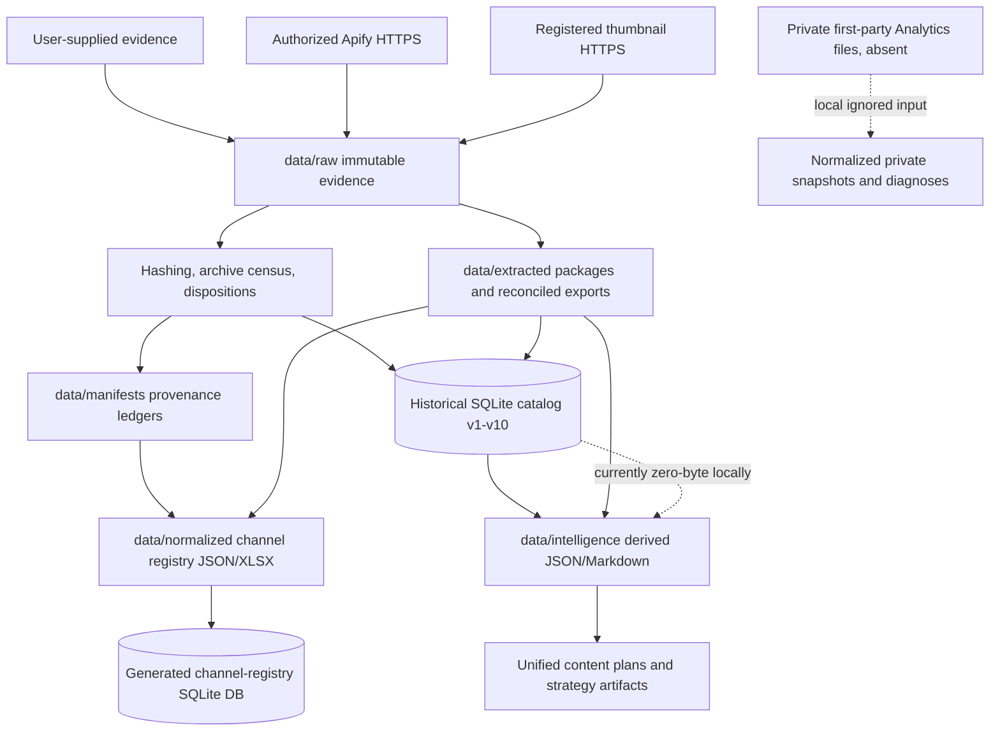
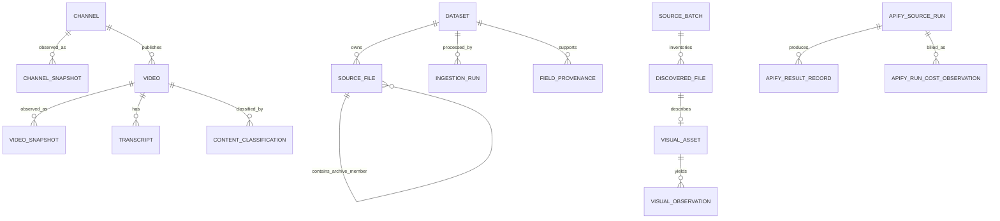
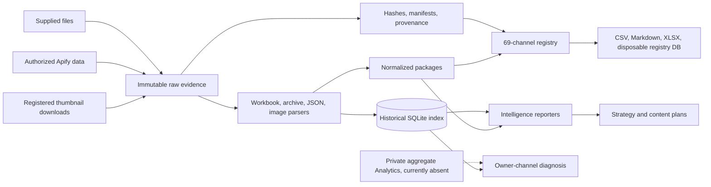

# YouTube Intelligence OS — Project Data Architecture Report

**Audit date:** 2026-09-20

**Audited revision:** `dcfe2927eee8c9bca11ac03cf21724c59b440b6b` (`main`, equal to `origin/main` when inspected)

**Investigation mode:** Read-only. No source, schema, evidence, or canonical dataset was modified.
**Verification vocabulary:** **VERIFIED** means directly established from tracked code/data; **STRONGLY INFERRED** means supported by several references but not observed in a complete runtime; **UNCERTAIN** means evidence is insufficient; **UNUSED / LEGACY CANDIDATE** means no active consumer was found, without assuming framework- or operator-driven use is impossible.

## 1. Executive Summary

**VERIFIED.** This repository is a local, file-first YouTube research and intelligence system. Its data architecture is not an application database behind a UI. It is an evidence pipeline:

1. Supplied files, screenshots, workbooks, transcript archives, and authorized Apify payloads enter as immutable raw evidence.
2. Manifests and SHA-256 hashes record identity, provenance, disposition, and relationships.
3. Python and Node scripts normalize evidence into workbooks, JSON, CSV, transcript ZIPs, and two SQLite schemas.
4. Reporter scripts derive topic, packaging, hook, script, editing, strategy, and content-plan intelligence.
5. A normalized channel registry and tracker summarize availability across 69 canonical channels.

Raw evidence is authoritative. The historical SQLite catalog is a derived, local index; the channel-registry SQLite database is a disposable generated query surface. Versioned intelligence JSON is durable derived evidence, not raw fact. This distinction is explicit in `AGENTS.md`, `data/catalog/README.md`, and `data/intelligence/README.md`.

Tracked `data/` contains 341 files totaling 168,021,551 bytes (168.0 MB decimal; 160.2 MiB): 138 JSON, 60 Markdown, 49 XLSX, 42 ZIP, 31 CSV, 5 TXT, 2 SQL, 2 PNG, and 12 extensionless placeholder/control files. The canonical normalized registry reports 69 channels, 1,904 videos, 1,893 real transcripts, 11 placeholders, 14 missing descriptions, 552 capability rows, and no real first-party Analytics snapshot.

Most processing is offline once evidence exists locally. Only Apify acquisition and registered thumbnail downloads require network access. There is no user account data, auth session, production API, UI state store, Redis/cache tier, remote database, geospatial data, or YouTube Data API integration.

Primary risks:

- The ignored historical catalog is currently a zero-byte file, so catalog-backed reporters cannot operate from this checkout until the catalog is rebuilt.
- Some reconstruction inputs and raw evidence are intentionally ignored/local; Git alone cannot reproduce every catalog observation.
- No dependency manifest locks `openpyxl`, Pillow, pytest, JSZip, or `@oai/artifact-tool`.
- Several read-oriented scripts use ordinary `sqlite3.connect(path)`, which can create an empty database when the expected file is absent.
- Data truth is intentionally duplicated across raw evidence, manifests, catalog rows, packages, registry outputs, and intelligence artifacts. Hashes and validators mitigate drift, but the architecture depends on disciplined provenance.

## 2. Data Architecture Overview



Data layers and ownership:

| Layer | Location | Meaning | Owner |
|---|---|---|---|
| Raw evidence | `data/raw/` | Immutable received/downloaded bytes | Ingestion scripts and operator policy |
| Provenance | `data/manifests/` | Durable evidence ledger, hashes, source/run identity, limitations | Inventory/register scripts |
| Extracted packages | `data/extracted/` | Cleaned, reconciled, presentation-ready derivatives | Node/Python package builders |
| Operational index | `data/catalog/youtube_inventory.db` | Local derived SQLite catalog, schema v10 | `inventory_catalog.py` and registration scripts |
| Normalized coverage | `data/normalized/channel-targets/` | Canonical 69-channel registry and workbook tracker | `build_youtube_channel_registry.py` |
| Derived intelligence | `data/intelligence/` | Evidence-bound analysis, hypotheses, strategies, plans | Reporter/orchestrator scripts |
| Schemas | `schemas/inventory/`, `data/catalog/channel_registry/schema.sql` | Versioned contracts | Additive SQL migrations/build script |
| Test data | `tests/fixtures/` | Synthetic inputs only | Tests; never production evidence |
| Private first-party data | `data/intelligence/first-party/` | Intended aggregate YouTube Studio/Analytics imports | `ingest_youtube_analytics.py`; currently absent and ignored |

Evidence:

- `AGENTS.md`, rules 2–9 and 12–15
- `data/catalog/README.md`
- `data/intelligence/README.md`
- `scripts/inventory_catalog.py`
- `scripts/register_structured_source.py`
- `scripts/build_youtube_channel_registry.py`
- `scripts/run_youtube_intelligence.py`

## 3. Data Source Inventory

### Durable source families

| Data source | Type | Location | Purpose | Read by | Written by | Persistence |
|---|---|---|---|---|---|---|
| Supplied source evidence | XLSX, ZIP, PDF, DOCX, TXT, PNG/JPEG, video and related files | `data/raw/` | Primary received evidence | Inventory, batch, structured registration, forensic reporters | Ingestion/acquisition only; thereafter immutable | Persistent local; tracked subset plus ignored evidence |
| Apify Actor payloads | JSON | `data/raw/channel-data/**/apify/`, historically `data/raw/competitors/` | Public channel/video metadata and transcript references | `apify_youtube_ingest.py`, package builders | Authorized acquisition workflow | Persistent raw evidence |
| Dataset manifests | Markdown, CSV, JSON | `data/manifests/` | Dataset identity, file ledger, hashes, acquisition configuration, validation | Validators, registry builder, humans | Ingestion/package workflows | Persistent, versioned |
| Batch discovery ledger | CSV | `data/manifests/batches/BATCH-000001_FILES.csv` | 45,774 discovered entries with disposition | Batch verification and audits | `register_batch.py` | Persistent, versioned |
| Structured channel packages | XLSX and transcript ZIP | `data/extracted/channel-data/**/packages/` | Per-channel canonical delivery packages | Registry builder, validators, downstream analysts | Package generator scripts | Persistent, versioned derivatives |
| Combined exports | JSON, CSV, XLSX | `data/extracted/channel-data/**/combined/` | Batch-wide normalized video tables | Package builders, registry builder, QA | Node package builders | Persistent, versioned derivatives |
| Recovery evidence | JSON, CSV, Markdown | `data/extracted/channel-data/DS-000022/recovery/` | Transcript recovery outcome and live evidence | Validators and auditors | Recovery workflow | Persistent, versioned |
| Historical catalog schema | SQL migrations | `schemas/inventory/001_initial.sql` through `010_supplied_channel_evidence.sql` | Additive SQLite schema | `inventory_catalog.py` | Human-authored migrations | Persistent, versioned |
| Historical catalog DB | SQLite | `data/catalog/youtube_inventory.db` | Fast index over evidence, structured entities, snapshots, classifications | Most historical reporters | Inventory/register/classification/acquisition scripts | Local, ignored, regenerable in principle; currently 0 bytes |
| Registry source JSON | JSON | `data/normalized/channel-targets/YOUTUBE_CHANNEL_REGISTRY.json` | Portable canonical registry and coverage model | Registry database builder, workbook builder, humans | `build_youtube_channel_registry.py` | Persistent, versioned derivative |
| Registry tracker | XLSX | `data/normalized/channel-targets/YOUTUBE_CHANNEL_MASTER_TRACKER.xlsx` | Human-friendly coverage workbook | Humans | Registry builder | Persistent, versioned derivative |
| Registry target export | CSV/Markdown | `data/manifests/YOUTUBE_CHANNEL_TARGETS.csv`, `.md` | Flat 69-channel coverage view | Humans, audits | Registry builder | Persistent, versioned derivative |
| Registry DB schema | SQL | `data/catalog/channel_registry/schema.sql` | Query model for registry JSON | Registry builder/validator | Human-authored | Persistent, versioned |
| Registry DB | SQLite | Generated from normalized JSON; ignored/not present as tracked artifact | Disposable query surface and views | `validate_youtube_channel_registry.py`, SQL queries | Registry builder | Local generated cache/index |
| Intelligence artifacts | JSON and Markdown | `data/intelligence/channels/`, `cross-channel/`, `blueprints/`, `plans/`, `system/` | Derived decisions, evidence mappings, hypotheses, plans | Orchestrator, refresh planner, humans | Reporter scripts | Persistent, versioned derived evidence |
| Freshness registry | JSON | `data/intelligence/system/intelligence-freshness-registry.json` | Artifact dependency graph and content hashes | Refresh planner/executor | Refresh workflow | Persistent, versioned |
| First-party Analytics contract | JSON | `data/intelligence/system/first-party-analytics-import-contract.json` | Accepted dimensions, metrics, storage rules | Importer, diagnosis reporter, tests | Human/script-generated contract | Persistent, versioned configuration |
| First-party Analytics snapshots | JSON | Intended `data/intelligence/first-party/` | Private aggregate owner-channel metrics | Diagnosis reporter | `ingest_youtube_analytics.py` | Local ignored; none present |
| Test fixtures | JSON, CSV, TSV | `tests/fixtures/` | Synthetic Analytics and reporter cases | Test modules | Test authors | Persistent, versioned; not production data |
| Runtime memory | Python dictionaries/lists, SQLite rows in active transaction | Process memory | Parsing, reconciliation, feature computation | Current CLI process | Current CLI process | Temporary |
| CLI/environment configuration | Arguments and `APIFY_TOKEN` | Process invocation/environment | Paths, IDs, cost caps, authorized remote token | CLI parsers, Apify client | Operator | Ephemeral except sanitized manifests |

### File census

| Tracked `data/` layer | Files | Bytes |
|---|---:|---:|
| `catalog` | 3 | 23,785 |
| `extracted` | 119 | 113,423,563 |
| `intelligence` | 66 | 8,833,277 |
| `manifests` | 74 | 13,881,382 |
| `normalized` | 3 | 706,246 |
| `raw` | 75 | 31,133,898 |
| `templates` | 1 | 19,400 |

The zero-byte ignored `data/catalog/youtube_inventory.db` is not included in tracked-file counts.

## 4. Source of Truth Matrix

| Data | Authoritative Source | Runtime Representation | Cache | Consumer |
|---|---|---|---|---|
| Received file bytes | Canonical immutable file under `data/raw/` | Byte stream/hash | `source_files` catalog row and manifest hash | Validators, parsers, forensic analysis |
| Dataset identity and ingestion provenance | Manifest plus raw hashes | Python dictionaries / SQLite rows | Historical catalog | Auditors, registry builder |
| Channel/video public observations | Source workbook/Actor payload at stated observation time | Parsed records, snapshot rows | Historical catalog; combined package | Topic, packaging, hook, strategy reporters |
| Stable YouTube channel identity | Exact channel ID/handle evidence | `channels` entity / registry channel object | Both SQLite schemas | Registry and all channel-bound features |
| Stable YouTube video identity | YouTube video ID in source evidence | `videos.youtube_video_id` / registry `youtube_video_id` | Both SQLite schemas | All video-level intelligence |
| Transcript body | Canonical ZIP member or immutable raw transcript file | Decoded text | Catalog stores locator/hash/metadata, not body | Hook/script and classification reporters |
| Transcript availability/status | Reconciled archive/package evidence | `transcripts` row / registry counters | Package and registry | Coverage, hook/script features |
| Thumbnail metadata | Registered source URL at observation time | URL string | Snapshot/package/registry | Packaging reporter; optional downloader |
| Downloaded visual evidence | Verified local image/video bytes | Pillow image/frame metadata | `visual_assets` and observations | Packaging/editing intelligence |
| Topic/format classification | Provenance-linked active classification row | Classification object | Historical catalog | Topic and strategy reporters |
| Derived intelligence claim | Versioned artifact containing evidence/provenance | Python dictionary | JSON/Markdown artifact | Orchestrator, humans |
| 69-channel coverage status | `YOUTUBE_CHANNEL_REGISTRY.json` generated from tracked authorities | In-memory registry object | Generated registry DB/XLSX/CSV | Coverage QA and operators |
| First-party owner metrics | Original Studio/Analytics export, if supplied | Normalized metric objects | Ignored normalized snapshot | First-party diagnosis |
| Apify credential | Operator environment | In-memory string/header | None | `ApifyHttp` only |

Rule: when raw bytes and a derived catalog row disagree, raw bytes win. Evidence: `data/catalog/README.md`, “Raw evidence remains authoritative.”

## 5. Static Data

Static/versioned data includes SQL schemas, controlled vocabularies in Python constants, the workbook template, manifests, normalized registry artifacts, and dated intelligence outputs. “Static” does not mean timeless: changes require a new commit, successor artifact, or additive migration.

- `schemas/inventory/*.sql`: immutable migration history, schema versions 1–10.
- `data/catalog/channel_registry/schema.sql`: current rebuild schema; generated DB is disposable.
- `data/templates/youtube-channel-package-template.xlsx`: five-sheet package contract.
- `data/intelligence/system/*contract*.json` and capability/freshness files: machine-readable policy/state.
- Reporter constants: stopwords, controlled topics, private-metric lists, thresholds, capability states.

No localization bundle, plist, GeoJSON, YAML configuration, or remote-config payload exists.

## 6. Dynamic Data

Dynamic data changes per ingestion or report run:

- ingestion run status, counts, warnings, and errors;
- append-only channel/video snapshots;
- Apify run metadata, costs, result records, and raw payloads;
- downloaded thumbnail bytes and validation results;
- content classifications;
- generated intelligence and refresh-run records;
- registry coverage rebuilt from current evidence;
- first-party normalized snapshots when real exports arrive.

Changes occur through explicit foreground CLI commands. No scheduler, watcher, background worker, or live synchronization process exists.

## 7. Local Data

All durable repository data is local filesystem data. Historical and registry SQLite databases are local. Raw/private files may be Git-ignored. Versioned artifacts are local and committed. There is no cloud object store, hosted SQL database, or shared cache in current architecture.

| Dataset | Local | Remote origin | Synced | Offline available | Source of truth |
|---|---:|---:|---|---:|---|
| Supplied packages | Yes | User-supplied | No automatic sync | Yes | Raw/package bytes |
| Apify payloads | Yes after acquisition | Yes | One-way explicit acquisition | Yes after saved | Saved raw payload + run manifest |
| Thumbnail files | Yes after download | Yes | One-way explicit download | Yes after saved | Downloaded verified bytes for visual analysis; URL observation for metadata |
| Historical catalog | Yes | No | Rebuilt from evidence | Only if valid DB exists | Raw evidence, not DB |
| Intelligence artifacts | Yes | No | Recomputed explicitly | Yes | Versioned artifact with provenance |
| First-party Analytics | Intended local ignored | User export | No automatic sync | Yes after import | Original export |

## 8. Remote Data

Two remote data paths exist:

1. `api.apify.com`: Actor launch, polling, dataset retrieval, and final billing. `scripts/apify_youtube_ingest.py` requires explicit planning/cost limits and `APIFY_TOKEN` from environment. Saved raw records are then registered transactionally.
2. Registered HTTPS thumbnail URLs, normally YouTube image hosts: `scripts/acquire_registered_thumbnails.py` downloads only URLs already present in registered evidence and constrains redirect hosts/schemes.

No REST application backend, GraphQL, WebSocket, Firebase, Supabase, YouTube Data API, or remote database exists.

## 9. Runtime Data

Runtime-only state consists of parsed workbook cells, transcript-member dictionaries, in-memory JSON trees, classification feature maps, reporter aggregates, cost calculations, CLI arguments, environment token, and uncommitted SQLite transaction state. Processes are short-lived. No service retains runtime state between commands.

Reporter outputs are persisted only when their CLI/write path is invoked. Pure planner commands return JSON/stdout without mutating canonical data.

## 10. Persistent Data

Persistent data uses four mechanisms:

1. Immutable raw files.
2. Versioned manifests and derived JSON/CSV/Markdown/XLSX/ZIP artifacts.
3. Local SQLite databases.
4. Git history for schema/artifact versioning.

No deletion API exists. Historical correction normally means a new dataset/revision relationship, new snapshot, additive migration, or successor intelligence artifact. Raw evidence should never be overwritten.

## 11. Temporary Data

Temporary data includes open ZIP member streams, parser objects, in-memory tables, SQLite transaction state, temporary build outputs, and ignored `outputs/`. SQLite may create `-wal`/`-shm` files while open. Package builders may render QA output outside canonical data. Temporary data is process-scoped unless explicitly written as an artifact.

The current workspace also contains untracked/ignored DS-000027 preflight material. It is not part of audited canonical revision and must not be treated as established project truth until formally ingested and committed.

## 12. Models / Entities

### Core historical catalog entities

**Dataset** — `schemas/inventory/001_initial.sql::datasets`

- `dataset_id`: stable repository identifier such as `DS-000023`.
- `dataset_name`: human-readable label.
- `semantic_class`: evidence class from `docs/DATA_CLASSIFICATION.md`.
- `description`: scope/context.
- `source_type`: how evidence arrived.
- `ingestion_mode`: copy/index behavior.
- `status`: lifecycle state.
- `discovered_as`: original characterization.
- `date_received`: receipt date.
- `created_at`, `updated_at`: catalog timestamps.
- `notes`: limitations or operator context.

**Source file** — `schemas/inventory/001_initial.sql::source_files`

- `file_id`: internal stable file identity.
- `dataset_id`: owning dataset.
- `ingestion_run_id`: run that registered it.
- `parent_file_id`: archive parent for members.
- `storage_kind`: physical file or archive member.
- `file_role`: workbook, transcript, source artifact, etc.
- `original_filename`, `original_path`, `relative_path`: received location/name context.
- `canonical_path`: repository copy when physical.
- `archive_member_path`: unique location inside ZIP when virtual.
- `extension`, `mime_type`, `size_bytes`: physical metadata.
- `sha256`: content identity; primary dedup/integrity key.
- `semantic_class`, `evidence_layer`: meaning and factual/interpretive tier.
- `is_copied`, `is_archive_member`: storage flags.
- `processing_status`, `verification_status`: workflow state.

**Channel and channel snapshot** — `002_structured_registration.sql`

- Stable channel: internal `channel_id`, YouTube channel ID, handle, display name, URL, creation dataset.
- Snapshot: observation ID, channel/dataset/run links, `observed_at`, subscriber count, reported video count.
- Stable identity and time-varying observations are intentionally separated.

**Video and video snapshot** — `002_structured_registration.sql`, extended by `010_supplied_channel_evidence.sql`

- Stable video: internal ID, unique YouTube video ID, channel, canonical URL, creation dataset.
- Snapshot: title, publication time, duration, views, likes, comments, derived views/day and engagement rate, description size, transcript word count, video type, description, thumbnail URL, and observation/run links.
- Snapshot metrics describe a point in time; they are not timeless video properties.

**Transcript** — `002_structured_registration.sql`, extended by v10

- Links video, dataset, run, and archive-member evidence.
- Stores availability, caption type, language, word count, transcript SHA-256, description-presence flag, canonical reference, and timing quality.
- Body is not stored as a database BLOB. Consumer opens canonical ZIP member/file and verifies hash.

**Field provenance** — `002_structured_registration.sql`

- Associates a field with dataset/run/source file and optional channel/snapshot/video/transcript IDs.
- `field_name` names assertion; `source_locator` identifies exact sheet cell/member/record; `value_origin` distinguishes extracted/computed values; `evidence_layer` distinguishes factual and interpretive tiers; `extraction_method` records method/version.

**Batch discovery and multimodal entities** — `003_multimodal_source_registration.sql`

- `source_batches`, `batch_roots`, `discovered_files`: recursive census and disposition.
- `visual_assets`: dimensions, format, EXIF JSON, perceptual hash, sequence/frame index, visual-state cluster.
- `visual_observations`: OCR or semantic inspection, method, surface, extracted text, confidence, structured JSON, evidence layer.
- `entity_classifications`: dataset/entity semantic labels including niche, audience, format, packaging, thumbnail, presenter, and editing style.
- `document_records`: descriptive metadata and whether content was read.

**Apify entities** — migrations v5–v6

- `apify_source_runs`: actor/build/run identity, sanitized input, time/status/count/cost, channel URL, transcript config.
- `apify_result_records`: result index and raw-record hash linked to video.
- `apify_run_cost_observations`: timestamped usage, charge events, finality.
- `thumbnail_evidence`: observed URL, video/dataset/run links, provider and method.

**Content classification** — migrations v8–v9

- Video/dataset/source file links.
- Dimension (`CONTENT_TOPIC` or `CONTENT_FORMAT`), nonempty value, evidence layer, status, source locator, method/version, reproducibility status, notes.
- Unique active classification per video/dimension is enforced by a partial unique index.

### Registry entities

`data/catalog/channel_registry/schema.sql` defines canonical channels, independent data-layer states, submissions, aliases, identity evidence, datasets, dataset-channel links, actor runs, videos, dataset-video links, transcripts, subtitle tracks, artifacts, gaps, capabilities, coverage, visual coverage, and non-channel screenshot subjects.

Important registry channel fields:

- `canonical_channel_id`: YouTube channel ID and registry primary key.
- `source_group`: standard package, historical catalog, or identity-only.
- `target_group`: original, added, or outside target.
- Layer statuses: identity, extraction, package, video metadata, descriptions, transcripts, thumbnail metadata, visual assets, forensic video, intelligence, first-party Analytics.
- `identity_evidence_source` and `limitations`: why status is believed and what remains unsupported.

### Intelligence artifact models

Artifacts are schema-versioned JSON, not Python classes. Common fields:

- `schema_version`: artifact contract identifier.
- `generated_on`/`generated_at`: generation date/time.
- `channel`: scoped identity and evidence cutoff.
- `evidence_snapshot`: source counts and observation window.
- `provenance`: input artifact paths, dataset IDs, hashes, method versions.
- `guardrails`/`limitations`: claims explicitly prohibited by available data.
- Feature arrays: per-video measured/derived features.
- Archetypes/opportunities/diagnoses/plans: interpreted outputs with supporting IDs.

## 13. Model Relationships



Cross-file relationships use stable IDs and evidence locators:

- `DS-*` joins manifests, raw/extracted packages, catalog rows, registry datasets, and artifact provenance.
- `CH-*` identifies five historical intelligence channels; YouTube channel IDs identify all 69 registry channels.
- YouTube video IDs reconcile workbook rows, transcript filenames/headers, JSON records, catalog videos, classifications, and intelligence features.
- SHA-256 joins physical evidence to manifests/catalog and detects exact duplicates.
- Artifact paths/schema versions join topic, packaging, hook/script, editing, strategy, and orchestration layers.

## 14. Database Schema

### Historical catalog

Technology: SQLite with `PRAGMA foreign_keys = ON`; additive migrations 001–010.

| Version | Adds |
|---|---|
| 1 | Dataset/file inventory, runs, locations, file relationships, errors |
| 2 | Channels, videos, snapshots, transcripts, field provenance |
| 3 | Batch discovery, visual assets/observations, entity classifications, documents |
| 4 | Missing foreign-key indexes on discovered files |
| 5 | Apify runs/results, channel-dataset links, thumbnail evidence, snapshot extensions |
| 6 | Apify cost observations |
| 7 | Dataset relationships |
| 8 | Content classifications |
| 9 | Active classification uniqueness |
| 10 | Supplied thumbnail references and transcript timing/canonical-reference fields |

Writes are transaction-scoped in inventory and registration scripts. Stable entities are updated conservatively; observations/snapshots and cost records are append-oriented. No DELETE statement was found as a normal data lifecycle operation. Schema migration is additive; shipped migrations are not edited per `data/catalog/README.md`.

Current runtime state: `data/catalog/youtube_inventory.db` exists as an ignored **0-byte file**. Therefore no actual table row counts can be verified from this checkout. Schema and tracked manifests remain inspectable, but catalog-backed execution will fail with missing-table errors.

### Channel registry database

This SQLite DB is generated from `YOUTUBE_CHANNEL_REGISTRY.json`, not authoritative. Schema provides 15 entity tables and views including `v_channel_status`, `v_completed_channels`, `v_pending_channels`, `v_channel_data_gaps`, `v_dataset_summary`, `v_video_transcript_status`, `v_channel_artifacts`, and `v_intelligence_coverage`.

`scripts/validate_youtube_channel_registry.py` checks control totals, foreign keys, illegal status combinations, required views, and idempotent rebuild output.

## 15. File-Based Data

### Workbook contract

Standard channel packages contain five sheets:

- `Channel Overview`: channel identity and aggregate metrics.
- `All Videos`: one row per video with identity, URL, type, publication, duration, public metrics, description/thumbnail metadata.
- `Descriptions`: video ID to full description mapping.
- `Verification`: package checks and traceability.
- `Analysis`: formulas/summary intended for human review.

Combined batch XLSX files contain one `Videos` sheet. The master tracker contains nine sheets: Dashboard, All Channels, Pending Channels, Data Coverage, Visual Evidence, Datasets, Submitted URLs, Intelligence Coverage, and Definitions.

`scripts/source_adapters/youtube_master_data.py` resolves sheet paths from OOXML relationships, locates headers by names instead of fixed columns, supports multi- and single-channel overviews, and fails loudly on missing required sheets/headers.

### Transcript ZIP contract

Each standard archive contains one index plus one TXT member per video. Parser requires header fields: Channel, Title, Video ID, URL, Published, Duration, Views, Likes, Comments, Caption type, Language, and Word count. `NONE AVAILABLE` maps to unavailable/placeholder status. Member bodies remain in ZIP; registration streams them without permanent extraction.

Across 35 extracted package archives, package video totals equal 1,601 and transcript records equal 1,601: 1,591 real and 10 placeholders. Seven DS-000022 raw source archives duplicate delivered package material by design; manifests classify parent/derived relationships.

### JSON and CSV contracts

- Raw Actor JSON preserves source fields, including public identifiers, metadata, descriptions, subtitles, thumbnails, and `_provenance` additions in derived clean copies.
- Combined master JSON/CSV flatten normalized channel/video/public metric/transcript fields while retaining `actor_*` columns for source fidelity.
- Manifest CSVs record repository path, sizes, hashes, status, source run, parent artifact, limitations, and duplicate classification.
- Intelligence JSON uses artifact-specific `schema_version` plus provenance, guardrails, evidence snapshots, measured features, and interpreted outputs.

No malformed tracked JSON was found in the repository-wide parse performed for this audit.

## 16. API Data

### Apify

| Item | Detail |
|---|---|
| Endpoint family | `api.apify.com` Actor run, run status, dataset items, billing/usage |
| Method | HTTPS JSON requests; exact methods constructed in `ApifyHttp` |
| Request data | Actor ID/build, allowlisted Actor input, channel URL(s), result ceilings, subtitle/transcript options |
| Response data | Run metadata/status, default dataset ID, result records, usage/cost observations |
| Auth | `APIFY_TOKEN` environment variable in Authorization header |
| Cache/persistence | Raw JSON file, sanitized manifests, historical catalog rows |
| Failure behavior | Failed run recorded; no normalized entity commit; timeouts/cost/identity violations raise errors |

Read/write flow:

```text
Operator plan and explicit cap
ApifyHttp creates Actor run
Polling reaches terminal state
Final billing observed
Dataset records downloaded
Channel identity and record schema validated
Raw JSON persisted and hash-verified
Single SQLite transaction writes run, files, channel/video snapshots,
transcripts, thumbnail evidence, result hashes, field provenance, and cost
```

### Thumbnail retrieval

Registered `thumbnail_url` values are inputs. Downloader permits HTTPS and registered hosts, follows constrained redirects, validates decoded images with Pillow, then records retrieval results. Missing/invalid images stay explicit failures; they do not become visual evidence.

## 17. Data Transformations

| Input | Transformation | Output | Loss characteristics |
|---|---|---|---|
| Physical source file | Hash, MIME/extension metadata, safe ZIP census | Manifest + source-file rows | No content loss; archive members indexed virtually |
| XLSX OOXML | Header-driven cell parse and type conversion | Channel/video/snapshot dictionaries | Formula presentation/styles not retained in catalog |
| Transcript TXT member | Header parse, availability mapping, word/hash metadata | Transcript row + canonical locator | Body stays external; DB representation intentionally partial |
| Actor record | Identity validation, normalized types, per-field provenance | Stable entities + snapshots + raw-record hash | Normalized model does not replace raw payload |
| Raw batch | Cleaning/reconciliation/dedup | Combined JSON/CSV/XLSX and packages | Presentation flattening; raw fields preserved where possible via `actor_*` |
| Public video observations | Age normalization, family grouping, lexical/structural features | Topic/package/hook/script artifacts | Derived and heuristic; guardrails label uncertainty |
| Intelligence layers | Opportunity selection and evidence-overlap composition | Unified content plan | Selective composition, not source replacement |
| Registry authorities | Identity reconciliation and status aggregation | Registry JSON/CSV/XLSX/SQLite | Summary counts lose item-level content but retain evidence paths |
| Studio export | Column normalization, ID/title/date matching, private-field rejection | First-party snapshot JSON | Unknown columns preserved; prohibited viewer fields rejected |

Lossy transformations are acceptable only because parent evidence and hashes remain available. Derived artifacts must not be mistaken for raw facts.

## 18. Data Flow Architecture

### Supplied channel package

```text
User-supplied XLSX/ZIP
inventory_catalog.py: hash and register physical/archive evidence
source_adapters/youtube_master_data.py: parse sheets and transcript headers
register_structured_source.py: reconcile YouTube video IDs
SQLite stable entities + append-only snapshots + provenance
validate_supplied_channel_packages.py: formula/schema/count/hash checks
report_* scripts: measured and interpreted intelligence
run_youtube_intelligence.py: evidence-linked content plan
```

### Multi-source forensic batch

```text
Supplied roots
register_batch.py discover: recursive census, symlink-safe, hash-first
Every entry receives disposition
Selected files registered/copied; duplicates linked
Pillow image metadata and perceptual clusters
OCR/semantic/document loaders attach observations
Editing/visual reporter consumes only proven forensic relationships
```

### Coverage registry

```text
Submitted URL ledger + identity evidence + manifests + packages
+ historical catalog evidence + visual ledger + intelligence artifacts
build_youtube_channel_registry.py
YOUTUBE_CHANNEL_REGISTRY.json
CSV/Markdown target views + XLSX tracker + disposable SQLite database
validate_youtube_channel_registry.py
```

## 19. Read Paths

| Dataset | Read path |
|---|---|
| Raw file | Path argument, binary stream, SHA-256, archive inspection, manifest/catalog comparison |
| XLSX package | ZIP OOXML XML, shared strings, sheet relationship map, header map, typed field conversion |
| Transcript | Catalog/package locator, ZIP member open, UTF-8 decode, header/body parse, hash verification |
| Historical observations | SQLite joins across channels/videos/latest snapshots/transcripts/classifications/provenance |
| Intelligence artifacts | Deterministic dated file selection, JSON decode, schema/channel/evidence checks, composition |
| Registry | JSON decode, table inserts into generated SQLite or workbook/CSV rendering |
| Analytics export | CSV/TSV/XLSX parser, header normalization, prohibited-field scan, metric/dimension mapping, video match |

Important callers:

- `report_topic_opportunity.py::load_channel_data()` joins stable videos, latest snapshots, active classifications, and transcript state.
- `report_hook_script_intelligence.py` resolves `canonical_reference`, verifies available transcript evidence, and distinguishes exact timestamp evidence from positional approximations.
- `run_youtube_intelligence.py` loads channel intelligence artifacts, selects opportunity, validates referenced video IDs against catalog, and composes layer outputs.

## 20. Write Paths

| Dataset | Write path | Update/delete behavior |
|---|---|---|
| Raw evidence | Explicit ingestion/acquisition writes new canonical file | Never silently overwritten; no normal delete |
| Manifest | Ingestion/package script writes or appends durable record | New evidence/revision recorded explicitly |
| Historical catalog | Transactional INSERT/limited identity UPDATE | Snapshots append; rollback on failure; no routine delete |
| Extracted package | Generator writes batch/package output | Rebuildable derivative; validation required |
| Intelligence | Reporter writes dated JSON/Markdown | Successor artifact instead of overwrite |
| Freshness run | Refresh executor records compact run | Historical run retained |
| Registry JSON/XLSX/CSV/DB | Full deterministic rebuild | Generated outputs replaced by rebuild; sources remain authority |
| First-party snapshot | Importer writes ignored private JSON | Snapshot identity based on source/content/date range; deletion policy undocumented |

## 21. Feature to Data Mapping

| Feature | Data required | Source | Storage | Main code |
|---|---|---|---|---|
| Inventory/provenance | Source bytes, path, dataset metadata | User files | Raw + manifest + SQLite | `inventory_catalog.py` |
| Recursive multimodal ingestion | Directory tree, images/docs/video metadata | User roots | Batch ledger + catalog | `register_batch.py` |
| Structured channel registration | Workbook and transcript ZIP | Supplied package | Catalog snapshots/provenance | `register_structured_source.py` |
| Supplied package validation | XLSX formulas/caches, ZIP members | Extracted packages | JSON/MD/CSV reports | `validate_supplied_channel_packages.py` |
| Apify acquisition | Channel URL, cost cap, Actor response | Remote Apify | Raw JSON + catalog + manifests | `apify_youtube_ingest.py` |
| Thumbnail acquisition | Registered thumbnail URLs | YouTube image hosts | Raw image + report/catalog evidence | `acquire_registered_thumbnails.py` |
| Topic opportunity | Public metrics, age, topic/format classification, transcript availability | Catalog | Intelligence JSON/MD | `report_topic_opportunity.py` |
| Packaging | Titles, public performance, thumbnail annotations/evidence | Catalog + intelligence inputs | Intelligence JSON/MD | `report_packaging_intelligence.py` |
| Hook/script | Transcript bodies, titles, topic/package artifacts | ZIP/raw + catalog + intelligence | Intelligence JSON/MD | `report_hook_script_intelligence.py` |
| Editing/visual | Proven forensic video/images, visual observations, relationships | Raw/catalog | Intelligence JSON/MD | `report_editing_visual_intelligence.py` |
| Strategy | Topic/package/hook-script artifacts and training rules | Intelligence artifacts | Diagnosis/benchmark/blueprint JSON/MD | `report_channel_strategy_intelligence.py` |
| Unified plan | Opportunity plus compatible packaging/hook/script/editing evidence | Intelligence + catalog | Plan JSON/MD | `run_youtube_intelligence.py` |
| First-party diagnosis | Aggregate Studio export + public/competitor context | User export + catalog | Ignored private JSON | `ingest_youtube_analytics.py`, `report_first_party_channel_diagnosis.py` |
| Registry/tracker | Identities, packages, manifests, visual/intelligence coverage | Tracked authorities | JSON/CSV/MD/XLSX/generated DB | `build_youtube_channel_registry.py` |
| Refresh planning | Artifact hashes/dependency categories | Git + artifacts + catalog | Plan/stdout and refresh-run JSON | `plan_intelligence_refresh.py`, `refresh_youtube_intelligence.py` |

## 22. Data to Feature Mapping

| Dataset | Features depending on it | Criticality |
|---|---|---|
| Raw evidence and hashes | Verification, rebuild, provenance, all downstream trust | Critical |
| Historical catalog | Historical reporters, classifications, orchestration, forensic joins | Critical for five validated channels; currently unavailable locally |
| Standard XLSX/ZIP packages | Registry coverage, transcript analysis, package QA | Critical for 35 package channels |
| Registry JSON | Tracker, registry DB, coverage reporting | Critical coverage authority; derived |
| Topic artifacts | Packaging/hook/strategy/orchestration | High |
| Packaging artifacts | Hook/script, strategy, orchestration | High |
| Hook/script artifacts | Strategy and orchestration | High |
| Editing evidence | Editing layer only; absent for 68/69 registry channels | Conditional |
| First-party exports | Owner-channel diagnosis | Optional; no real data yet |
| Apify manifests/raw payloads | Rebuild of acquired public evidence and cost audit | High for acquired datasets |

## 23. Cache Architecture

There is no conventional TTL cache. SQLite databases, combined exports, normalized registry files, and intelligence artifacts function as materialized indexes/derived caches, but they have explicit provenance and rebuild semantics.

- Cache keys: stable IDs, dataset IDs, artifact paths, content hashes, schema versions.
- Expiration: no time-based TTL.
- Invalidation: `intelligence-freshness-registry.json` maps input content hashes/change categories to dependent artifacts.
- Refresh: explicit `plan_intelligence_refresh.py` then `refresh_youtube_intelligence.py`.
- Stale behavior: artifacts remain historical; freshness planner marks layers affected. They are not silently deleted.
- Size bound: none for JSON/SQLite/materialized artifacts.

## 24. Offline Data Architecture

True offline features, when required local evidence and valid catalog exist:

- inventory verification;
- workbook/transcript parsing and package validation;
- registry generation;
- intelligence reporting and plan composition;
- first-party file import;
- all static queries over local artifacts.

Network-required features:

- new Apify acquisition or cost reconciliation;
- downloading registered thumbnail URLs.

Current checkout caveat: historical catalog is zero bytes and some raw inputs are ignored/local. Therefore the architecture supports offline processing, but this checkout cannot run every catalog-backed flow without reconstruction inputs.

## 25. Configuration Data

Configuration comes from:

- CLI arguments: dataset/channel IDs, paths, cost caps, result counts, output paths, benchmark channels.
- `APIFY_TOKEN`: environment-only secret.
- Python constants: semantic classes, allowed input keys, thresholds, evidence/status vocabularies.
- JSON contracts/configs: DS preflight/config files, identity evidence, Analytics import contract, freshness registry.
- SQL CHECK constraints: legal status vocabularies and relationship rules.

There are no `.env` files, deployment environments, feature-flag service, remote config, or production/staging database URLs.

## 26. Authentication / Sensitive Data

No end-user authentication or session model exists. Only secret is Apify service token, read from environment and never intentionally persisted. Sanitized Actor input uses an allowlist.

Potentially sensitive data:

- private first-party aggregate Analytics exports, intended for ignored local storage;
- operational screenshots/logs that may reveal balances or account context;
- absolute source paths in some manifests;
- public YouTube channel/video/transcript content.

`ingest_youtube_analytics.py` rejects viewer-level personal fields such as email, phone, IP, viewer/user ID, and names. No passwords, payment cards, precise location, contacts, device IDs, or health records are modeled. Health-topic video content is public content, not user medical data.

No credential-like literal was found in the tracked-tree masked scan documented in `PROJECT-DEEP-TECHNICAL-REPORT.md`.

## 27. Map / Geospatial Data

Not applicable. No GeoJSON, latitude/longitude model, map tiles, routes, GPS, geocoding, or navigation engine exists. A video/channel `location` field may preserve public source metadata, but no geospatial feature consumes it.

## 28. Navigation / Route Data

Not applicable. There is no application navigation or geographic route data. CLI subcommands are operational entry points, not navigation datasets.

## 29. Derived / Calculated Data

| Value | Inputs | Logic | Function/file | Persisted |
|---|---|---|---|---:|
| `views_per_day` | views, published/observed timestamps | Views divided by bounded age | registration/topic reporter | Snapshot/artifact |
| `engagement_rate` | likes, comments, views | Public interaction ratio | registration | Snapshot |
| Content type | duration/source type | Shorts threshold `<= 180` seconds plus source evidence | `classify_content_pilot.py` | Classification |
| Family-relative performance | video normalized performance, topic family peers | Channel-relative bands/medians | `report_topic_opportunity.py` | Artifact |
| Title features | title text | lexical markers, length, numbers, patterns | `report_packaging_intelligence.py` | Artifact |
| Hook windows | transcript tokens/timestamps | Exact timed windows when available; positional approximation otherwise | `report_hook_script_intelligence.py` | Artifact |
| Repeatability | family/archetype item outcomes | Minimum 3 items for repeatable label | strategy reporter | Artifact |
| Calibration verdict | per-channel observations | minimum sample 3; tolerance band 0.15 | `empirical_calibration_verdict()` | Artifact |
| Coherence | selected opportunity and layer evidence overlap | shared evidence IDs and availability checks | `run_youtube_intelligence.py` | Plan |
| Registry status/counts | packages/manifests/catalog/intelligence | deterministic aggregation | registry builder | Registry artifacts |
| Perceptual cluster | image perceptual hashes | distance/sequence rules in batch pipeline | `register_batch.py` | Catalog/ledger |

Derived values are labeled separately from source-extracted facts through `value_origin`, `evidence_layer`, artifact guardrails, and schema fields.

## 30. IDs & Relationships

- `DS-000001` style dataset IDs: repository-assigned, stable, primary provenance namespace.
- `RUN-*`: ingestion/registration run identity.
- `BATCH-*`: recursive source batch identity.
- `CH-000001` style IDs: historical intelligence channel IDs.
- YouTube channel ID: canonical registry identity for all 69 channels; stable external identity.
- YouTube video ID: unique stable external video identity and reconciliation key.
- `FILE-*`, snapshot, transcript, provenance, observation, classification IDs: catalog-generated sequences.
- SHA-256: content identity and exact duplicate detection.
- Artifact schema version: contract identity, not record identity.
- Snapshot identity for Analytics: based on channel/source/date-range/content inputs, with content hash/version in importer logic.

Collision risk is low for YouTube IDs and SHA-256. Sequential internal IDs can collide if independently rebuilt databases are merged without controlled remapping; architecture treats databases as single generated catalogs, not mergeable peers.

## 31. Validation

Validation points:

- Existence, type, size, SHA-256, archive member path, archive safety, compression ratio (`MAX_COMPRESSION_RATIO = 500`).
- Required workbook sheets and headers resolved by names.
- Numeric/date conversion errors fail loudly.
- Workbook video IDs reconciled one-to-one with transcript members.
- Exact channel identity required; similar names are insufficient.
- Actor input allowlist, cost cap, terminal run status, final billing, result uniqueness.
- SQLite foreign keys and schema-version prerequisites.
- Content-classification controlled values, provenance, method/reproducibility constraints, active uniqueness.
- Registry control totals and illegal state combinations.
- First-party prohibited personal fields and supported metric/dimension mappings.
- Intelligence references checked against known videos/evidence IDs; private metrics remain unavailable without first-party data.

Data entering as free-text descriptions/transcripts is not semantically validated for factual truth. AI interpretations are explicitly labeled and must not be upgraded to factual observations.

## 32. Data Integrity

### Confirmed controls

- All 138 tracked JSON files parsed successfully during this audit.
- Registry has 69 unique canonical channel IDs and 552 coverage rows: exactly 8 capabilities per channel.
- Registry reports 67 submitted rows, 63 normalized URL identities, 4 exact duplicate submissions, and 69 canonical channels.
- Standard package layer reports 35 channels and 1,601 unique videos.
- Package transcript totals reconcile to 1,591 real plus 10 placeholders.
- Registry total across package plus historical sources is 1,904 videos, 1,893 real transcripts, 11 placeholders, and 14 missing descriptions.
- All 69 channels have `identity_status = VERIFIED`; one lacks a current handle but retains exact channel identity.

### Confirmed integrity gap

The ignored historical catalog file is 0 bytes. Any code that assumes schema/tables exist will fail. This does not invalidate tracked raw/manifests/intelligence artifacts, but it blocks verification of live catalog row-level integrity.

### Structural risks

- Direct SQL is distributed across scripts; schema changes can drift from queries.
- Some raw evidence is local/ignored, so a clean clone cannot recreate all OCR/semantic rows.
- Derived package copies intentionally duplicate source bytes; relationship metadata must remain correct to avoid double counting.
- Registry and historical catalog use different channel ID namespaces for part of the system; builder mapping is critical.

## 33. Data Quality

Objective observations:

- Registry package channels: 35; historical channels: 5; identity-only channels: 29.
- Extraction states: 28 complete, 12 complete with limitations, 29 not extracted.
- Transcript states: 38 complete real, 2 complete with placeholders, 29 none.
- Visual assets: 35 thumbnail-URL-only, 2 thumbnail evidence, 1 forensic video evidence, 31 none.
- Forensic editing evidence: 1 channel available with limitations, 68 unavailable.
- First-party Analytics: all 69 are schema-ready with no real data.
- Capability statuses: 209 data-ready, 313 unavailable, 23 validated, 7 partial.
- Raw/derived Actor JSON deliberately repeats video IDs across successive raw, clean, and reconciled artifacts; this is lineage duplication, not independent evidence.

Known quality issue from tracked audit evidence: master tracker workbook contains cached `HYPERLINK` formula errors in some generated cells. This affects workbook presentation/recalculation, not registry JSON truth. See `docs/audits/` and the deep technical report for the exact tracked audit reference.

## 34. Duplicate Data

Intentional duplication:

- Raw source artifact and extracted normalized package.
- Transcript content in supplied raw archive and delivered package archive.
- Actor raw record, combined master JSON/CSV/XLSX, per-channel workbook, catalog snapshot, and registry video row.
- Registry JSON rendered into CSV, Markdown, XLSX, and generated SQLite.
- Intelligence JSON rendered into companion Markdown.
- Stable observations repeated in append-only snapshots at different times.

Dedup controls:

- SHA-256 for exact file identity.
- YouTube video/channel IDs for logical identity.
- `file_relationships` and `dataset_relationships` for explicit equivalence/revision relationships.
- `duplicate_of_discovered_file_id` for batch duplicates.
- `raw_record_sha256` and unique Actor run/result indexes.
- Registry submission `duplicate_of_global_row`.

Risk: downstream users who combine raw, extracted, registry, and catalog records without lineage keys can count one observation several times. `AGENTS.md` explicitly forbids treating duplicated datasets as independent evidence.

## 35. Unused / Legacy Data

- `data/intelligence/channels/CH-000004/content-performance-intelligence-2026-08-28.md`: **LEGACY, retained intentionally**. No generator/tool version survives; `data/intelligence/README.md` marks it not reproducible.
- Pilot and superseded dated intelligence artifacts: **historical, not dead**. Freshness registry excludes some from canonical current state but retains audit history.
- Raw source duplicates under DS-000022: **not unused**; preserved as original evidence while extracted copies support delivery.
- 29 identity-only channels: **data gap, not unused**. They support target coverage but not intelligence generation.
- Seven screenshot-only subjects: **not canonical channels** until identity resolution; retained as evidence subjects.
- Generated DBs: ignored/disposable, but active code expects them. Not dead.

No meaningful tracked dataset can be confidently declared dead solely from static call references because many artifacts are operator/human consumed.

## 36. Missing Data

Confirmed missing/unavailable data:

- Valid historical catalog database in current checkout.
- Real first-party YouTube Analytics export for any channel.
- Extraction packages for 29 identity-only channels.
- Forensic video evidence for 68 of 69 registry channels.
- Downloaded thumbnail evidence for most package channels; 35 are URL-only.
- Descriptions for 14 package videos.
- 11 transcript bodies are placeholders across full registry; 29 identity-only channels have no transcript dataset at all.
- Some reconstruction-only OCR/native semantic observations cannot be recreated from tracked catalog-independent inputs without rerunning their original processes.

“Missing transcripts = 0” in channel aggregate fields applies to videos represented by packages after placeholders are counted separately; it does not mean all 69 channels have transcript evidence.

## 37. Data Generation Pipeline

```text
Raw supplied/downloaded evidence
  inventory_catalog.py / register_batch.py
  hashes, dispositions, manifests, local catalog

Structured workbook + transcript archive
  source_adapters/youtube_master_data.py
  register_structured_source.py / register_supplied_channel.py
  channels, videos, snapshots, transcripts, provenance

Raw Actor batches
  Node package builders and Python validators
  combined JSON/CSV/XLSX, per-channel XLSX/ZIP, reports

Catalog/package evidence
  classify_content_pilot.py
  report_topic_opportunity.py
  report_packaging_intelligence.py
  report_hook_script_intelligence.py
  report_editing_visual_intelligence.py
  report_channel_strategy_intelligence.py
  run_youtube_intelligence.py
  versioned intelligence artifacts and plans

All authorities
  build_youtube_channel_registry.py
  JSON registry, target CSV/MD, XLSX tracker, generated SQLite DB
```

The pipeline is not automatically scheduled. Operator chooses input, command, and output. Paid acquisition requires explicit authorization and cap.

## 38. Data Versioning / Migrations

- Historical DB: integer schema versions in `schema_meta`; migrations applied in filename order; current version 10.
- Registry JSON: root `schema_version`; registry SQL is rebuilt rather than migrated in place.
- Intelligence: semantic string schema versions such as `topic-opportunity-1`, `hook-script-intelligence-1`, and `youtube-intelligence-os-content-plan-1`.
- Artifacts: dated filenames and successor policy preserve history.
- Refresh: content hashes and dependency graph determine affected layers.
- Raw datasets: new `DS-*` identity or explicit revision/relationship; raw bytes are not overwritten.
- API payloads: Actor run/build IDs and observation timestamps pin acquisition context.

Compatibility risk: no central schema registry validates every JSON artifact against formal JSON Schema. Consumers often depend on dictionary keys and artifact-specific checks.

## 39. Error & Failure Handling

| Failure | Behavior |
|---|---|
| Missing raw source | Ingestion/verification raises error; no evidence fabricated |
| Changed canonical bytes | SHA-256 mismatch/revision conflict; registration rejected |
| Unsafe ZIP/path/compression | Archive rejected before extraction/registration |
| Missing workbook sheet/header | `SourceFormatError`; processing stops |
| Workbook/transcript ID mismatch | Reconciliation error; transaction not committed |
| Malformed numeric/date field | Conversion error; run logged failed |
| Duplicate Actor video ID | Validation/reconciliation rejects or deduplicates explicitly |
| Wrong channel identity | Acquisition registration rejected |
| Cost cap/timeout/final billing failure | Remote run flow stops; failure metadata recorded |
| Missing transcript | Explicit unavailable/placeholder state; hook/script feature omitted or degraded |
| Missing visual evidence | Editing status `NOT_AVAILABLE`; no inferred editing style |
| Missing private Analytics | Private metrics marked unavailable; public-only diagnosis remains bounded |
| Missing DB file | Ordinary SQLite connection may create empty file, then query fails with missing table |
| Malformed intelligence artifact | JSON/key/schema/evidence checks fail; no silent fallback guaranteed |

There is no end-user UI error state. Failures appear as CLI exceptions, nonzero exits, JSON status, Markdown reports, or catalog ingestion-error rows.

## 40. Data Security

### Verified strengths

- Environment-only Apify token and header transport.
- Sanitized Actor input allowlist.
- Parameterized SQL values in inspected database code.
- No raw BLOB warehouse in SQLite; large/sensitive bytes remain files with hashes.
- ZIP traversal/compression controls and streaming member inspection.
- Thumbnail HTTPS/host constraints and image decode validation.
- First-party viewer-level PII rejection.
- No `verify=False`, unsafe pickle, `eval`, or `exec` found in tracked scan.

### Risks

- Local raw files and SQLite are not encrypted by application code.
- Retention/deletion policy for private first-party exports is not documented.
- Absolute source paths and operational screenshots can expose workstation/account context.
- External JS/Python dependencies are unpinned because no dependency manifest exists.
- Ordinary SQLite connections can create misleading empty files.

No actual secret value is reproduced in this report.

## 41. Data Performance

Verified characteristics:

- Large combined JSON/CSV artifacts range into multi-megabyte sizes; batch ledger has 45,774 rows.
- Reporters frequently load whole JSON artifacts/transcript collections into memory.
- XLSX is parsed as ZIP/XML in some core paths; validators/builders use `openpyxl` where installed.
- SQLite indexes cover common dataset/channel/video/transcript/hash/classification joins.
- No pagination layer exists for local processing.
- Apify polling is synchronous; acceptable for CLI, not a service architecture.

Risks:

- Whole-file JSON parsing and repeated transcript reads will scale linearly and may become memory-heavy beyond current corpus.
- Rebuilding registry/workbooks is full-batch rather than incremental.
- Direct correlated SQL subqueries in reports may become expensive as catalog grows.
- No explicit database connection pooling is needed for foreground CLI, but concurrent writers would serialize on SQLite.

## 42. Concurrency Risks

Architecture assumes one foreground writer per database/artifact family. SQLite transactions protect atomic writes, but there is no cross-process job lock, artifact lock, or compare-and-swap protocol.

Potential races:

- Two registration processes can allocate sequential IDs from the same observed maximum.
- Two artifact generators can target same dated output path.
- Registry rebuild can replace generated outputs while another process reads them.
- A reader opening missing DB can create empty file while rebuild is expected elsewhere.
- Remote acquisition and cost reconciliation can overlap for same Actor run without an external coordinator.

Unique constraints and transactions catch some conflicts, but operator serialization remains implicit.

## 43. Important Findings

1. **VERIFIED — Raw evidence is source of truth.** Catalog, registry, packages, and intelligence are derived. Evidence: `AGENTS.md`, `data/catalog/README.md`.
2. **VERIFIED — File-first, local architecture.** No production API/UI/cloud DB/cache tier exists. Evidence: repository inventory and scripts.
3. **VERIFIED — Historical DB unavailable now.** `data/catalog/youtube_inventory.db` is ignored and 0 bytes.
4. **VERIFIED — Registry coverage is broad but intelligence depth is uneven.** 69 identities; 35 package channels; five historically validated intelligence channels; one forensic-video channel; no real first-party data.
5. **VERIFIED — Provenance is first-class.** IDs, hashes, source locators, evidence layers, methods, and limitations recur across schemas/artifacts.
6. **VERIFIED — Duplication is deliberate lineage.** Raw, extracted, indexed, normalized, and analyzed forms coexist; consumers must not count them as independent evidence.
7. **VERIFIED — No TTL cache/sync/delete lifecycle.** Updates are explicit ingestions, append-only observations, rebuilds, or successor artifacts.
8. **VERIFIED — Reproducibility is incomplete from Git alone.** Ignored local raw data and non-reproducible historical observations remain dependencies.
9. **VERIFIED — First-party design is privacy-aware but unvalidated on real data.** Contract/tests exist; real export does not.
10. **VERIFIED — Dependency reproducibility is weak.** No package manifests/locks exist.

## 44. Uncertainties

### UNCERTAIN — Complete historical catalog contents

Observed: schema, manifests, and derived artifacts exist; local DB is 0 bytes.

Missing evidence: populated DB.

Verification: rebuild from all required canonical inputs or obtain known-good local catalog, then run `PRAGMA integrity_check`, foreign-key checks, table counts, and dataset verifiers.

### UNCERTAIN — Full reproducibility of OCR/semantic observations

Observed: manifests preserve results/coverage, but catalog README says original on-device Vision and AI-agent observations require rerun.

Missing evidence: complete deterministic generator inputs/versioning.

Verification: rerun exact documented toolchain against preserved images and compare hashes/rows.

### UNCERTAIN — Real first-party Analytics compatibility

Observed: importer contract and synthetic tests exist.

Missing evidence: actual Studio export.

Verification: ingest a redacted real aggregate export in ignored storage and compare mapping/diagnosis results.

### UNCERTAIN — Long-term deletion/retention policy

Observed: immutability and historical preservation rules.

Missing evidence: legal/privacy retention schedule, secure deletion process, backup policy.

Verification: define policy before real private Analytics accumulates.

### UNCERTAIN — Spreadsheet behavior across Excel/Google Sheets

Observed: cached formula errors are documented; generators and validators exist.

Missing evidence: consistent recalculation in all target spreadsheet clients.

Verification: open/recalculate/render generated tracker in supported clients and rerun validation.

## 45. Complete Data Mental Model

Think of project as an evidence refinery, not an app database.

At bottom are source bytes: user-supplied research, screenshots, videos, workbooks, transcript archives, and explicitly authorized remote captures. These bytes should never be edited. SHA-256 hashes, manifests, and exact source locators establish provenance.

Next is registration. Historical SQLite schema separates stable identities from time-varying snapshots. It does not own raw truth; it indexes files and makes joins fast. It records how every important field was obtained. Batch tables cover recursive multimodal evidence. Apify tables cover remote runs, raw-record hashes, costs, and thumbnails. Classification tables attach bounded interpretations with evidence layers and reproducibility metadata.

Next is delivery normalization. Per-channel workbooks and transcript ZIPs give a standard human-usable package. Combined JSON/CSV/XLSX give batch views. These are derived copies, so their parent raw evidence and hashes remain essential.

Next is intelligence. Reporters calculate public, channel-relative signals, extract title/hook/script/visual features, group patterns, and emit schema-versioned JSON plus readable Markdown. Assertions remain separated from facts. Missing private metrics and missing visual evidence produce explicit unavailable states, not invented values.

Next is orchestration. `run_youtube_intelligence.py` combines compatible topic, packaging, hook, script, and optional editing evidence into a content plan. It checks source overlap and known video IDs. Strategy layer compares channels without pooling raw metrics and labels weak, repeatable, or contradictory patterns.

Alongside this sits 69-channel registry. It answers “what data exists for which channel?” by aggregating submissions, exact identities, packages, visual evidence, and intelligence coverage into one JSON model. CSV, Markdown, XLSX, and SQLite are views of that model.

Maintenance rules:

1. Preserve raw bytes and provenance first.
2. Assign stable dataset/channel/video IDs before analysis.
3. Hash and reconcile every copy/archive member.
4. Keep source observation, calculation, AI interpretation, and hypothesis separate.
5. Treat catalog/registry DBs as indexes, not truth.
6. Never count raw and derived copies as independent evidence.
7. Add schema migrations; do not rewrite shipped migrations.
8. Write successor intelligence artifacts; do not overwrite history.
9. Report missing evidence as unavailable.
10. Rebuild and validate generated surfaces after source changes.

## High-Level Data Flow Diagram



## Data Lifecycle Table

| Dataset | Created | Loaded | Updated | Persisted | Deleted |
|---|---|---|---|---|---|
| Raw supplied evidence | User delivery + explicit ingestion | Binary/ZIP/XLSX readers | Never in place | `data/raw/` | No normal path |
| Apify raw payload | Authorized remote run | JSON decoder | New run creates new evidence | Raw JSON + manifest | No normal path |
| Manifest | Ingestion/package generation | Text/CSV/JSON parser | Append/new version | Git-tracked files | No normal path |
| Historical catalog | Schema init + registrations | SQLite queries | Transactions, snapshots, classifications | Ignored SQLite | Rebuild file may be discarded; raw remains |
| Channel package | Package generator | OOXML/ZIP readers | Rebuilt derivative | `data/extracted/` | No automated deletion |
| Intelligence artifact | Reporter | JSON decoder | New dated successor | `data/intelligence/` | Historical artifacts retained |
| Registry | Registry builder | JSON/CSV/XLSX/SQLite | Full rebuild | Normalized/manifest outputs | Generated DB replaceable |
| First-party snapshot | Analytics importer | JSON diagnosis reader | New snapshot per export/range | Ignored private tree | Policy not documented |
| Runtime state | CLI invocation | Process memory | During process | Not persisted unless output written | Process exit |

## Audit Coverage

The audit inspected every tracked data-layer path by inventory, parsed every tracked JSON, enumerated CSV headers/row counts, enumerated ZIP members, enumerated XLSX sheet names through OOXML, inspected both SQL schema families, traced data-read/write searches across all scripts/tests, and cross-checked current normalized registry totals. Large transcript bodies, every spreadsheet cell, and every binary media frame were not manually read; their structure, counts, hashes, consumers, and validation paths were inspected instead.

| Measure | Result |
|---|---:|
| Tracked repository files | 477 |
| Tracked files under `data/` | 341 |
| Tracked JSON parsed | 138/138 |
| Tracked XLSX sheet inventories | 49/49 |
| Tracked ZIP member inventories | 42/42 |
| Tracked CSV header/row inventories | 31/31 |
| Historical SQL migrations | 10/10 |
| Registry SQL schema | Inspected |
| Populated historical DB rows | Not inspectable; local file is 0 bytes |

## Evidence Index

Primary implementation evidence:

- `AGENTS.md`
- `data/catalog/README.md`
- `data/intelligence/README.md`
- `docs/DATA_CLASSIFICATION.md`
- `schemas/inventory/001_initial.sql` through `010_supplied_channel_evidence.sql`
- `data/catalog/channel_registry/schema.sql`
- `scripts/inventory_catalog.py`
- `scripts/register_batch.py`
- `scripts/source_adapters/youtube_master_data.py`
- `scripts/register_structured_source.py`
- `scripts/register_supplied_channel.py`
- `scripts/apify_youtube_ingest.py`
- `scripts/acquire_registered_thumbnails.py`
- `scripts/validate_supplied_channel_packages.py`
- `scripts/classify_content_pilot.py`
- `scripts/report_topic_opportunity.py`
- `scripts/report_packaging_intelligence.py`
- `scripts/report_hook_script_intelligence.py`
- `scripts/report_editing_visual_intelligence.py`
- `scripts/report_channel_strategy_intelligence.py`
- `scripts/run_youtube_intelligence.py`
- `scripts/ingest_youtube_analytics.py`
- `scripts/report_first_party_channel_diagnosis.py`
- `scripts/build_youtube_channel_registry.py`
- `scripts/validate_youtube_channel_registry.py`
- `scripts/plan_intelligence_refresh.py`
- `scripts/refresh_youtube_intelligence.py`
- `data/normalized/channel-targets/YOUTUBE_CHANNEL_REGISTRY.json`
- `data/manifests/YOUTUBE_CHANNEL_TARGETS.csv`
- `data/intelligence/system/intelligence-freshness-registry.json`
- `data/intelligence/system/first-party-analytics-import-contract.json`
