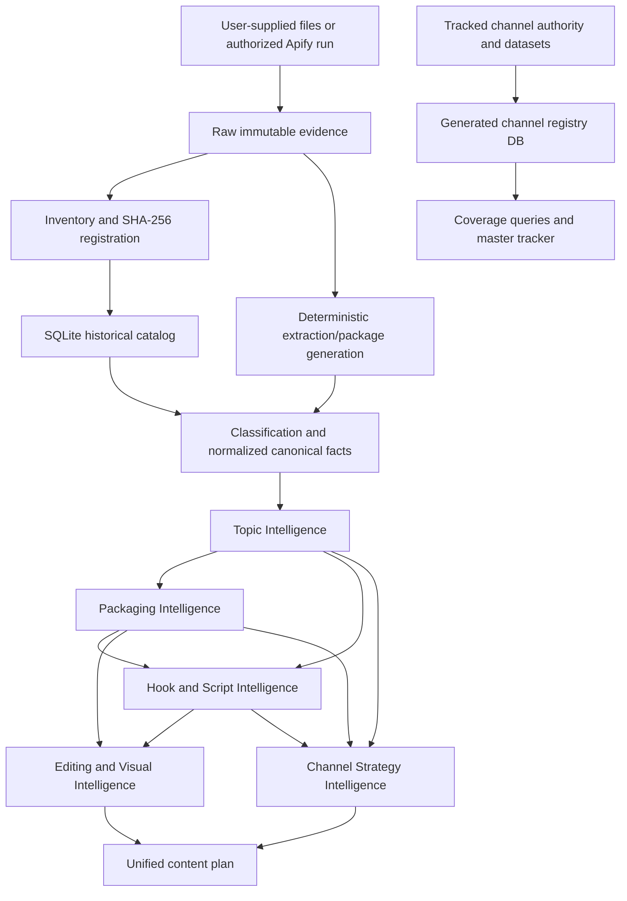
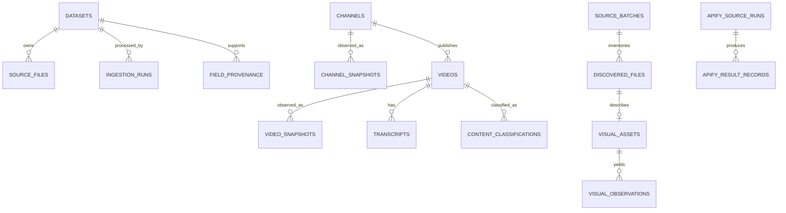

# YouTube Intelligence OS — Deep Technical Report

**Audit date:** 2026-09-20

**Audited revision:** `dcfe2927eee8c9bca11ac03cf21724c59b440b6b` (`main`, equal to `origin/main` when verified)

**Mode:** read-only static analysis plus local test discovery; no dependencies installed, no production data changed
**Evidence labels:** **VERIFIED** = directly confirmed in repository/runtime; **INFERRED** = strong multi-source conclusion; **UNCERTAIN** = insufficient evidence; **DEAD / UNUSED**, **LEGACY**, and **BROKEN / INCOMPLETE** retain their literal meanings.

## 1. Executive Summary

> This application is a local, evidence-first YouTube research and content-intelligence toolkit. It ingests supplied or explicitly authorized channel data, preserves provenance, derives channel-scoped topic/packaging/hook/script/editing intelligence, and composes evidence-traceable content plans through command-line programs and file artifacts.

It is not a web, mobile, desktop, or hosted service. No UI, HTTP server, user account system, production API, scheduler, notification system, or cloud deployment exists on `main`. Its working surface is a set of Python/Node/Swift command-line utilities, SQLite schemas, tracked manifests, raw/extracted/normalized data, generated intelligence JSON/Markdown, and tests.

Two related storage systems exist:

1. Historical inventory catalog: gitignored `data/catalog/youtube_inventory.db`, schema versions 1–10. It stores datasets, source files, channel/video snapshots, transcripts, provenance, classifications, visual observations, and bounded Apify acquisition records. **Current checkout finding:** database file was absent at audit start and later recreated as a zero-byte file by a concurrent preflight/test process, so DB-backed live commands cannot run here without reconstruction.
2. Channel registry: generated, gitignored `data/catalog/youtube_channel_registry.db`, built from tracked authorities by `scripts/build_youtube_channel_registry.py`. Its tracked schema and normalized JSON describe 69 canonical channels, 67 submitted URLs, 1,904 unique videos, 1,893 real transcripts, 11 placeholders, and 552 capability-coverage rows. **Current checkout finding:** generated registry DB was also absent.

V1 intelligence is implemented for five historical canonical channels. Topic, packaging, hook/script, channel strategy, and unified-plan generation are present. Editing/visual intelligence is intentionally conditional: only CH-000004 has registered forensic video evidence. First-party YouTube Analytics ingestion and diagnosis are implemented but have no real first-party export. Broader channel-package holdings cover 35 standard-package channels; 29 target channels remain identity-only.

Most important audit findings:

- **VERIFIED — High operational risk:** no dependency manifest or lockfile. `pytest` and `openpyxl` are unavailable in current runtime, though several scripts/tests require them.
- **VERIFIED — High reproducibility gap:** both generated SQLite databases are absent. Many live reporters open the historical database by default; an absent path can become an empty SQLite file and then fail with `no such table`.
- **VERIFIED — Medium documentation drift:** root README still says Phase 1D is current and describes V1 progression as later add-ons; current AGENTS/Phases/registry docs describe V1 complete and 25 datasets.
- **VERIFIED — Medium portability/runtime gap:** tracked reports cite prior green runs in a `.venv`, but that `.venv` is not present in this checkout. Fresh verification cannot reproduce those runs without environment setup.
- **VERIFIED — Medium spreadsheet interoperability limitation:** tracked audit documents record 1,090 cached `HYPERLINK()` error values in the master tracker workbook. Excel likely recalculates them; readers trusting cached values may show errors.
- **VERIFIED — Low code defect:** `run_youtube_intelligence.py::_from_composed_blueprint()` defines `payoff_structure["escalation"]` twice. Python retains only the second value. Values are currently identical, so observed behavior is unchanged, but duplicate key masks future divergence.
- **VERIFIED — Security posture:** no credential-like literal was found by repository-wide masked pattern scan. Apify token is environment-only and filtered from persistence. Network entry points are narrow and synchronous.

## 2. Project Purpose

### Problem

YouTube research material often arrives as spreadsheets, transcript archives, screenshots, forensic reports, and scraper exports. Without controls, these are easy to duplicate, mix across channels, detach from sources, or over-interpret. Repository addresses that by separating immutable evidence from extraction and intelligence, preserving hashes and locators, and labeling facts versus interpretations.

### Intended users

- Channel strategist or analyst supplying competitor/channel datasets.
- Engineer maintaining ingestion, provenance, and intelligence pipelines.
- Research operator running bounded Apify acquisition or local report commands.
- Future content team consuming generated plans.

### Core objectives

- Preserve raw evidence and provenance.
- Reconcile duplicate physical datasets before counting them independently.
- Maintain channel separation.
- Derive public-metric-relative intelligence without inventing private YouTube metrics.
- Degrade explicitly when thumbnails, transcripts, timestamps, forensic evidence, or first-party analytics are unavailable.
- Produce deterministic, auditable artifacts rather than opaque model memory.

Evidence: `AGENTS.md`; `README.md`; `docs/Architecture.md`; `docs/Database.md`; `scripts/run_youtube_intelligence.py`.

## 3. Project Status

**VERIFIED:** V1 intelligence capability is implemented for five historical channels. Channel strategy is tested across health and finance niches. Dataset/package registry includes 25 datasets and 69 canonical channel identities.

**VERIFIED:** Phase roadmap and implementation history are no longer cleanly aligned. `docs/Phases.md` explicitly says Phase 3 was superseded by direct V1 intelligence work. Formal Phases 5–9 remain described as future even though portions of their intended behavior now exist.

**VERIFIED:** No V2 product surface exists on `main`: no UI, API, RAG/vector retrieval, agents, scheduled automation, or YouTube Data API integration.

**INCOMPLETE:** First-party Analytics capability is code-ready, but `data/intelligence/system/first-party-analytics-capability-status-2026-09-11.json` and tests disclose that no real first-party export has been ingested.

**INCOMPLETE:** 29 target channels are identity-verified but not extracted; DS-000026 remains a proposal, not a launched dataset.

**UNTRACKED PREFLIGHT:** During this audit, a concurrent workflow created six ignored raw preflight JSON files plus `docs/audits/DS-000027_DR_ARES_PREFLIGHT_PROPOSAL_2026-09-20.md`. It proposes Dr. Ares Senior as DS-000027, reports a conservative `$0.148` Apify envelope, and explicitly stops pending launch approval. No Actor launch, spend, dataset registration, package build, commit, or push is claimed. These user-owned files were preserved and not folded into tracked registry totals.

## 4. Repository Overview

| Path | Responsibility | Status |
|---|---|---|
| `scripts/` | Ingestion, registration, validation, reporting, orchestration, refresh, packaging | Active |
| `schemas/inventory/` | Additive SQLite migrations v1–v10 | Active historical catalog schema |
| `data/catalog/channel_registry/` | Separate registry schema and example SQL | Active generator contract |
| `tests/` | 341 declared test functions plus fixtures | Active; environment-dependent |
| `data/raw/` | Immutable source evidence | Active; some ignored local holdings absent |
| `data/extracted/` | Deterministic packages/exports | Active |
| `data/normalized/` | Canonical channel target registry and tracker workbook | Active |
| `data/intelligence/` | Channel, cross-channel, global, plan, and system artifacts | Active |
| `data/manifests/` | Durable provenance, file ledgers, classifications, batch records | Active |
| `docs/` | Architecture, phase, status, workflows, decisions, audits | Active but partially drifted |
| `channels/` | Reserved future channel-brain workspace | Placeholder only |
| `config/` | Reserved future configuration | Placeholder only |
| `logs/` | Reserved ignored operational logs | Placeholder only |
| `.codex/skills/` | Developer workflow skills | Tooling, not production architecture |
| `outputs/` | Local generated/intermediate output | Ignored; contains local duplicates/inspection material |

## 5. Repository Statistics

At audited revision and final workspace snapshot:

- Tracked files: **477**.
- Workspace files excluding `.git`: **504**, including this report and concurrently created untracked DS-000027 preflight evidence.
- Tracked size: **169,856,676 bytes**.
- Tracked top-level counts: `data` 341, `scripts` 42, `tests` 33, `docs` 30, `.codex` 12, `schemas` 11, other root/scaffold files 8.
- Tracked extensions: 143 JSON, 106 Markdown, 64 Python, 49 XLSX, 42 ZIP, 33 CSV, 15 extensionless, 12 SQL, 5 TXT, 3 MJS, 2 PNG, 1 Swift, 1 TSV, 1 INI.
- Tracked data size: raw 31.1 MB; extracted 113.4 MB; normalized 0.7 MB; intelligence 8.8 MB; manifests 13.9 MB.
- Test functions discovered by AST: **341** across 27 `test_*.py` modules. Six other test/fixture files account for total 33 under `tests/`.
- Files over 1 MB in workspace: 38; files over 10 MB: 3.
- No vendored `node_modules`, `Pods`, `DerivedData`, `build`, or `dist` tree was found.

## 6. Technology Stack

| Category | Technology / version | Purpose | Evidence |
|---|---|---|---|
| Language | Python 3; code compatible with modern 3.x | Primary CLI, SQLite, analysis, validation | 64 `.py`; `scripts/` |
| Language | Node.js v24.14.0 observed | Spreadsheet/package generation | 3 `.mjs` scripts |
| Language | Swift + Vision | On-device OCR helper | `scripts/image_text_recognition.swift` |
| Database | SQLite, schema v10 | Local inventory/provenance catalog | `schemas/inventory/*.sql` |
| Registry database | SQLite generated schema | Cross-dataset channel coverage/query registry | `data/catalog/channel_registry/schema.sql` |
| Data formats | JSON, CSV, TSV, XLSX, ZIP, Markdown | Evidence, packages, reports | `data/`, packagers |
| HTTP client | Python `urllib.request` | Apify API and registered thumbnails | `apify_youtube_ingest.py`, `acquire_registered_thumbnails.py` |
| Images | Pillow 11.3.0 observed | Decode/measure/hash images | `image_pipeline.py`, thumbnail acquisition |
| Spreadsheets | `openpyxl` 3.1.5 cited historically; absent now | Read/validate/build templates and tests | scripts/tests/docs audits |
| Spreadsheet authoring | `@oai/artifact-tool` runtime path supplied externally | XLSX generation/render/inspection | Node packagers/tracker builder |
| ZIP generation | JSZip supplied by explicit runtime path | Deterministic transcript packages | Node packagers |
| Testing | pytest 8.4.2 cited historically; absent now; unittest-compatible tests | Unit/integration/regression checks | `pytest.ini`, `tests/`, audit docs |
| Version control | Git | Canonical history and hash-pinned audit evidence | `.git`, ledger validator |
| Authentication | Environment variable `APIFY_TOKEN` only | Apify bearer auth | `apify_youtube_ingest.py:1334` |
| CI/CD | None | No automated pipeline present | no `.github/workflows`, CI config, deploy config |
| Cloud/API | Apify Actor `streamers/youtube-scraper` | Explicitly bounded acquisition | `apify_youtube_ingest.py` |
| UI/web/mobile | None | Not implemented | no frontend/server manifest or entry point |

Dependency risks: no `requirements.txt`, `pyproject.toml`, `package.json`, or lockfile exists. Runtime modules must be sourced from an external bundled workspace or manually provisioned. This is biggest build reproducibility weakness.

## 7. Project Entry Point

There is no single application boot process. Each command is an independent CLI entry point using `if __name__ == "__main__": main()`.

Primary intelligence entry:

```text
python scripts/run_youtube_intelligence.py --channel CH-... --opportunity ...
    load channel intelligence JSON artifacts
    select requested topic candidate
    prefer authored full blueprint when available
    otherwise join packaging/hook/script by evidence-video overlap
    load editing availability and optional editing artifact
    verify all referenced video IDs against SQLite catalog
    label private metrics unavailable
    calculate coherence result
    emit JSON and optional Markdown
```

Primary ingestion entry:

```text
python scripts/inventory_catalog.py init
    apply migrations 001..010 in filename order

python scripts/inventory_catalog.py ingest ...
    inventory source
    hash physical files and safe ZIP members
    copy approved evidence into canonical raw layer
    commit transaction
    write durable manifest

python scripts/register_structured_source.py register --dataset-id ...
    verify canonical source hashes
    parse XLSX and transcript ZIP
    reconcile video IDs
    create channel/video/snapshot/transcript/provenance rows
    update manifest
```

Registry entry:

```text
python scripts/build_youtube_channel_registry.py
    read raw submitted URL authority
    read identity evidence, manifests, packages, historical catalog, intelligence
    reconcile canonical identities and independent coverage layers
    build generated SQLite registry
    emit normalized registry JSON/ledgers when requested
```

## 8. Architecture

Actual architecture is a local layered data pipeline with file-oriented artifacts and SQLite indexing. It is neither MVC nor MVVM. It resembles a batch-oriented layered architecture with repository-like SQL access embedded directly in scripts.



Layer boundaries are mostly explicit in paths and evidence labels. SQL access is not centralized: scripts call `sqlite3` directly, while `report_common.connect()` provides only a small connection helper. This favors transparency but creates schema coupling across reporters.

## 9. System Architecture Diagram

```text
External/user evidence
  |-- supplied XLSX/ZIP/JSON/screenshots
  |-- bounded Apify Actor run
  |-- first-party Studio export (supported, none real)
  |
  +-- data/raw/ [immutable]
        |
        +-- inventory_catalog / register_* / package_*
        |     +-- manifests and checksums
        |     +-- extracted packages
        |     +-- historical SQLite catalog
        |
        +-- report_topic_opportunity
              +-- report_packaging_intelligence
              +-- report_hook_script_intelligence
              +-- report_editing_visual_intelligence
              +-- report_channel_strategy_intelligence
                    +-- run_youtube_intelligence
                          +-- JSON/Markdown content plan

Tracked target authority + manifests + packages + historical catalog
  +-- build_youtube_channel_registry
        +-- normalized registry JSON
        +-- generated registry SQLite
        +-- master XLSX tracker
```

## 10. Directory Structure

`data/raw` is evidence authority. `data/extracted` contains deterministic derivatives. `data/normalized` contains reconciled canonical representations. `data/intelligence` contains observations, AI interpretations, hypotheses, recommendations, and composed plans. `data/manifests` preserves durable audit records. `schemas` and `scripts` define regeneration logic. `docs` records intent, decisions, and prior audits.

`outputs/` contains ignored local outputs, including nested duplicate raw exports. These are not canonical and should not be counted as independent evidence.

## 11. Important File Catalog

| File | Responsibility | Main dependencies | Importance |
|---|---|---|---|
| `AGENTS.md` | Current project rules and capability status | None | Canonical operational policy |
| `scripts/inventory_catalog.py` | Schema initialization, raw ingestion, verification, manifest generation | SQLite, filesystem, ZIP | Critical |
| `scripts/apify_youtube_ingest.py` | Cost-bounded live acquisition and transactional registration | urllib, SQLite, `APIFY_TOKEN` | Critical network boundary |
| `scripts/register_structured_source.py` | XLSX/ZIP to channel/video/provenance rows | SQLite, OOXML parser | Critical |
| `scripts/build_youtube_channel_registry.py` | Cross-dataset channel reconciliation | SQLite, openpyxl, tracked authorities | Critical registry |
| `scripts/report_topic_opportunity.py` | Public-metric topic families/outliers/candidates | SQLite, transcripts | Critical intelligence |
| `scripts/report_packaging_intelligence.py` | Title/thumbnail/package archetypes and hypotheses | topic artifact, SQLite | Critical intelligence |
| `scripts/report_hook_script_intelligence.py` | Hook/script features and archetypes | transcripts, topic/package artifacts | Critical intelligence |
| `scripts/report_editing_visual_intelligence.py` | Forensic visual/editing features and availability | DB, CSV/TSV/Markdown evidence | Conditional intelligence |
| `scripts/report_channel_strategy_intelligence.py` | Performance labels, diagnosis, benchmark, blueprint | all intelligence layers | Critical strategy |
| `scripts/run_youtube_intelligence.py` | Final layer composition and coherence validation | all channel artifacts, SQLite | Primary product entry |
| `scripts/plan_intelligence_refresh.py` | Dependency-aware staleness plan | Git, artifact hashes, DB | Operations |
| `scripts/refresh_youtube_intelligence.py` | Controlled artifact successor generation | planner and reporters | Operations |
| `schemas/inventory/*.sql` | Historical catalog schema v1–10 | SQLite | Critical data contract |
| `data/catalog/channel_registry/schema.sql` | Registry DB contract and views | SQLite | Critical coverage contract |
| `data/normalized/channel-targets/YOUTUBE_CHANNEL_REGISTRY.json` | Portable normalized registry | builder | Canonical derived registry |
| `docs/Phases.md` | Current capability/roadmap narrative | AGENTS and artifacts | Important, partially inconsistent |

## 12. Module Breakdown

### Inventory and provenance

`inventory_catalog.py` applies every migration, hashes physical files, inspects ZIP members without permanent extraction, rejects unsafe compression ratios above 500, detects duplicate/revision conflicts, copies only approved data, and writes manifests. `register_batch.py` recursively inventories multi-root batches, records symlinks without following them, assigns explicit dispositions, copies selected files, and computes image hashes/clusters. Loader scripts attach OCR, semantic, and document results to registered discoveries.

### Structured YouTube registration

`source_adapters/youtube_master_data.py` parses XLSX as OOXML ZIP directly, avoiding a hard openpyxl dependency for core registration. `register_structured_source.py` reconciles workbook and transcript archive video IDs, writes stable entities plus append-only snapshots, records field-level evidence layers, and supports two narrowly scoped legacy backfills. `register_supplied_channel.py` handles looser single-channel exports.

### Acquisition and packaging

`apify_youtube_ingest.py` plans cost from price/cap, builds allowlisted Actor input, authenticates by header, polls status/billing, validates identity and records, retains raw payloads, and registers results transactionally. `acquire_registered_thumbnails.py` fetches only exact registered HTTPS thumbnail URLs and restricts redirects to registered hosts. Node packagers generate combined datasets, five-sheet workbooks, transcript ZIPs, manifests, and QA renders.

### Intelligence

Topic reporter derives channel-relative and family-relative performance using public views normalized by age. Packaging reporter extracts title features, aggregates title/thumbnail/pair archetypes, and generates explicit hypotheses. Hook/script reporter derives opening windows from exact timestamps when available and positional approximations otherwise; script phases are heuristic AI interpretations with source sentence indexes. Editing reporter activates only when registered forensic evidence exists. Strategy reporter labels items/families, calibrates rules, benchmarks channels without pooling raw metrics, and generates experiment-category blueprints. Unified orchestrator composes these artifacts and rejects missing evidence IDs.

### Registry and coverage

Registry builder joins submitted URLs, identity evidence, package data, historical catalog data, visual evidence, and intelligence coverage into one 69-channel model. Independent status fields prevent identity, extraction, transcript, visual, intelligence, and first-party readiness from being conflated.

### Refresh

Planner models 16 ordered layers and propagates change categories through dependencies. Executor writes successor artifacts instead of overwriting prior artifacts and supports dry-run/replay behavior.

## 13. Feature Inventory

| Feature | Status | Main files | Notes |
|---|---|---|---|
| Raw inventory and hashing | Implemented | `inventory_catalog.py` | SHA-256, ZIP members, manifest |
| Recursive multimodal ingestion | Implemented | `register_batch.py` | Disposition for every discovery |
| XLSX/ZIP channel registration | Implemented | `register_structured_source.py` | Append-only snapshots/provenance |
| Supplied package validation | Implemented | `validate_supplied_channel_packages.py` | Requires openpyxl |
| Bounded Apify acquisition | Implemented | `apify_youtube_ingest.py` | Explicit cost and identity controls |
| Thumbnail acquisition | Implemented | `acquire_registered_thumbnails.py` | Registered HTTPS URLs only |
| Topic classification | Implemented | `classify_content_pilot.py` | Controlled vocabulary |
| Topic Opportunity Intelligence | Implemented | `report_topic_opportunity.py` | Five historical channels |
| Packaging Intelligence | Implemented | `report_packaging_intelligence.py` | Title-only when thumbnail gap exists |
| Hook/Script Intelligence | Implemented | `report_hook_script_intelligence.py` | Timing-quality disclosed |
| Editing/Visual Intelligence | Conditional | `report_editing_visual_intelligence.py` | Only CH-000004 has evidence |
| Channel Strategy Intelligence | Generalized working | `report_channel_strategy_intelligence.py` | Health + finance |
| Unified content plan | Implemented | `run_youtube_intelligence.py` | Five channels |
| First-party Analytics ingestion | Ready, no real data | `ingest_youtube_analytics.py` | Rejects viewer-level PII |
| First-party diagnosis | Ready, no real data | `report_first_party_channel_diagnosis.py` | Relative cohorts, no universal thresholds |
| Dependency-aware refresh | Implemented | `plan_*`, `refresh_*` | File successors, no overwrite |
| 69-channel registry/tracker | Implemented artifacts; DB absent locally | registry builder/validator | 29 channels identity-only |
| Web UI/dashboard | Not implemented | None | Remote `ui/v1` is docs-only at shown commit |
| REST/GraphQL API | Not implemented | None | No server |
| Authentication/user roles | Not applicable | None | Only Apify service token |
| RAG/vector database | Not implemented | None | Deferred |
| Scheduled/background automation | Not implemented | None | Deferred |
| YouTube Data API | Not implemented | None | Explicitly excluded unless authorized |

## 14. Screen / Page Inventory

Not applicable. Repository has no screens, routes, components, web pages, native views, or interactive product navigation. XLSX tracker is a generated artifact, not an application screen.

## 15. Navigation Architecture

No UI navigation exists. Command navigation is through `argparse` subcommands:

- `inventory_catalog.py`: `init`, `ingest`, `verify`.
- `register_batch.py`: `discover`, `register`, `images`.
- `register_structured_source.py`: `register`, `verify`, two legacy backfills.
- `apify_youtube_ingest.py`: `plan`, `run`, `ingest-existing`, `reconcile-cost`.
- `report_channel_strategy_intelligence.py`: `diagnose`, `benchmark`, `training-registry`, `blueprint`, `cross-niche-calibration`.

## 16. User Flows

### Supplied dataset

Operator provides source path and dataset identity. Inventory hashes and safely inspects source, copies approved evidence, records SQLite rows, and writes manifest. Structured registration parses workbook/archive, reconciles video IDs, writes channel/video/snapshot/transcript rows, and appends manifest section. Validator then checks hashes, counts, SQLite integrity, foreign keys, and manifest agreement. Error paths halt on changed canonical bytes, malformed values, unsafe archive, or missing provenance.

### Authorized Apify acquisition

Operator runs `plan`, reviews price/cap/result ceiling, then runs `run` with environment token. HTTP client creates Actor run, polls terminal state and final billing, downloads records, validates exact requested identity, deduplicates video IDs, saves raw payload, verifies saved bytes, and transactionally inserts snapshots/provenance/cost observations. Failed runs are recorded without normalized entities.

### Intelligence plan

Operator chooses channel and opportunity. Orchestrator loads current artifacts, finds candidate, selects authored blueprint or evidence-overlap assembly, attaches editing only when evidence exists, checks referenced video IDs in catalog, marks private metrics unavailable, computes coherence, and emits JSON/Markdown.

### Registry query

Operator builds registry DB from tracked authorities, validates expected control totals/views, then uses `example_queries.sql` or generated XLSX tracker to inspect target progress, transcript gaps, visual coverage, or capability availability.

## 17. Data Models

Historical catalog core relationships:



Registry model separately tracks canonical channels, aliases/submissions, datasets, videos, transcripts, artifacts, availability gaps, visual coverage, intelligence capabilities, and independent data-layer status.

## 18. Database / Persistence

### Historical catalog

SQLite migrations are additive and ordered. v1 adds inventory; v2 channel/video/transcript snapshots; v3–4 batch and multimodal records plus indexes; v5–6 Apify provenance/cost; v7 dataset relationships; v8–9 content classifications and active uniqueness; v10 thumbnail URL and transcript timing quality.

Writes use SQLite transactions in ingestion/registration scripts. Snapshots and billing observations are append-only. Raw BLOBs are intentionally not stored; DB stores paths, hashes, text snapshot fields, and locators. Hash verification makes raw files authoritative over catalog rows.

### Registry DB

Generated and disposable. Tracked schema has strict controlled-value checks and query views. Rebuild input is tracked; generated DB is ignored.

### Other persistence

JSON/CSV/Markdown/XLSX/ZIP artifacts are primary durable outputs. No browser storage, Redis, object store, keychain, or cloud DB exists. No sync/conflict-resolution layer exists beyond hash checks, duplicate relationships, append-only snapshots, and explicit successor artifacts.

### Integrity risks

- Missing generated DB causes default SQLite connections to create empty files unless caller opens read-only or checks existence.
- Rebuild recipe depends on local ignored raw evidence; tracked manifests alone do not recreate every OCR/AI observation.
- Schema knowledge is duplicated in direct SQL across scripts.

## 19. API / Networking

| Service | Method | Purpose | Auth | Called from |
|---|---|---|---|---|
| `api.apify.com` Actor/run/dataset endpoints | HTTPS JSON | Launch/poll/download bounded YouTube scrape; reconcile billing | Bearer `APIFY_TOKEN` header | `apify_youtube_ingest.py::ApifyHttp`, `invoke_actor`, `wait_for_final_billing` |
| Registered thumbnail URLs, normally `i.ytimg.com` | HTTPS GET | Download current thumbnail evidence | None | `acquire_registered_thumbnails.py::fetch_registered` |

Apify timeout defaults: 1,800 seconds for run, 60 seconds for cost reconciliation. Polling sleeps synchronously. Thumbnail redirects must remain HTTPS and on registered host. No retry framework, connection pool, pagination service, WebSocket, SSE, GraphQL, or YouTube Data API exists.

## 20. Authentication & Authorization

No application users, signup, login, sessions, roles, permissions, OAuth, or password reset exist. Only authentication boundary is Apify token read from process environment and sent in `Authorization` header. Sanitized actor input uses an allowlist excluding auth fields. Token value is not printed; CLI prints only presence/missing state.

## 21. State Management

State lives in:

- SQLite transactions for inventory/registration.
- Immutable or append-only files and manifests.
- In-memory Python dictionaries/lists during batch execution.
- Deterministic JSON artifacts selected by filename rules.

No Redux/BLoC/Context/Zustand or long-lived process state exists. Main state risk is duplicated truth between manifests, generated DBs, and derived artifacts; validators and hash registries mitigate but do not eliminate it.

## 22. Offline Architecture

Most reporting and analysis is truly offline if ignored raw evidence and historical DB are present. Apify acquisition and thumbnail downloads require internet. First-party analytics ingestion is file-only. Current checkout is not fully runnable offline because generated DBs and some ignored raw fixtures are absent.

## 23. Map / Location / Navigation

Not applicable. No geolocation, maps, GPS, route engine, or device location permission exists.

## 24. Background Processing

None. All work is foreground, synchronous CLI execution. No workers, queues, daemons, cron, timers beyond polling loops, background refresh, or scheduled jobs exist.

## 25. Notifications

Not implemented. No push/local notifications, tokens, payloads, permissions, or deep links exist.

## 26. Analytics

Two meanings must be separated:

- Product telemetry: none. No Mixpanel/Firebase/Amplitude/crash reporting.
- YouTube channel analytics: file-based importer supports aggregate Studio CSV/TSV/XLSX, normalizes known metrics/dimensions, rejects personal viewer fields, preserves unknown columns, and matches videos by ID/URL then title/date. No real first-party export is stored.

## 27. Feature Flags / Remote Config

No remote config or A/B platform exists. Behavior switches are CLI flags, controlled vocabulary/constants, evidence availability, and build-time/user-provided paths. `native_ab_eligibility` is analytical metadata, not a live feature flag.

## 28. Environment Configuration

No dev/staging/prod flavors or deployment environments exist. Runtime configuration comes from CLI arguments and `APIFY_TOKEN`. Repository roots are derived from script paths. External spreadsheet runtime paths are explicit arguments. No `.env` file is tracked.

## 29. Business Rules Catalog

- Raw evidence is immutable; derived outputs never overwrite it. Evidence: `AGENTS.md`, `docs/Security.md`.
- Same dataset ID with changed bytes is rejected as revision conflict. Evidence: `inventory_catalog.py`, `register_structured_source.py` tests.
- Every discovered batch item needs a disposition. Evidence: `register_batch.py`, batch tests.
- Similar channel name alone cannot merge identities; exact handle/ID evidence required. Evidence: `apify_youtube_ingest.py::reconcile_channel_identity`.
- Paid acquisition must remain below explicit cost cap. Evidence: `maximum_results_for_cap`, `enforce_cost_cap`.
- Short form is duration `<= 180` seconds. Evidence: `classify_content_pilot.py::SHORT_FORM_MAX_SECONDS`.
- Private metrics must be reported unavailable unless first-party evidence exists. Evidence: reporter `PRIVATE_METRICS` constants and tests.
- Cross-channel benchmarks keep per-channel normalization; raw metrics are not pooled. Evidence: strategy tests.
- One breakout item cannot make a family repeatable; repeatable winner needs at least three items. Evidence: strategy classifier/tests.
- Editing style is not inferred without registered forensic video evidence. Evidence: editing reporter and availability artifact.
- Medical channels require external validation; competitor transcript claims do not count. Evidence: `_medical_validation()`.
- Short-only formats are not native YouTube A/B eligible in plan metadata. Evidence: `_native_ab_eligibility()`.
- First-party viewer-level personal fields are rejected. Evidence: `PROHIBITED_PERSONAL_FIELDS`.
- Successor intelligence artifacts are written rather than overwriting historical files. Evidence: `refresh_youtube_intelligence.py::write_successor`.

## 30. Important Constants / Thresholds

| Constant | Value | Meaning |
|---|---:|---|
| `MAX_COMPRESSION_RATIO` | 500 | ZIP-bomb guard |
| `SHORT_FORM_MAX_SECONDS` | 180 | Controlled short/long classification |
| Apify default run timeout | 1,800 s | Maximum poll window |
| Apify reconciliation timeout | 60 s | Billing finalization poll window |
| Repeatable archetype sample | 3 items | Minimum for repeatability label |
| High-confidence archetype sample | 10 items | Hook/script confidence threshold |
| Title-hook overlap | 0.5 direct; 0.2 partial | Lexical continuity heuristic |
| Current registry controls | 69 channels; 1,904 videos | Validator invariants |

Many strategy thresholds are heuristic and channel-relative. They are encoded directly in reporter functions rather than centralized configuration. This aids auditability but makes calibration changes code changes.

## 31. Third-Party Dependencies

- Pillow: actively used for image decode, dimensions, EXIF, and perceptual hashing.
- openpyxl: actively required by workbook template builder, package validator, registry builder, and four test modules; absent now.
- pytest: intended test runner; absent now.
- `@oai/artifact-tool`: actively required by three Node spreadsheet builders; supplied externally, no pinned version.
- JSZip: actively required by two package builders; supplied externally, no pinned version.
- Apple Vision framework: used only by Swift OCR helper.

No obviously unused installed dependency can be proven because repository has no dependency manifest. Standard-library imports dominate Python code.

## 32. Security Review

### Findings

**Medium — generated DB creation side effect.** Several default connections use ordinary `sqlite3.connect(path)`. When expected DB is absent, SQLite creates a zero-byte/empty file before later queries fail. Impact: confusing local state and false assumption that catalog exists. Recommended fix: existence check or URI `mode=ro` for all read-only reporters.

**Medium — unpinned external runtimes.** Spreadsheet generators accept arbitrary module paths. This is necessary in current environment but gives supply-chain/reproducibility risk. No package integrity pin is present.

**Low — raw evidence can contain sensitive operational metadata.** Authenticated pricing/balance screenshots and run logs are tracked for some datasets. No credential-like literal was found, but such evidence should continue to be reviewed before commits.

### Controls verified

- No hardcoded credential-like literal found by masked scan across tracked files.
- Apify token uses environment only and header transport.
- Actor persisted input is allowlisted.
- Thumbnail acquisition restricts scheme/host and validates decoded image.
- SQL values are parameterized in inspected code; dynamic SQL is limited to generated placeholder lists/table metadata.
- ZIP ingestion inventories without unsafe blind extraction and enforces compression-ratio checks.
- Ledger validator rejects absolute and `..` paths before disk access.

No evidence of TLS disabling, `verify=False`, shell injection, unsafe pickle, `eval`, or `exec` was found.

## 33. Privacy Review

Stored public channel data can include channel/video identifiers, titles, descriptions, metrics, transcripts, thumbnails, and public URLs. First-party Analytics may include aggregate performance, traffic source, search term, geography, and audience segment metrics. Importer explicitly rejects viewer-level identity fields such as email, phone, IP, viewer/user ID, and names.

No contacts, camera, microphone, health records, device identifiers, or precise location collection exists. Health-channel content is public subject matter, not user health data. Retention policy is not formally defined beyond immutable evidence preservation and local ignored storage.

## 34. Performance Review

**Verified constraints:** large combined JSON/CSV files reach 7–18 MB; batch file ledger is ~13 MB. Packagers and reporters commonly load whole JSON payloads and transcripts into memory. Apify ingestion is synchronous. Registry builder reads many workbooks and evidence files in one process.

**Possible scaling risks:** whole-file memory growth, repeated XLSX parsing, direct per-artifact filesystem scans, and transcript aggregation will become expensive with thousands more channels. Current scale is suitable for local batch work; no claim supports continuous multi-user scale.

No frontend rendering, N+1 web query, image lazy-loading, or main-thread UI concern applies.

## 35. Concurrency Review

No async/await, threads, workers, or process pool is used in production scripts. SQLite writes are transaction-scoped and single-process. This avoids races within one run but offers no coordination between simultaneous operators. Concurrent writers could contend on SQLite or generate colliding successor filenames; repository provides no lock service.

## 36. Error Handling

Core ingestion uses `CatalogError` and explicit failure states, rollback, and nonzero exits. Validators raise typed/local exceptions. Reporters mostly raise `ValueError` or `OrchestrationError` for mismatched artifacts. Missing evidence is frequently represented as `NOT_AVAILABLE` instead of exception.

Weaknesses:

- Some image metadata parsing catches broad `Exception` and discards details.
- `register_supplied_channel.py` catches broad exception for rollback/cleanup; safe but coarse.
- Documentation taxonomy in `docs/Error_Handling.md` is broader than implemented exception classes and still says no classes are implemented, now partly outdated.
- Read-only DB helpers do not consistently guard missing database before connect.

## 37. Logging

No logging framework exists. CLIs print structured JSON, summaries, or errors to stdout/stderr. Apify raw run logs may be preserved as evidence. `logs/` is reserved but inactive. Token presence is logged without value. Risk of accidental verbose source data exists because plain `print` has no central redaction policy, though inspected network path sanitizes secrets.

## 38. Tests & QA

| Area | Tests | Quality / critical gaps |
|---|---|---|
| Inventory/schema/provenance | Strong | Temp DB, hash, FK, ZIP, idempotency tests |
| Apify | Strong offline fixtures | No live integration in suite by design |
| Batch/multimodal | Strong | Local ignored production fixtures unavailable |
| Topic/package/hook/script | Strong regression artifacts | Heuristics tested, not statistical external validity |
| Editing/visual | Conditional | Needs ignored historical DB/raw forensic fixtures |
| Strategy/orchestration | Strong | Extensive guardrail/generalization tests |
| Registry/tracker | Strong design | Requires openpyxl and generated DB |
| First-party analytics | Strong synthetic tests | No real export validation |
| Node packagers | Wrapper tests | External artifact-tool/JSZip runtime not pinned |

Fresh test evidence:

- `pytest -q`: unavailable (`command not found`).
- `python3 -m pytest -q`: unavailable (`No module named pytest`).
- `python3 -m unittest discover -s tests`: 273 tests discovered; 38 errors. Errors were environmental/data prerequisites: 4 missing `openpyxl`, 1 missing ignored DS-000011 fixture, and 33 failures caused by absent historical SQLite schema/data. No assertion failure was observed in tests that reached assertions.
- Historical tracked evidence reports 341 passing tests on a prior configured `.venv`; that environment is absent now, so this audit does not promote historical result to current runtime fact.

## 39. Build Process

No compiled application build exists. Python scripts run directly. Swift OCR is invoked as a standalone helper in a macOS environment. Node packaging requires explicit absolute paths to artifact-tool and JSZip. XLSX validation/template scripts require openpyxl. Database setup is `python3 scripts/inventory_catalog.py init`, followed by controlled re-ingestion.

Build risk: no one-command bootstrap, dependency file, lockfile, or supported runtime-version document.

## 40. CI/CD

No CI/CD configuration exists. No GitHub Actions, GitLab CI, Jenkins, CircleCI, Fastlane, Docker, deployment manifest, or release pipeline was found. Verification is manual and documented in audit files.

## 41. Git / Branch Situation

- Current branch: `main`.
- HEAD: `dcfe2927eee8c9bca11ac03cf21724c59b440b6b`.
- Upstream: `origin/main`, same revision when checked.
- Worktree: clean for tracked files after audit; ignored outputs and nested raw duplicates already existed.
- Remote branches: `origin/main`, `origin/ui/v1`, plus stale-looking merged feature/fix refs `origin/feat/youtube-channel-registry-and-tracker-2026-09-14` and `origin/fix/repository-audit-remediation-2026-09-14`.
- Tags: none listed.
- `origin/ui/v1` points to a documentation handoff commit, not verified UI source.

Repository moved from `a22c8d2` to `dcfe292` during initial audit discovery, apparently by external workspace synchronization. Final report uses only final HEAD state.

## 42. Documentation Accuracy

### Accurate/current

- `AGENTS.md` accurately states V1 and channel-strategy status.
- `docs/YOUTUBE_CHANNEL_REGISTRY.md` matches normalized registry control counts.
- `data/catalog/README.md` accurately explains schema v10 and catalog role.
- Security/provenance rules match code controls closely.

### Partially outdated

- `README.md` calls Phase 1D current and says repository is not finished product, while V1 intelligence is complete.
- `docs/Architecture.md` labels most downstream intelligence planned and claims future structured database is not chosen; historical catalog and V1 intelligence now exist.
- `docs/PROJECT_SCOPE.md` and parts of `docs/Database.md` retain Phase 0.5-era wording.
- `docs/PROJECT_STATUS_REPORT_2026-09-13.md` stops at DS-000024 planning; DS-000025 is now complete.
- `docs/Error_Handling.md` says no error class is implemented, while code uses `CatalogError`, `AnalyticsImportError`, `DiagnosisError`, `OrchestrationError`, and `ValidationError`.

### Contradictions/qualified claims

- Audit history records both missing and later installed openpyxl in an earlier `.venv`; current checkout has neither `.venv` nor openpyxl.
- Registry workbook claims need qualification: tracked audit records 1,090 cached hyperlink errors despite Excel recalculation behavior.
- `docs/Phases.md` honestly acknowledges roadmap numbering no longer maps cleanly to implementation.

## 43. Dead / Legacy / Duplicate Code

- `report_topic_opportunity_pilot.py` and pilot-specific intelligence artifacts are legacy baselines; generalized reporter supersedes them but tests retain regression value.
- `package_five_channel_youtube_dataset.mjs` is dataset-specific legacy generator intentionally preserved; generalized `package_youtube_channel_dataset.mjs` is current reusable path.
- Two `register_structured_source.py` backfill subcommands are deliberately restricted to DS-000001; legacy maintenance tools, not general features.
- Nested ignored copies under DS-000021 and DS-000023 raw paths duplicate canonical tracked exports. They are ignored local artifacts and must not count as independent evidence.
- `outputs/` duplicates/generated inspection outputs are noncanonical.
- No source file can be safely labeled dead solely by static search; all 42 script files have documented/tested or historical roles.

## 44. Technical Debt

1. Add reproducible Python and Node dependency manifests with pinned versions.
2. Make read-only DB opens fail before file creation.
3. Reconcile README/Architecture/Phases/status docs.
4. Centralize shared SQLite access/schema capability checks.
5. Separate large reporter constants/heuristics into versioned calibration contracts where appropriate.
6. Add one supported bootstrap/verification command.
7. Resolve or regenerate tracker hyperlink cached values for non-Excel consumers.
8. Define retention/privacy policy for first-party analytics and authenticated operational evidence.

## 45. Known Bugs / Suspicious Behavior

- Duplicate `"escalation"` key in `run_youtube_intelligence.py::_from_composed_blueprint`; current values identical.
- Missing database path creates empty SQLite file before `no such table` errors in multiple readers.
- Registry tracker contains 1,090 cached formula errors by prior direct XML audit.
- Test suite cannot reproduce current green state without external environment and ignored fixtures.
- `_pick_current()` selects lexicographically last dated artifact; filenames not conforming to sortable date convention could select wrong artifact.
- Evidence-overlap assembly is explicitly partial semantic matching, not authored content coherence. Code discloses this, but consumers may overread generated plans.

## 46. Architecture Risks

- File naming conventions act as artifact registry and version selection.
- Two SQLite models overlap channel/video concepts but have different purposes and schemas.
- Direct SQL in many modules increases migration coupling.
- Local-only raw evidence means a clean clone cannot reproduce all outputs.
- Generated intelligence JSON is both output and input for later layers; schema changes require careful coordinated migration.

## 47. Maintainability Risks

- Large monolithic scripts: strategy reporter 1,443 lines; Apify adapter 1,353; Node packagers ~1,000 lines each.
- No type checker, formatter, linter, coverage tool, or CI gate configured.
- Heuristic rules and report assembly live together.
- Historical audit documents are detailed but sometimes supersede each other without one canonical changelog.

## 48. Scalability Considerations

Current local batch design fits dozens of channels and low-thousands of videos. Scaling to continuous monitoring or many users would need explicit job orchestration, immutable object storage, production DB, concurrency controls, incremental transcript processing, artifact schema/version registry, and query/API layer. Those are not code gaps relative to current scope; they are V2 architecture decisions explicitly deferred.

## 49. Dependency Risks

- No dependency declaration or lock.
- External workspace module paths make builds machine-dependent.
- Apple Vision OCR is macOS-specific.
- SQLite and OOXML code rely on Python stdlib behavior without minimum Python version declaration.
- Apify Actor name/build/pricing can change externally; run manifests pin observed build/pricing per acquisition but code uses Actor API name.

## 50. Missing Critical Tests

- Clean-clone bootstrap test proving dependencies and DB reconstruction.
- Read-only reporter test proving missing DB never creates a file.
- Full live-artifact schema migration test across every intelligence artifact version.
- Tracker test in non-Excel reader after recalculation/export.
- Real anonymized first-party Analytics fixture from YouTube Studio.
- Concurrency/locking test for simultaneous refresh or ingestion.
- Large-corpus memory/performance benchmark.
- Network timeout/retry integration around Apify and thumbnail downloads.

## 51. Missing Documentation

- Supported Python/Node/Swift versions.
- Dependency install/lock procedure.
- One end-to-end setup and verification guide for clean clone.
- Canonical artifact schema/version catalog.
- Operator recovery guide for absent/corrupt local DB.
- Data retention/privacy policy.
- Explicit deprecation map for pilot and dataset-specific scripts.

## 52. Recommended Future Documentation

Create `docs/OPERATIONS.md` for bootstrap/rebuild/runbook, `docs/ARTIFACT_SCHEMAS.md` for JSON contracts, and `docs/CURRENT_ARCHITECTURE.md` replacing Phase 0.5 planning language with present system. Keep roadmap separate from current architecture.

## 53. End-to-End Execution Flows

### Topic to unified plan

```text
Historical SQLite catalog
  report_topic_opportunity.load_items()
  assign_topic_families()
  aggregate_topic_families()
  internal_candidates()
  JSON topic artifact
  report_packaging_intelligence.build_report()
  report_hook_script_intelligence.build_report()
  optional report_editing_visual_intelligence.build_report()
  run_youtube_intelligence.build_plan()
  validate_coherence()
  JSON + Markdown content plan
```

### First-party Analytics

```text
Studio CSV/TSV/XLSX
  ingest_youtube_analytics.load_tables()
  build_schema_mapping()
  detect_report_type()
  match_video() by ID, URL, then title/date
  normalize_export()
  immutable copied raw export + normalized snapshot
  report_first_party_channel_diagnosis.build_diagnosis()
  private-metric diagnosis joined to existing public intelligence
```

### Refresh

```text
Change category / Git diff / dependency hash
  plan_intelligence_refresh.affected_layers()
  build_refresh_plan()
  ordered stale artifacts
  refresh_youtube_intelligence.execute()
  rebuild_payload()
  semantic_equal() guard
  write_successor()
  refresh-run report
```

### Registry

```text
67 submitted URL rows
+ identity evidence
+ 25 dataset manifests
+ 35 standard packages
+ historical catalog/intelligence
  build_youtube_channel_registry.build_model()
  strict expected totals and independent layer states
  generated registry SQLite + normalized JSON
  validate_youtube_channel_registry
  tracker workbook / SQL queries
```

## 54. File Coverage Report

```text
Total repository files discovered: 504 final workspace files; 477 tracked at audited revision
Files excluded as generated/vendor: 25 ignored/local files plus this report and the
  untracked DS-000027 handoff; no vendor tree
Files manually/code-semantically inspected: 42 scripts, 33 test/fixture files,
  12 SQL files, 30 docs, root policies/config, plus representative and indexed data artifacts
Files classified: 477/477 tracked files
Files requiring further investigation: 49 XLSX and 42 ZIP binary artifacts were
  metadata/hash/validator-audit reviewed, not manually opened member-by-member;
  ignored historical SQLite DB and several ignored raw fixtures were absent
Estimated analysis coverage: 100% inventory/classification; about 95% of meaningful
  source/config/test semantics; lower for binary payload content by design
```

No 100% semantic-content claim is made. Large raw JSON/CSV/XLSX/ZIP evidence was inventoried and cross-checked through manifests, hashes, schemas, validators, and representative records rather than read byte-by-byte.

## 55. Unanswered Questions

- Can a clean authorized environment reconstruct both SQLite DBs from currently available local raw evidence without missing OCR/semantic rows?
- Which exact Python/Node dependency versions are intended as supported, rather than historically observed?
- Should registry and historical catalog eventually merge, or remain purposefully separate?
- Are the 1,090 cached tracker hyperlink errors acceptable for Google Sheets/LibreOffice consumers?
- What retention/access policy will apply when real first-party Analytics is ingested?
- Which remote branches should be pruned, and does `ui/v1` represent only planning or future implementation intent?
- When will DS-000026 receive explicit pricing/budget authorization, if ever?

## 56. Final Project Mental Model

Think of repository as an evidence ledger plus deterministic analysis workshop. Evidence enters through controlled local files or one authorized Apify adapter. Raw bytes remain immutable and are named by hashes and manifests. SQLite gives queryable identities, snapshots, transcript locators, classifications, and provenance, but never replaces raw evidence. Reporters read canonical facts and progressively produce topic, package, hook/script, editing, and strategy artifacts. Every later layer should preserve unavailable evidence, counter-evidence, confidence, and source IDs. Unified orchestrator is final V1 product surface: a CLI-generated content plan, not an interactive app.

Separate channel registry answers a different question: what channels and datasets exist across entire repository, what evidence layer each has, and what remains missing. It reconciles 69 channel identities across historical and standardized package worlds without pretending all are equally analyzed.

System is mature as a local, provenance-aware research codebase. It is not production software infrastructure. Biggest next engineering need is reproducible execution: pinned dependencies, safe read-only DB opening, clean-clone reconstruction, automated verification, and documentation aligned with actual V1.

## Completeness Checklist

- [x] Repository root inspected
- [x] All first-level directories inspected
- [x] All source modules identified
- [x] Entry points traced
- [x] Architecture determined
- [x] Major features traced
- [x] Every screen/page identified (none)
- [x] Navigation mapped (CLI subcommands; no UI navigation)
- [x] Models mapped
- [x] Database/persistence mapped
- [x] APIs mapped
- [x] Authentication mapped
- [x] State management mapped
- [x] Offline behavior analyzed
- [x] Background services analyzed (none)
- [x] Notifications analyzed (none)
- [x] Analytics analyzed
- [x] Remote configuration analyzed (none)
- [x] Build configuration analyzed
- [x] Environment configuration analyzed
- [x] Security reviewed
- [x] Privacy reviewed
- [x] Performance reviewed
- [x] Concurrency reviewed
- [x] Tests reviewed
- [x] CI/CD reviewed (none)
- [x] Git state reviewed
- [x] Documentation cross-checked
- [x] Dead/legacy code investigated
- [x] Important dependencies reviewed
- [x] Runtime verification attempted where appropriate
- [x] Major conclusions reference source evidence
- [x] Unknowns identified
- [x] File coverage calculated
- [x] Report cross-checked against inventory

# File-by-File Appendix

## A. Production scripts

| File | Purpose / important functions | Used by / dependencies | Runtime role / status |
|---|---|---|---|
| `scripts/acquire_registered_thumbnails.py` | URL allowlist, redirect guard, decode/measure/store, manifest | Pillow, urllib, catalog | Active network acquisition |
| `scripts/apify_youtube_ingest.py` | Cost plan, Actor invoke, validation, raw retention, transactional ingest | urllib, SQLite, inventory catalog | Active bounded acquisition |
| `scripts/apply_youtube_transcript_recovery.py` | Merge recovered subtitle evidence into workbook/ZIP/JSON/CSV | openpyxl, ZIP/XML | Active corrective utility; dependency absent |
| `scripts/build_youtube_channel_package_template.py` | Strip reference workbook into reusable template | openpyxl | Active build helper; dependency absent |
| `scripts/build_youtube_channel_registry.py` | Reconcile 69-channel model and build registry DB | openpyxl, SQLite, manifests/packages | Active; generated DB absent |
| `scripts/build_youtube_channel_master_tracker.mjs` | Generate/render 9-sheet tracker workbook | artifact-tool | Active artifact builder |
| `scripts/classify_content_pilot.py` | Controlled topic/format classifications | SQLite | Active generalized batch plus pilot compatibility |
| `scripts/classify_forensic_dataset_relationship.py` | Register DS-000012/015 relationship | SQLite | Narrow active utility |
| `scripts/generate_batch_manifests.py` | Produce coverage/file/dataset manifests from DB | SQLite/CSV | Active audit utility |
| `scripts/image_pipeline.py` | EXIF, dimensions, dHash, batch stdin | Pillow | Active image inspection |
| `scripts/image_text_recognition.swift` | Vision OCR over image path | Apple Vision | Platform-specific helper |
| `scripts/ingest_youtube_analytics.py` | Parse, map, reject PII, normalize and copy Studio exports | stdlib CSV/ZIP/XML, catalog | Ready, no real data |
| `scripts/inventory_catalog.py` | Initialize schema, ingest, verify, manifest | SQLite/filesystem/ZIP | Core active |
| `scripts/load_document_results.py` | Load document characterization rows | SQLite/JSON | Active ingestion support |
| `scripts/load_ocr_results.py` | Load OCR observations | SQLite/JSON | Active ingestion support |
| `scripts/load_semantic_results.py` | Load semantic visual observations/classifications | SQLite/JSON | Active ingestion support |
| `scripts/package_five_channel_youtube_dataset.mjs` | Reproduce DS-000020 package | artifact-tool, JSZip | Legacy dataset-specific, preserved |
| `scripts/package_youtube_channel_dataset.mjs` | General package generator | artifact-tool, JSZip | Current reusable packager |
| `scripts/plan_intelligence_refresh.py` | Hash/dependency-based stale plan | Git, SQLite/files | Active operations |
| `scripts/refresh_youtube_intelligence.py` | Rebuild selected artifacts as successors | all reporters/planner | Active operations |
| `scripts/register_batch.py` | Recursive discovery, disposition, copy, image registration | SQLite, Pillow helper | Core multimodal ingestion |
| `scripts/register_structured_source.py` | Workbook/archive registration and provenance | SQLite, OOXML adapter | Core structured ingestion |
| `scripts/register_supplied_channel.py` | Loose single-channel workbook/transcript registration | SQLite, adapter | Active alternate importer |
| `scripts/report_channel_coverage.py` | Historical Tier A/B channel coverage | SQLite | Active read-only report |
| `scripts/report_channel_strategy_intelligence.py` | Labels, diagnosis, benchmark, calibration, blueprint | intelligence artifacts | Core strategy |
| `scripts/report_common.py` | Repo root, DB connection, Markdown/JSON emit | SQLite | Shared minimal helper |
| `scripts/report_corpus_status.py` | Dataset/batch/classification gap report | SQLite | Active read-only report |
| `scripts/report_dataset_matrix.py` | Dataset provenance matrix | SQLite | Active read-only report |
| `scripts/report_editing_visual_intelligence.py` | Discover forensic evidence, timing/visual/editing archetypes | SQLite, CSV/TSV/Markdown | Conditional core intelligence |
| `scripts/report_first_party_channel_diagnosis.py` | Private-metric relative diagnosis and longitudinal state | normalized analytics + public artifacts | Ready, no real data |
| `scripts/report_hook_script_intelligence.py` | Opening windows, script phases, archetypes, continuity | SQLite/transcript files | Core intelligence |
| `scripts/report_packaging_intelligence.py` | Title/thumbnail/pair archetypes and tests | topic artifact/SQLite | Core intelligence |
| `scripts/report_topic_opportunity.py` | Topic families, relative performance, candidates | SQLite/transcripts | Core intelligence |
| `scripts/report_topic_opportunity_pilot.py` | Original fixed CH-000003 pilot | SQLite | Legacy regression baseline |
| `scripts/run_youtube_intelligence.py` | Compose and validate unified plans | intelligence artifacts/SQLite | Primary V1 entry |
| `scripts/source_adapters/__init__.py` | Package marker | None | Active package scaffold |
| `scripts/source_adapters/batch_rules.py` | Dataset-specific batch classification rules/constants | register_batch | Active adapter data |
| `scripts/source_adapters/youtube_master_data.py` | Direct OOXML workbook and transcript ZIP parsing | stdlib ZIP/XML | Core adapter |
| `scripts/validate_dataset_ledgers.py` | Path, size, hash, historical-commit checks | Git/filesystem | Active provenance validator |
| `scripts/validate_supplied_channel_packages.py` | Workbook/ZIP/ID/formula validation reports | openpyxl, ZIP | Active; dependency absent |
| `scripts/validate_youtube_channel_registry.py` | Expected totals, views, idempotence validation | registry builder, SQLite | Active; prerequisites absent |

## B. Test files

All are active regression/unit/integration tests unless noted. Main dependencies are target module, stdlib temp files/SQLite, and where stated openpyxl or local ignored evidence.

| File | Coverage | Current limitation |
|---|---|---|
| `test_acquire_registered_thumbnails.py` | URL/redirect/image/dedup/manifest | Runs with Pillow |
| `test_apify_youtube_ingest.py` | normalization, caps, identity, raw retention, secrets, provenance | Offline fixtures; runs |
| `test_apply_youtube_transcript_recovery.py` | workbook/ZIP recovery | openpyxl absent |
| `test_build_youtube_channel_package_template.py` | workbook template | openpyxl absent |
| `test_channel_strategy_intelligence.py` | 69 tests across taxonomy/generalization/calibration/artifacts | One local raw fixture absent |
| `test_content_classifications.py` | controlled classification/provenance | Runs |
| `test_dataset_ledger_provenance.py` | hashes/path escape/historical pins | Runs |
| `test_editing_visual_intelligence.py` | forensic discovery/report/availability | historical DB absent |
| `test_first_party_analytics.py` | import mapping/PII/diagnosis/refresh | historical DB absent for wrapper setup |
| `test_forensic_dataset_relationship.py` | idempotent relationship | Runs |
| `test_hook_script_generalization.py` | archive/physical transcript reads and all-channel artifacts | historical DB absent for live cases |
| `test_hook_script_intelligence.py` | timing, archetypes, continuity, traceability | Artifact/unit portions run |
| `test_intelligence_refresh.py` | dependency propagation, dry run, changes | Runs |
| `test_inventory_catalog.py` | schema, ingest, hashes, ZIP, FK, verify | Runs |
| `test_packaging_generalization.py` | five-channel title/thumbnail behavior | Runs |
| `test_packaging_intelligence.py` | features/archetypes/hypotheses | Runs |
| `test_packaging_intelligence_v2.py` | visual evidence and causal guards | Runs |
| `test_portable_evidence_paths.py` | cross-worktree path rebasing | Runs |
| `test_register_batch.py` | recursion/symlinks/dedup/images/rollback | Runs |
| `test_register_structured_source.py` | migrations/reconciliation/provenance/backfills | Runs |
| `test_run_youtube_intelligence.py` | 32 orchestration/coherence/medical/availability tests | historical DB absent for live cases |
| `test_topic_opportunity.py` | topic metrics/candidates/live artifact | historical DB absent for live cases |
| `test_topic_opportunity_pilot.py` | fixed pilot invariants | historical DB absent |
| `test_validate_supplied_channel_packages.py` | package formula/ID/transcript validation | openpyxl absent |
| `test_youtube_channel_master_tracker.py` | workbook formulas/styles/registry linkage | openpyxl and generated DB absent |
| `test_youtube_channel_registry.py` | raw authority/model/DB/validator | openpyxl/historical DB absent |
| `test_youtube_dataset_packager_generalization.py` | Node packager interface/generalization | external modules needed for full build |

Fixtures: `tests/fixtures/apify_youtube/*.json` cover successful run and videos with/without transcripts. `tests/fixtures/youtube_analytics/*` cover video performance, traffic source, and retention curve. `pytest.ini` limits discovery to `tests` and `test_*.py`.

## C. SQL and configuration

| File/group | Purpose | Status |
|---|---|---|
| `schemas/inventory/001_initial.sql` | inventory, source, run, error tables | Active v1 |
| `002_structured_registration.sql` | channels/videos/snapshots/transcripts/provenance | Active v2 |
| `003_multimodal_source_registration.sql` | batches/discovered files/visual/document/classification | Active v3 |
| `004_discovered_files_fk_indexes.sql` | FK indexes | Active v4 |
| `005_apify_youtube_acquisition.sql` | Apify run/result/thumbnail and snapshot extensions | Active v5 |
| `006_apify_cost_observations.sql` | billing observations | Active v6 |
| `007_dataset_relationships.sql` | dataset relationship evidence | Active v7 |
| `008_content_classifications.sql` | topic/format assertions | Active v8 |
| `009_content_classification_uniqueness.sql` | one active classification/dimension | Active v9 |
| `010_supplied_channel_evidence.sql` | thumbnail URL and timing quality | Active v10 |
| `data/catalog/channel_registry/schema.sql` | separate 69-channel registry and views | Active generated model |
| `data/catalog/channel_registry/example_queries.sql` | 17 operator query patterns | Active |
| `.gitignore` | local DB/cache/output/privacy boundaries | Active |
| `.gitattributes` | repository attribute behavior | Active |
| `.codex/hooks.json` | local Codex hook config | Developer tooling only |

## D. Documentation

`README.md` is top-level orientation but outdated. `AGENTS.md` is current policy. `docs/Architecture.md`, `Database.md`, `Phases.md`, `Security.md`, `Error_Handling.md`, `Prompts.md`, and `DECISIONS.md` define architecture/evidence doctrine. `DATA_*` and `FIRST_PARTY_ANALYTICS_WORKFLOW.md` define operational workflows. `YOUTUBE_CHANNEL_REGISTRY.md` and `STATUS_QUERIES.md` document current coverage/query model. `PROJECT_STATUS_REPORT_2026-09-13.md` is historical. `docs/audits/*` are point-in-time audit evidence; later addenda supersede earlier claims. `docs/source-discovery/*` records Phase 0.5 discovery. `docs/superpowers/plans/*` are implementation plans, not runtime code. `TOOLS_INSTALLED.md` describes developer tools, not production dependencies.

## E. Data and artifact groups

- `data/manifests/DS-000001..DS-000025*`: durable dataset provenance and package ledgers. Active historical record.
- `data/manifests/batches`, `classifications`, `relationships`, `apify`: batch, semantic, dedup, acquisition/cost evidence.
- `data/raw/channel-data/DS-000020..025`: immutable Actor/source evidence. Canonical; nested ignored copies are duplicates.
- `data/raw/channel-data/DS-000027/preflight`: six concurrent, ignored preflight evidence files; preserved locally, no acquisition launched.
- `docs/audits/DS-000027_DR_ARES_PREFLIGHT_PROPOSAL_2026-09-20.md`: concurrent untracked approval-gate handoff; inspected, not treated as committed project truth.
- `data/extracted/channel-data/DS-000020..025`: combined JSON/CSV/XLSX and per-channel workbook/transcript packages.
- `data/intelligence/channels/CH-000001..005`: topic, packaging, hook/script, editing, diagnosis artifacts.
- `data/intelligence/cross-channel`: comparisons, benchmarks, editing availability.
- `data/intelligence/plans`: composed unified content plans.
- `data/intelligence/system`: capability, freshness, calibration, and refresh-run records.
- `data/normalized/channel-targets`: registry JSON and master tracker workbook.
- `data/raw/channel-targets`: immutable submitted-channel authority.

Binary XLSX/ZIP/PNG artifacts are meaningful evidence or deliverables, not source code. Their roles, counts, hashes, sheet/member structure, and known validation results were inspected through manifests and validator/audit records; contents were not exhaustively reproduced in this report.
