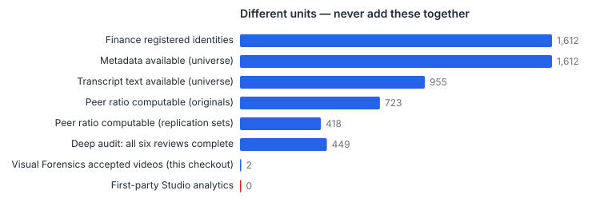

# YIOS Structured-Data Census & Evidence-Authority Audit — 2026-10-26

**Scope:** read-only census of the structured data that can be reached from Machine B's checkout `/Users/ghilmanislam360/Documents/youtube-intelligence-os`. The census was run at HEAD `d987510b966eaabba6cc2990290b52d2ecf3fe8e` (branch `research/finance-economics-intelligence`, clean worktree) and also reads the unmerged PR #44 ref `origin/codex/what-if-archive-main-integration` @ `badec432` and `origin/research/casually-finance-success-playbook` through `git show`. Nothing in the repository was written.
**Receipts:** `receipts/census.json` (every table and file, with SHA-256, row count, PK/ID uniqueness and a null profile). Reproduce with `python3 -I scripts/census.py <repo> receipts`.

## 0. Snapshot corrections vs the brief

| Brief said | Verified now | Source |
|---|---|---|
| Latest accepted research NICK_172, HEAD `3aa43bfd` | **NICK_173 committed**: HEAD `d987510b` "complete NICK_173 deep audit" | `git log`; `RESUME_HERE.md` |
| 448 deep-audited / 1,164 remaining | **449 / 1,163** (all six reviews `COMPLETE_LIMITED_EVIDENCE` in `VIDEO_AUDIT_966.jsonl`) | census `live_ledger_all_six_complete` |
| Next candidate `UfqNzF7sQzo` NOT_STARTED | `UfqNzF7sQzo` is now complete (NICK_173). The next selected item is `UmKdQCMCc98`, not started. I did not touch it. | `RESUME_HERE.md` |

Other live Claude/Codex processes were present on the machine during the audit. This audit wrote nothing to the repository, so it cannot conflict with the Finance writer or Visual Forensics owners.

## 1. Evidence-authority map

| Artifact | Location | Role | Source / derived | Snapshot | Status |
|---|---|---|---|---|---|
| Channel registry DB | `data/catalog/youtube_channel_registry.db` (141 MB, SHA `39e7a28b…`) | Canonical multi-niche channel/video/transcript registry | Derived from DS packages (Apify/user exports) | Collections 2026-08-31 → 09-25 | **CANONICAL** for public metadata; quick_check ok, 0 FK violations |
| Inventory DB | `data/catalog/youtube_inventory.db` (52 MB, SHA `277c09f6…`) | File/source provenance, thumbnail & visual observations | Derived | — | **CANONICAL** for provenance; 0 FK violations |
| `youtube-intelligence-os.db`, `youtube_intelligence.db` | `data/catalog/` | — | — | — | **EMPTY 0-byte files** (SHA of empty string). Not data |
| Finance live audit ledger | `research/finance-economics-intelligence/VIDEO_AUDIT_966.jsonl` | Deep-audit status and analyst reviews for the original 966 | Source of record for audit status | live (NICK_173) | **CANONICAL** (status) |
| Finance universe | `…/reconciliation-all-repository-2026-10-21/FINANCE_UNIVERSE.csv` | 1,612-identity population definition | Derived | frozen 2026-10-21 | **CANONICAL for membership**. Its `audit_status` column is **STALE** (430 complete vs live 449) |
| Original 966 metrics | `…/VIDEO_AUDIT_966.csv`, `VIDEO_MASTER.csv` | Frozen views/age/format and peer ratios | Derived from DS-000001/20–24 | 2026-09-11/12/13; 159 undated | **CANONICAL** frozen snapshot |
| Expansion masters | `…/expansion-12-channel-2026-10-20/` (197), `…/expansion-monkey-explains-1999-2026-10-21/` (63) | Metadata-only expansion | Derived | retrieval 2026-09-28…10-21 | Canonical metadata; **not deep-audited** |
| Casually Finance performance | `origin/research/casually-finance-success-playbook:research/casually-finance-success-playbook/VIDEO_PERFORMANCE.csv` (206) | Separate branch | Derived | snapshot 2026-10-11 | **BRANCH-ONLY** (not in current checkout) |
| Landscape | `…/LANDSCAPE_VIDEOS.csv` (180) | Display views ("272K") and relative dates ("7d ago") | Derived | 2026-10-15 | **LOW PRECISION**: excluded from tests |
| Title/topic/script/thumbnail/virality CSVs (×966) | `…/*_966.csv` | Projections of the ledger | Derived | live | Projections, not independent evidence |
| `Topic_tags_provisional`, `Audience_problem`, `Demand_type`, `Time_sensitivity`, `Narrative_angle` | `VIDEO_MASTER.csv` | Classifications | 936/966 `TITLE_KEYWORD_HEURISTIC_NOT_SEMANTIC_REVIEW`; `Time_sensitivity` = `UNVERIFIED` for **all 966** | — | **HEURISTIC / UNVERIFIED**: not usable as evidence of evergreen-ness |
| Deep-audit analyst prose | `VIDEO_AUDIT_966.jsonl` → `title/thumbnail/script/topic/virality.analysis` | AI/analyst interpretation | Interpretation | live | **OUTCOME-AWARE**: prose quotes each video's tier (e.g. "Weak 0.14×"). Features coded from it leak the outcome |
| Visual Forensics (Casual Finance) | `research/visual-forensics/` (INDEX 2 videos: `o3FQcd91MIs`, `Uumnx2Fo6cE`) | Visual-only CT scans | Observation | accepted 2026-10-24 | **VISUAL_ONLY**; frames/audio external (Machine A); Machine B source MP4 `UNVERIFIED` |
| Visual Forensics Video 003 checkpoint 6 | — | — | — | — | **NOT FOUND** in any local ref or commit message; presumed Machine A-only. **INACCESSIBLE** here |
| What If production brain | PR #44 ref, `research/visual-forensics/channels/CH-000004/what-if-source-package/production_intelligence_brain/` | 14 source videos decoded | Observation + reconstruction | v1.0.0 | **UNMERGED (PR #44)**; read via `git show` |
| What If derived experiments | PR #44 `research/production-experiments/what-if-derived/` | YIOS reconstructions / rejected prototypes | **YIOS-created**, not channel evidence | — | Experimental; never treated as algorithm evidence |
| Prior algorithm validation | `data/intelligence/global/youtube-algorithm-primary-validation-2026-09-04.md` | 12/33 DS-000018 claims validated | Interpretation with primary sources | 2026-09-08 authority | Historical-current; reused, re-checked against today's Help pages |
| V1 intelligence JSONs | `data/intelligence/channels/CH-00000{1..5}/` etc. | Generated layers | Derived | 2026-09-09…11 | Historical derived; not re-validated here |
| Media library | `/Users/ghilmanislam360/Documents/YIOS-Media-Library/` (4.1 GB) | MP4 originals | Source media | — | Inventoried by size only. **Not decoded** (out of scope) |

## 2. SQLite census (full record scan, every table)

### `youtube_channel_registry.db`: 26 tables, `pragma quick_check` = ok, `foreign_key_check` = 0 violations, all PKs unique

| Table | Rows | Notable nulls/empties |
|---|---|---|
| channels | 75 | `limitations` 61, `handle_unavailable_reason` 74 |
| videos | 2,303 | `video_type` NULL 159; `thumbnail_url` empty 396; `raw_json` NULL 667; `description_unavailable_reason` 2,286 (expected) |
| transcripts | 2,303 | 12 placeholders (`is_placeholder=1`, <200 chars); 2 duplicate-hash groups |
| subtitle_tracks | 2,455 | `track_type` 18 |
| dataset_videos | 2,303 | every video is in exactly 1 dataset; 0 orphans |
| datasets | 33 | `evidence_scope`, `limitations` empty for all 33 |
| intelligence_coverage | 600 | — |
| channel_data_layers | 825 | `limitation_reason` 319 |
| availability_gaps | 216 | — |
| artifacts 318 · channel_aliases 142 · submissions 67 · identity_evidence 75 · visual_coverage 75 · dataset_channels 50 · actor_runs 19 · intelligence_capabilities 8 · registry_metadata 4 · non_channel_subjects 4 · subject_datasets 4 | | |
| transcript_fts (+5 shadow tables) | 2,291 | FTS5 index. The CLI sqlite3 lacks fts5; Python counted it |

Quality findings:
- **`video_type` labels are inconsistent:** `video` 1,150 · `regular video` 890 · `shorts` 90 · `Short` 14 · NULL 159. The Finance baseline normalizes these; any new consumer must too.
- **`published_at` is not ISO datetime for 771 rows** (date-only or other forms). Age calculations drop or approximate these.
- 5 duplicate (channel, title) pairs; 10 videos with NULL views.
- 46 of 75 channels have video rows. **First-party analytics = `SCHEMA_READY_NO_DATA` for 75/75.** Forensic video evidence exists for 1/75 (CH What If).

### `youtube_inventory.db`: 28 tables, quick_check ok, 0 FK violations, all PKs unique

| Table | Rows | Note |
|---|---|---|
| discovered_files | 45,774 | 41,717 are duplicates of another discovered file (`duplicate_of_discovered_file_id`) |
| field_provenance | 12,335 | |
| source_files | 6,953 | 6,729 archive members |
| visual_assets | 5,172 | |
| videos | 667 | all 667 also in the registry DB (overlap 667) |
| video_snapshots / transcripts | 668 / 668 | one video has two snapshots; `views_per_day` empty 480 |
| content_classifications | 604 | `method_version` empty 302 |
| apify_result_records 480 · thumbnail_evidence 479 · visual_observations 244 · ingestion_runs 37 · source_locations 34 · datasets 26 · channel_dataset_links 22 · document_records 17 · batch_roots 12 · channel_snapshots 12 · apify_run_cost_observations 10 · channels 10 · schema_meta 10 · apify_source_runs 9 · entity_classifications 9 · dataset_relationships 1 · source_batches 1 · file_relationships 0 · ingestion_errors 0 | | |

## 3. Flat-file census (full record scan): 53 Finance CSV/JSONL files + VF index + 16 What If CSVs

All per-video Finance tables keyed by `Video_ID` have **unique IDs** (966/966, 197/197, 63/63, 1,612/1,612). The exceptions are by design:
- `DATE_SENSITIVITY.csv`: 1,190 rows / 595 IDs (two date-shift variants per DS-000022 video).
- `EXISTING_DATA_INVENTORY.csv`: 39 rows / 37 IDs (2 repeated channel IDs, one per source row).

The full list with SHA-256 is in `receipts/census.json → flat_files`.

**Checksum manifests:** `expansion-monkey…` 8/8 match; `reconciliation…` 6/6 match; `expansion-12-channel…` 6/7 match. **`README.md` mismatches**: it was edited by commit `1ac2d370 "register first expansion audit blocker"` after the manifest was written. Every data file matches.

**What If brain (PR #44, unmerged; `git show`):** MASTER_WORDS 7,864 · MASTER_AUDIO_VISUAL_SYNC 1,421 · AUDIO_TRIGGER_PATTERNS 1,221 · MASTER_SENTENCES 604 · MASTER_STATES / STATE_PATTERNS 581 · MASTER_ASSETS 448 · MASTER_MOTIONS / MOTION_PATTERNS 438 · MASTER_SHOTS / SHOT_PATTERNS 200 · TRANSITION_PATTERNS 82 · MASTER_AUDIO_EVENTS 29 · SOURCE_VIDEO_INDEX / SOURCE_TO_FORENSIC_MAP 14 · VISUAL_CHANGE_PATTERNS 3.

## 4. Population integrity — units that must never be added together

| Unit | Count | Locator |
|---|---|---|
| Finance registered identities | **1,612** = 966 original + 197 expansion + 63 Monkey + 386 reconciliation additions | FINANCE_UNIVERSE.csv |
| …with transcript text (universe flag) | 955 `TEXT_AVAILABLE` (+16 partial forensic, 11 unavailable, 433 not registered, 197 not acquired) | FINANCE_UNIVERSE.csv |
| Deep-audited (all six reviews complete) | **449** (all in the original 966) | VIDEO_AUDIT_966.jsonl |
| …of which have a computable peer ratio | 419 | analysis |
| Original 966 with a computable peer ratio | **723** (11 channels; DS-000001's 159 are undated, so excluded) | analysis; matches stored `Lifetime_rate_ratio` exactly (max relative difference 7.1e-5) |
| Replication sets with a peer ratio (same rule) | **418** (Expansion 169, Monkey 52, Casually Finance 197) | analysis |
| Registry DB videos (all niches) | 2,303 across 46 channels | registry DB |
| …with a dated collection snapshot | 1,319 across 35 channels | analysis (manifest collection dates) |
| What If registry videos | 83 | registry DB |
| What If forensically decoded source videos | 14 (12 matched to IDs; 10 present in the registry) | PR #44 SOURCE_VIDEO_INDEX |
| Casual Finance Visual Forensics videos | 2 (visual-only) | research/visual-forensics/INDEX.csv |
| Visual Forensics Video 003 | not accessible | — |
| First-party Studio analytics rows | **0** | registry DB |

The 1,612 identities, 449 audits, 14 What If decodes and Visual Forensics events (e.g. 507 visual states in `Uumnx2Fo6cE`) are different units. They describe overlapping or nested sets and must not be summed into a "sample size".

## 5. Coverage matrix

| Evidence type | Finance original 966 | Expansion 260 | Reconciliation 386 | Other niches (registry) |
|---|---|---|---|---|
| Title | 966 | 260 | 386 | 2,303 |
| Frozen views + date (peer ratio computable) | 723 | 221 | 197 (Casually Finance) / 180 landscape low-precision | 1,319 dated |
| Duration / format | 807 known format | 260 | 206 | 2,144 typed |
| Likes / comments | 966 rows (some null) | 260 | not in CF file | registry |
| Transcript (stored text, auto-captions; audio unverified) | 955 | 0 (not acquired) | partial | 2,291 non-placeholder |
| Thumbnail image inspected | 449 deep + others local | URL only | reference | URL only for most |
| Deep audit (six reviews) | 449 | 0 | 0 | — |
| Frame-level visual forensics | 0 | 0 | 2 (Casually Finance) | 14 What If (PR #44) |
| Impressions / CTR / retention / traffic / revenue | **0** | **0** | **0** | **0** |

## 6. What was scanned and what was not

- **Full record scan:** every table in both non-empty SQLite DBs, all 53 Finance CSV/JSONL files listed in the receipt, the VF index and the 16 What If brain CSVs.
- **Inventoried only (hash/size):** `FINANCE_1612_COMBINED_INTELLIGENCE.xlsx` (projection of the ledger; its JSON projections are validated by the Finance writer's own checks), the media library (4.1 GB, size only), the What If per-video forensic folders (listed, not opened), the Casually Finance VF evidence folders, and `data/raw/` (850 MB, **not read**; AGENTS.md rule 4 and the graphify rule).
- **Not accessible:** Visual 003 checkpoint 6; Machine A external roots (`/Users/ghilmankhan/YIOS-local-audits/…`); Machine A source MP4s.
- **Not re-validated:** V1 intelligence JSONs under `data/intelligence/` (historical derived layers).

## 7. Permissible analytical uses

| Data | OK for | Not OK for |
|---|---|---|
| Frozen views + age + same-channel peers | Descriptive, within-channel, age-matched comparisons of *lifetime* public reach | Velocity, impressions, CTR, retention, traffic source, causation |
| Title text | Mechanical feature coding, within-channel association | Packaging causation (no impressions or CTR, and upload-era titles unknown) |
| Current thumbnails | Describing current artwork | Upload-era packaging. Every thumbnail record says `historical_design: UNKNOWN` |
| Auto-caption transcripts | Lexical hook/opening features | Timing, pacing in seconds, delivery, audio quality |
| Analyst/AI prose | Qualitative context and claim audits | Outcome-blind feature coding (it is contaminated by outcome knowledge) |
| What If forensic decode | Production grammar of a hit-heavy sample | Success vs failure contrasts (no low-performer decodes) |
