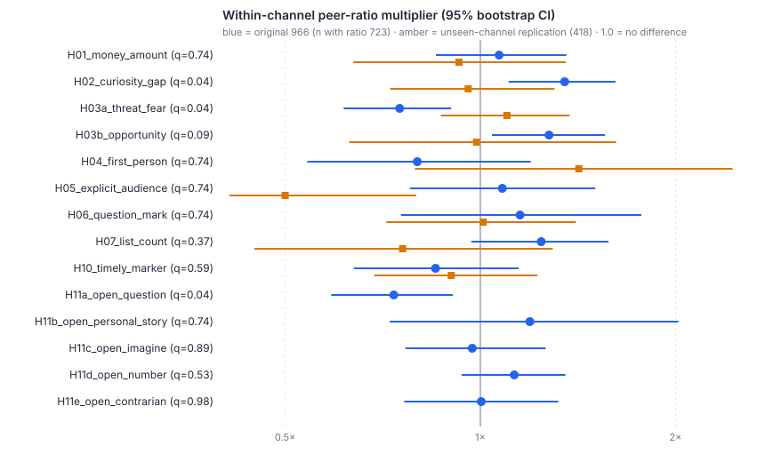

# YIOS Virality Hypothesis Tests — 2026-10-26

**Bottom line:** none of the 14 pre-registered title/hook hypotheses survived the full robustness bar. Four show a within-channel association in the original Finance corpus that survives FDR correction and leave-one-channel-out. **None of the title effects replicated on 418 videos from 7 channels the tests had never seen.** A simple interpretable model does **not** predict peer-relative performance better than "assume typical". Outperformance in this corpus is concentrated in rare hits and is not explained by title surface features.

Reproduce: `python3 -I scripts/analyze.py <repo> derived` (stdlib only, seed 20261026, 4,000 permutations, 1,500 bootstrap draws). Full outputs: `derived/analysis_results.json`, per-video table `derived/per_video_features.csv`.

## 1. Outcome and design

- **Outcome:** `log(peer ratio)`, where peer ratio = the video's lifetime views/day ÷ the median lifetime views/day of up to 10 nearest-age videos from the **same channel, same format and same snapshot**, with peer age 0.5–2× the target's age, at least 5 peers and the target ≥ 7 days old. This is the project's own rule (`build_baseline.compare`), re-implemented. It reproduces all 723 stored `Lifetime_rate_ratio` values (max relative difference 7.1e-5). The same rule was applied unchanged to the replication sets.
- **What the outcome is:** a *lifetime-average public reach proxy relative to the channel's own age-matched norm*. It is not impressions, CTR, retention, traffic source or current velocity. It controls for channel size and age only approximately.
- **Populations:**
  - **Discovery set:** original Finance 966 → 723 with a ratio (11 channels; Nick Invests contributes 348).
  - **Replication set:** 418 videos from channels never used in discovery: Mark Invests 74, Uncle John Financial 46, Uncle Frank Retirement 23, Logical Money 15, Primitive Education 11 (Shorts), MonkeyExplains 52, Casually Finance 197 (168 Shorts, 29 long-form).
- **Test:** the feature (pre-registered regex on title or on the first 60 transcript words) is compared within each channel × format stratum, using strata with ≥2 videos on each side. Effect = weighted mean within-stratum difference (weight n₁n₀/(n₁+n₀)) → reported as a **multiplier on the peer ratio**. Significance: stratified permutation test (labels shuffled within stratum). 95% CI: stratified bootstrap. Multiple testing: Benjamini–Hochberg across the 14 primary tests.
- **Robustness gates for "SURVIVED_ASSOCIATION":** q < 0.10 **and** no leave-one-channel-out sign flip **and** same sign in the later half of publication dates **and** same sign in the unseen-channel replication set.
- **Features were fixed before any outcome was inspected in this audit.** The regexes are in `scripts/analyze.py` (`TITLE_FEATURES`, `OPENING_FEATURES`) and were not tuned afterwards.

## 2. Primary results (all 14 kept visible)

| # | Hypothesis (falsifiable form) | n with / without | Multiplier [95% CI] | p (perm) | q (BH) | LOCO range | Later half | Excl. Nick | Unseen-channel replication | Verdict |
|---|---|---|---|---|---|---|---|---|---|---|
| H01 | Titles with a money amount outperform same-channel peers | 142 / 545 | 1.07 [0.85, 1.36] | 0.55 | 0.74 | 1.03–1.11 | 1.07 | 1.10 | 0.93 [0.64, 1.35] | **NOT SUPPORTED** |
| H02 | Curiosity-gap wording (why / secret / truth / nobody / actually …) outperforms | 238 / 462 | **1.35 [1.11, 1.62]** | 0.003 | 0.042 | 1.29–1.77 | 1.48 | 1.77 | **0.96 [0.73, 1.30]** | **SUGGESTIVE, NOT ROBUST**: does not transfer to unseen channels |
| H03a | Threat/fear wording outperforms | 144 / 543 | **0.75 [0.62, 0.90]** | 0.009 | 0.042 | 0.69–0.81 | 0.62 | 0.69 | **1.10 [0.87, 1.37]** | **SUGGESTIVE (opposite direction), NOT ROBUST**. The "fear sells" claim is not supported here |
| H03b | Opportunity/wealth wording outperforms | 168 / 505 | 1.28 [1.04, 1.56] | 0.026 | 0.089 | 1.16–1.39 | 1.23 | 1.39 | 0.99 [0.63, 1.62] | **SUGGESTIVE, NOT ROBUST** |
| H04 | First-person titles (I/my) outperform | 10 / 462 | 0.80 [0.54, 1.20] | 0.52 | 0.74 | 0.56–1.03 | 0.81 | 0.56 | 1.42 (n=4) | **UNTESTABLE (n too small)** |
| H05 | Explicit audience targeting ("in your 30s", "if you", "retirees") outperforms | 61 / 481 | 1.08 [0.78, 1.50] | 0.64 | 0.74 | 0.90–1.53 | 1.24 | 1.53 | **0.50 [0.32, 0.80]**, p=0.037, 2/5 strata same sign | **NOT SUPPORTED; unstable/contradictory** |
| H06 | Question-mark titles outperform | 39 / 425 | 1.15 [0.75, 1.77] | 0.42 | 0.74 | 1.10–1.30 | 1.13 | 1.30 | 1.01 | **NOT SUPPORTED** |
| H07 | Numbered list titles ("7 signs…") outperform | 74 / 473 | 1.24 [0.97, 1.58] | 0.13 | 0.37 | 1.15–1.28 | 1.08 | 1.15 | 0.76 [0.45, 1.29] | **NOT SUPPORTED** |
| H10 | Timely markers (year, "now", Fed, tariff, "just") outperform | 62 / 437 | 0.85 [0.64, 1.15] | 0.29 | 0.59 | 0.70–0.93 | 0.89 | 0.70 | 0.90 [0.69, 1.22] | **NOT SUPPORTED** (directionally < 1 in both sets; underpowered) |
| H11a | Opening (first 60 transcript words) containing a question outperforms | 151 / 559 | **0.74 [0.59, 0.91]** | 0.006 | 0.042 | 0.49–0.82 | 0.53 | 0.49 | not available (no transcripts in replication sets) | **SUGGESTIVE (negative), UNREPLICATED** |
| H11b | Opening with a personal story ("when I…", "I was…") outperforms | 9 / 415 | 1.19 [0.72, 2.02] | 0.63 | 0.74 | 1.14–1.41 | 1.22 | 1.41 | n/a | **UNTESTABLE (n=9)** |
| H11c | "Imagine / what if" opening outperforms | 98 / 450 | 0.97 [0.77, 1.26] | 0.83 | 0.89 | 0.93–1.21 | 2.25 | 1.21 | n/a | **NOT SUPPORTED** |
| H11d | Opening contains a number/statistic | 479 / 218 | 1.13 [0.94, 1.35] | 0.23 | 0.53 | 1.06–1.39 | 1.24 | 1.39 | n/a | **NOT SUPPORTED** |
| H11e | Contrarian opening ("most people…", "myth", "wrong") | 87 / 591 | 1.00 [0.76, 1.32] | 0.98 | 0.98 | 0.86–1.07 | 1.07 | 0.95 | n/a | **NOT SUPPORTED** |

Read "1.35×" as: within the same channel and format, titles with the feature had a geometric-mean peer ratio about 35% higher than titles without it. The peer ratio is itself a noisy lifetime proxy.

### Counterexamples (strongest and weakest videos *with* each feature)

- **H02 curiosity:** strongest `7sbA9WZrfHk` Carl, "What Happens If You Invest $100 Every Month (Most People Don't Realize This)" 160.6×; `m5WPi3LX9z0` Brimm., "Why Airlines Use This Exact Layout" 73.2×. Weakest `eB0XSeS7y8Q` Shaami, "Why Banks Treat You Differently at Different Levels of Wealth (The Harsh Truth)" 0.07×; `w5rktnyQfCI` Carl, "Why Net Worth EXPLODES After $100K…" 0.11×; `M5EdVY6AyA0` Carl, "Why a High-Yield Savings Account Could Be Your Most Expensive Mistake" 0.12×.
- **H03a threat:** strongest `tynTfEi4518` Nick, "The Car Payment Trap Nobody Talks About" 24.5×; `pfYMWypWbYY` Brimm., "How Endless Tourism Is Destroying Amsterdam" 12.7×. Weakest `KHLY6SyLvgQ` Crayon, "Every Financial Crisis Explained in 10 Minutes" 0.08×; `slIKJx4U0YM` Carl, "The One Financial Mistake Every Generation Repeats" 0.12×.
- **H01 money:** strongest `2LXED3ENhck` Dark Ledger, "How Banks Treat You at Every Level of Wealth — $0 to $25M" 159.1×. Weakest `T58qpmXZmoY` Shaami, "POV: You Own an $800 Million Company" 0.07×; `ddpHhCVTDeY` Dark Ledger, "How your Life Changes After You Save $100k" 0.11×.
- **H11a open question:** strongest `tynTfEi4518` Nick 24.5×; weakest `TTilKZZd3Es` Carl, "Should You Pay Off Your Mortgage Early or Invest? (The Real Math For 2026)" 0.06×.
- **H05 audience:** the identical title "Your Life If You Start Building Wealth in Your 30s" is **14.8× on Sonny Finance (`uByLqFbCcEA`) and 0.14× on Lucas Grant (`6dw0y-ATdwI`)**.

## 3. Why the robust bar matters here

1. **One channel dominates.** Nick Invests is 348/723 rated videos. Effects grow when Nick is excluded (H02 1.77×), so the pooled estimate is not a Nick artefact, but each remaining channel contributes only 9–76 videos.
2. **Wording families overlap.** "why … nobody … secret" and "rich/wealthy" co-occur in the same title grammars (e.g. "Secretly Wealthy"), so H02 and H03b are not independent findings.
3. **The replication failure is the decisive result.** Seven new channels, the same rule and the same regexes produce multipliers of 0.93–1.10 with wide CIs for every title feature except H05, which goes in the *opposite* direction. The most defensible reading: **the wording that works is channel-specific**, i.e. a fit between a channel's audience and its framing, not a portable lever.
4. **Opening-question (H11a)** is the most interesting negative signal. Openings that start with a question did worse in 8/11 strata, and in the later half the effect is 0.53×. Possible reasons: a question delays the payoff; questions co-occur with certain script templates; or it is chance. **Not replicable here** (no transcripts in the replication sets). Logged as a candidate for a controlled experiment, not a rule.

## 4. Exploratory families (reported, not used for decisions)

**Thumbnail descriptors, coded from analyst prose on 449 deep audits (`EXPLORATORY_ANALYST_PROSE_OUTCOME_AWARE`):** arrow 1.00× (p=0.996), red 0.94× (p=0.59), face/expression 1.26× [0.96, 1.66] (p=0.11), number/dollar 1.16× (p=0.28), "no text" 0.78× (n=13). No family member is significant after BH (min q = 0.395). **Caveat:** the analysts wrote these descriptions while knowing the video's tier, so even a "significant" result here would not be clean evidence.

**Topic families (project keyword heuristic `build_baseline.TOPICS`, not semantic):** no topic survives BH (min q = 0.395). Retirement is 0.68× in the originals but **1.72× in replication** (whose channels include retirement specialists Uncle Frank and Uncle John). Geopolitics 0.66× (p=0.08). Topic payoff therefore depends on channel and audience. "Retirement topics are good/bad" is not a portable finding.

**Promise/payoff mismatch:** **NOT TESTABLE** with clean methods. The only mismatch codes are in analyst prose that cites the outcome. A blind coder (human or model given title + transcript only, no metrics) would be needed.

## 5. Continuous and timing variables

| Variable | Result | Interpretation |
|---|---|---|
| Duration (log), within-channel Spearman vs peer ratio | Originals: median ρ = **0.09**, positive in 6/8 channels (Crayon 0.55, Dark Ledger 0.32, Bob 0.23; Nick −0.06). Replication: positive in 4/6 (Logical Money 0.52, Uncle John 0.35; Uncle Frank −0.25) | Weak, inconsistent positive lean. **Inconclusive.** Length is chosen alongside topic, so it is confounded |
| Title length | Median ρ = 0.04 (originals); mostly negative in replication | **No association** |
| Weekend vs weekday (UTC) | median ratio 0.94 (n=207) vs 1.00 (n=516) | No meaningful difference. Consistent with the official statement that publish time doesn't affect long-term views |
| Publication hour (UTC blocks) | 00–05: 1.14, 06–11: 0.86, 12–17: 1.02, 18–23: 0.78 (n=31) | Confounded with channel time zone and schedule. **Not interpretable** as a timing effect |
| Like-rate (likes/views) vs peer ratio | **Negative in 9/9 channels** (ρ −0.01 to −0.54; Carl −0.54, Dark Ledger −0.49, Sonny −0.48) | See §6 |

## 6. A structural finding: breakouts have *lower* like-rates

Within every Finance channel, the videos that reach more people than their age-matched peers have lower likes per view. Two explanations fit (`PLAUSIBLE_HYPOTHESIS`):
- (a) Breakouts reach many non-subscribed, weakly-attached viewers through recommendations, and those viewers like less.
- (b) A partly mechanical effect: views are in the denominator of the like-rate.

So public like-rate is **not** a usable satisfaction proxy for comparing videos, and a high like-rate is not a sign a video "should have" gone viral. This matters because the official satisfaction signal is surveys and post-watch behaviour, which we don't see.

## 7. Distribution shape: hits, not averages

- In 33 registry channels with ≥10 videos, the **top 10% of videos carry a median 66.9% of lifetime views** (range 32.3%–98.3%). See `charts/view_concentration.svg`.
- Peer-ratio tiers: originals STRONG 179 / TYPICAL 383 / WEAK 161 (n=723); replication 91 / 240 / 87 (n=418). Extreme ratios (50–350×) occur on almost every channel.
- **Channel identity explains 37.8% of the variance** in log lifetime views/day among Finance long-form videos (734 videos, 11 channels), and **57.5%** across 35 channels of all niches (1,169 videos). Any cross-channel "pattern" that ignores the channel is mostly measuring which channel the video came from.
- Lifetime views scale with age at a median within-channel slope of **0.34** (Finance) and **0.57** (all niches), far below 1. Raw views/day therefore penalizes older videos, which is why raw cross-age comparisons are invalid.

## 8. Same idea, opposite outcomes: concept transfer is unreliable

| Concept | Strong instance | Weak instance |
|---|---|---|
| "How [institution] treats you at every level of wealth" | Dark Ledger `2LXED3ENhck` 159.1× | Shaami `eB0XSeS7y8Q` 0.07×; Sonny `2RAV0z4kDrs` ("Doctors") 0.08×; Dark Ledger `STe549lyFhs` ("IRS") 0.18× |
| "Your life if you start building wealth in your 30s" | Sonny `uByLqFbCcEA` 14.8× | Lucas Grant `6dw0y-ATdwI` 0.14× |
| "Silent millionaire" POV | Shaami `4OO-DQjN_-g` 18.9× | Dark Ledger `678hv_fceWE` 0.17×; Shaami `PbzkmAofNO4` 0.08× |
| "Why everything changes after…" (Nick, 20 videos) | `2DBQnxaDScs` 18.8× | `rbnPR2Dnmz4` 0.28× (7 strong, 2 weak) |
| "Your life if…" (Sonny, 10 videos) | `vb7UojsINvg` 35.6× | `8q9YRFeFaus` 0.32× |

Concepts that were strong on **two** unrelated channels (hypothesis-generating only):
- "Renting vs Buying a Home — The Real Math": Logical Money `nkT_K8l1rEw` 350.4×, Mark Invests `pnJCpIhshX4` 297.2×.
- "Real estate vs stocks — the real math": Logical Money `bbP8Mr_MThk` 36.0×, Mark `k-ZxdjawYDs` 102.1×.
- "Paying cash for cars" POV: Lucas Grant `by_Ah5cDyP8` 29.1×, Money Life POV `H5r9VQgsQIg` 9.7×.
- "The number where compounding takes over": Carl `rnbgKswe2nA` 51.4×, Uncle Frank `OX-fSJzHyPI` 67.1×.

These are **decision-math comparison questions** that a viewer might search for and that stay relevant over time. Whether search drives them is `UNKNOWN` (no traffic-source data).

## 9. Prediction test (Part 9)

Model: ridge regression (λ=5) on the 9 title features + standardized title length + standardized log duration, both within channel. Baseline: predict "typical" (log ratio 0, i.e. the peer median).

| Split | n test | MAE baseline | MAE model | Gain 95% CI | Spearman | Tier accuracy (always-TYPICAL → model) | STRONG recall |
|---|---|---|---|---|---|---|---|
| Temporal (train oldest 75%, test newest 25%) | 178 | 0.782 | 0.803 | [−0.061, +0.018] | 0.13 | 0.618 → 0.629 | 5.3% |
| Train originals → test unseen channels | 231 | 1.073 | 1.098 | [−0.056, +0.005] | 0.02 | 0.459 → 0.459 | 0% |
| Leave-one-channel-out (8 channels ≥20 videos) | 27–348 | — | better in 6/8 channels by 0.02–0.06; worse for Nick and Lucas Grant | — | −0.01 to 0.33 | — | — |

**Conclusion:** we **cannot** predict which videos will outperform from title and duration features. The model is no better than "assume typical" on new time periods or new channels. **No YIOS module should present a title/packaging "virality score".** Ranking signals that matter (appeal among those shown, engagement, satisfaction) are not observable to us.

## 10. What each causal test would need

| Question | Needed |
|---|---|
| Does wording X increase reach? | Owned-channel A/B title tests (Studio "Test & compare": watch-time share), many videos, pre-registered |
| Does an opening question hurt? | Owned-channel paired uploads or Shorts with matched topics + retention curves (first 30 s) |
| Is a topic evergreen / search-driven? | Traffic-source split (Search share over time) + external search-volume series |
| Does length matter? | Within-topic length variants + AVD/APV + satisfaction proxies |
| Do thumbnails matter? | Upload-era thumbnail versions + blind coding + A/B tests |
