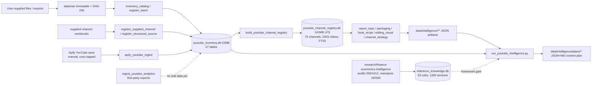

# Architecture Map — 2026-11-11

The system is a **file- and SQLite-based evidence pipeline driven by Python CLI scripts**. There is no web app, API server, queue, scheduler, or LLM runtime. Code: `scripts/` (65 modules, ~21.6k lines incl. `production_pipeline*.py`), `tests/` (45 files), `schemas/inventory/` (11 SQL migrations). Everything else is data and research evidence (`data/` 1.2 GB, `research/` 214 MB, `docs/` 24 MB).

## Components (what → where → depends on → output → failure)
| Component | Code | Depends on | Output | Fails when |
|---|---|---|---|---|
| Inventory catalog | `scripts/inventory_catalog.py`, `register_batch.py`, `schemas/inventory/001–004` | raw files, SQLite | hashes, dispositions, 45,774 `discovered_files` | raw path moved; ledger hash drift (D3) |
| Structured registration | `register_structured_source.py`, `register_supplied_channel.py`, `source_adapters/` | workbooks, openpyxl | channels/videos/snapshots/provenance (12,335 `field_provenance`) | duplicate video IDs -> `EvidenceConflict` by design |
| Apify acquisition | `apify_youtube_ingest.py`, schema 005/006 | `APIFY_TOKEN` env | run provenance, cost rows | no token -> `SecurityViolation`; no retry (D5) |
| Channel registry | `build_youtube_channel_registry.py` (1,230 lines), `data/catalog/channel_registry/` | inventory DB + ledgers | registry DB (+FTS5 transcripts) | LFS pointer not pulled |
| V1 intelligence | `report_topic_opportunity.py`, `report_packaging_intelligence.py`, `report_hook_script_intelligence.py`, `report_editing_visual_intelligence.py`, `report_channel_strategy_intelligence.py` | registry/catalog | per-channel JSON under `data/intelligence/` | missing evidence -> `NOT_AVAILABLE` by design |
| Orchestrator | `run_youtube_intelligence.py` (848 lines) | artifacts + catalog (read-only) | content plan; validates coherence (`validate_coherence`), optional `--framework-plan` gate | `OrchestrationError` on inconsistent artifacts |
| Reference framework | `research/finance-economics-intelligence/reference-framework/build_reference_kb.py`, `schemas/inventory/011` | reference ZIP | FTS5 KB | — |
| Finance audits | `research/finance-economics-intelligence/*.py` (validators, builders) | audits, ledgers | accepted NICK_xxx audits | local-only gates (D1) |
| Production pipeline (demo) | `production_pipeline.py` | Whisper, ffprobe, Pillow | CapCut-style JSON package | hardcoded demo keywords (D9) |
| First-party analytics | `ingest_youtube_analytics.py`, `report_first_party_channel_diagnosis.py` | Studio CSV exports | diagnostics | no real export ingested |

## Weaknesses
1. Two committed SQLite files are the "database"; no migrations runner besides scripts, no backup other than git/LFS.
2. Provenance ledgers hash repo code, so refactors need manifest updates (D3).
3. Quality gates for the active workstream (Finance) live outside CI (D1).
4. Long-lived divergent branches (research branch 210 commits ahead of `main`, 20+ draft PRs) = integration risk.
5. Counts differ by population (selected inventory 10 channels vs registry 75) — documented but a frequent source of confusion.
6. No circular imports were found in a compile check; scripts share `report_common.py` via `sys.path.insert` (`run_youtube_intelligence.py:~20`), a fragile packaging pattern (`[tool.setuptools] packages = []`).
