# Asset dependency graph (Slot 07)

Generated by `tools/build_manifest.py` from `tools/asset_data.py`. An arrow `A --> B` means **B needs A first** (A is a dependency of B). Orange = Codex draws it; blue = Claude builds it in code. Rigs are build dependencies of the art, not proof that every layer is on screen.

- 68 buildable assets (34 Codex art, 34 Claude code/model/rig) in 11 families; 25 code, 30 illustration, 5 model, 4 rig, 4 texture.
- Longest dependency chain: 4 levels (levels below).

```mermaid
flowchart LR
  subgraph EARTH ["Earth"]
    EARTH_001_SURFACE["001 Surface"]
    EARTH_002_CLOUDS["002 Clouds"]
    EARTH_003_ATMOSPHERE["003 Atmosphere"]
    EARTH_004_NIGHT_LIGHTS["004 Night Lights"]
    EARTH_005_TERMINATOR["005 Terminator"]
    EARTH_006_ATMOS_SLICE["006 Atmos Slice"]
  end
  subgraph MOON ["Moon"]
    MOON_001_GLOBE["001 Globe"]
    MOON_002_TERRAIN_SURFACE["002 Terrain Surface"]
    MOON_003_HORIZON["003 Horizon"]
    MOON_004_GLOBE_SHADE["004 Globe Shade"]
    MOON_005_PROPS["005 Props"]
    MOON_006_SITE_DRESSING["006 Site Dressing"]
    MOON_007_DUST["007 Dust"]
  end
  subgraph OBS ["Observatory"]
    OBS_001_EXTERIOR["001 Exterior"]
    OBS_002_DOME["002 Dome"]
    OBS_003_INTERIOR["003 Interior"]
    OBS_004_MOUNTAINS["004 Mountains"]
    OBS_005_NIGHT_SKY["005 Night Sky"]
    OBS_006_DOME_SLIT["006 Dome Slit"]
    OBS_007_PROPS["007 Props"]
  end
  subgraph TEL ["Telescope"]
    TEL_001_HOUSING["001 Housing"]
    TEL_002_MOUNT["002 Mount"]
    TEL_003_APERTURE["003 Aperture"]
    TEL_004_PRIMARY_CUTAWAY["004 Primary Cutaway"]
    TEL_005_DETECTOR_BOX["005 Detector Box"]
  end
  subgraph ASTRO ["Astronaut"]
    ASTRO_001_HELMET["001 Helmet"]
    ASTRO_002_VISOR["002 Visor"]
    ASTRO_003_VISOR_REFLECTION["003 Visor Reflection"]
    ASTRO_004_TORSO["004 Torso"]
    ASTRO_005_PLSS["005 Plss"]
    ASTRO_006_ARMS["006 Arms"]
    ASTRO_007_GLOVES["007 Gloves"]
    ASTRO_008_LEGS["008 Legs"]
    ASTRO_009_BOOTS["009 Boots"]
    ASTRO_010_POSE_SET["010 Pose Set"]
    ASTRO_011_SHADOW["011 Shadow"]
  end
  subgraph RETRO ["Retroreflector"]
    RETRO_001_ASSEMBLY["001 Assembly"]
    RETRO_002_CUBE_ARRAY["002 Cube Array"]
    RETRO_003_CUBE_CUTAWAY["003 Cube Cutaway"]
    RETRO_004_FRAME_MOUNT["004 Frame Mount"]
    RETRO_005_CUBE_3FACE["005 Cube 3Face"]
    RETRO_006_SHADOW["006 Shadow"]
  end
  subgraph OPT ["Light and optics (code)"]
    OPT_001_LIGHT_PULSE["001 Light Pulse"]
    OPT_002_BEAM_SPREAD["002 Beam Spread"]
    OPT_003_PHOTON_MARKER["003 Photon Marker"]
    OPT_004_CORNER_PATHS["004 Corner Paths"]
    OPT_005_ATMOS_DISTORT["005 Atmos Distort"]
    OPT_006_ACCUM["006 Accum"]
    OPT_007_SCATTER["007 Scatter"]
  end
  subgraph MG ["Motion graphics (code)"]
    MG_001_STOPWATCH["001 Stopwatch"]
    MG_002_RULER["002 Ruler"]
    MG_003_FORMULA["003 Formula"]
    MG_004_HIST["004 Hist"]
    MG_005_LABELS["005 Labels"]
    MG_006_HIGHLIGHT["006 Highlight"]
    MG_007_PATH_ARROWS["007 Path Arrows"]
  end
  subgraph SCI ["Scientific models (code)"]
    SCI_001_LIGHT_TIME["001 Light Time"]
    SCI_002_ORBIT_GEOMETRY["002 Orbit Geometry"]
    SCI_003_STATS["003 Stats"]
    SCI_004_SCALES["004 Scales"]
    SCI_005_CORNER_CUBE["005 Corner Cube"]
  end
  subgraph BG ["Backgrounds (code)"]
    BG_001_SPACE["001 Space"]
    BG_002_DARK_FIELD["002 Dark Field"]
    BG_003_NEUTRAL_CUTAWAY["003 Neutral Cutaway"]
  end
  subgraph RIG ["Rigs (code)"]
    RIG_001_GLOBE_LIGHTING["001 Globe Lighting"]
    RIG_002_TELESCOPE_DOME["002 Telescope Dome"]
    RIG_003_ASTRONAUT_POSE["003 Astronaut Pose"]
    RIG_004_CAMERA_MULTIPLANE["004 Camera Multiplane"]
  end
  EARTH_001_SURFACE --> EARTH_002_CLOUDS
  EARTH_001_SURFACE --> EARTH_004_NIGHT_LIGHTS
  MOON_001_GLOBE --> MOON_004_GLOBE_SHADE
  MOON_002_TERRAIN_SURFACE --> MOON_005_PROPS
  MOON_003_HORIZON --> MOON_006_SITE_DRESSING
  OBS_001_EXTERIOR --> OBS_002_DOME
  OBS_002_DOME --> OBS_006_DOME_SLIT
  TEL_002_MOUNT --> TEL_001_HOUSING
  TEL_001_HOUSING --> TEL_004_PRIMARY_CUTAWAY
  TEL_001_HOUSING --> TEL_005_DETECTOR_BOX
  ASTRO_002_VISOR --> ASTRO_003_VISOR_REFLECTION
  ASTRO_001_HELMET --> ASTRO_010_POSE_SET
  ASTRO_002_VISOR --> ASTRO_010_POSE_SET
  ASTRO_003_VISOR_REFLECTION --> ASTRO_010_POSE_SET
  ASTRO_004_TORSO --> ASTRO_010_POSE_SET
  ASTRO_005_PLSS --> ASTRO_010_POSE_SET
  ASTRO_006_ARMS --> ASTRO_010_POSE_SET
  ASTRO_007_GLOVES --> ASTRO_010_POSE_SET
  ASTRO_008_LEGS --> ASTRO_010_POSE_SET
  ASTRO_009_BOOTS --> ASTRO_010_POSE_SET
  RETRO_002_CUBE_ARRAY --> RETRO_001_ASSEMBLY
  RETRO_004_FRAME_MOUNT --> RETRO_001_ASSEMBLY
  RETRO_006_SHADOW --> RETRO_001_ASSEMBLY
  RETRO_005_CUBE_3FACE --> RETRO_003_CUBE_CUTAWAY
  SCI_005_CORNER_CUBE --> RETRO_003_CUBE_CUTAWAY
  RETRO_002_CUBE_ARRAY --> RETRO_005_CUBE_3FACE
  SCI_001_LIGHT_TIME --> OPT_001_LIGHT_PULSE
  SCI_004_SCALES --> OPT_002_BEAM_SPREAD
  SCI_005_CORNER_CUBE --> OPT_004_CORNER_PATHS
  SCI_003_STATS --> OPT_006_ACCUM
  SCI_001_LIGHT_TIME --> MG_001_STOPWATCH
  SCI_001_LIGHT_TIME --> MG_002_RULER
  SCI_002_ORBIT_GEOMETRY --> MG_002_RULER
  SCI_001_LIGHT_TIME --> MG_003_FORMULA
  SCI_003_STATS --> MG_004_HIST
  SCI_004_SCALES --> MG_007_PATH_ARROWS
  SCI_004_SCALES --> SCI_002_ORBIT_GEOMETRY
  EARTH_001_SURFACE --> RIG_001_GLOBE_LIGHTING
  EARTH_002_CLOUDS --> RIG_001_GLOBE_LIGHTING
  EARTH_003_ATMOSPHERE --> RIG_001_GLOBE_LIGHTING
  EARTH_004_NIGHT_LIGHTS --> RIG_001_GLOBE_LIGHTING
  EARTH_005_TERMINATOR --> RIG_001_GLOBE_LIGHTING
  MOON_001_GLOBE --> RIG_001_GLOBE_LIGHTING
  MOON_004_GLOBE_SHADE --> RIG_001_GLOBE_LIGHTING
  SCI_002_ORBIT_GEOMETRY --> RIG_001_GLOBE_LIGHTING
  TEL_001_HOUSING --> RIG_002_TELESCOPE_DOME
  TEL_002_MOUNT --> RIG_002_TELESCOPE_DOME
  TEL_003_APERTURE --> RIG_002_TELESCOPE_DOME
  OBS_002_DOME --> RIG_002_TELESCOPE_DOME
  OBS_006_DOME_SLIT --> RIG_002_TELESCOPE_DOME
  ASTRO_010_POSE_SET --> RIG_003_ASTRONAUT_POSE
  ASTRO_011_SHADOW --> RIG_003_ASTRONAUT_POSE
  MOON_007_DUST --> RIG_003_ASTRONAUT_POSE
  classDef codex fill:#f3e3c0,stroke:#9a6b00,color:#000
  classDef claude fill:#cfe3f5,stroke:#1f5f99,color:#000
  class EARTH_001_SURFACE,EARTH_002_CLOUDS,EARTH_004_NIGHT_LIGHTS,EARTH_006_ATMOS_SLICE,MOON_001_GLOBE,MOON_002_TERRAIN_SURFACE,MOON_003_HORIZON,MOON_005_PROPS,MOON_006_SITE_DRESSING,OBS_001_EXTERIOR,OBS_002_DOME,OBS_003_INTERIOR,OBS_004_MOUNTAINS,OBS_006_DOME_SLIT,OBS_007_PROPS,TEL_001_HOUSING,TEL_002_MOUNT,TEL_003_APERTURE,TEL_004_PRIMARY_CUTAWAY,TEL_005_DETECTOR_BOX,ASTRO_001_HELMET,ASTRO_002_VISOR,ASTRO_003_VISOR_REFLECTION,ASTRO_004_TORSO,ASTRO_005_PLSS,ASTRO_006_ARMS,ASTRO_007_GLOVES,ASTRO_008_LEGS,ASTRO_009_BOOTS,ASTRO_010_POSE_SET,RETRO_001_ASSEMBLY,RETRO_002_CUBE_ARRAY,RETRO_004_FRAME_MOUNT,RETRO_005_CUBE_3FACE codex
  class EARTH_003_ATMOSPHERE,EARTH_005_TERMINATOR,MOON_004_GLOBE_SHADE,MOON_007_DUST,OBS_005_NIGHT_SKY,ASTRO_011_SHADOW,RETRO_003_CUBE_CUTAWAY,RETRO_006_SHADOW,OPT_001_LIGHT_PULSE,OPT_002_BEAM_SPREAD,OPT_003_PHOTON_MARKER,OPT_004_CORNER_PATHS,OPT_005_ATMOS_DISTORT,OPT_006_ACCUM,OPT_007_SCATTER,MG_001_STOPWATCH,MG_002_RULER,MG_003_FORMULA,MG_004_HIST,MG_005_LABELS,MG_006_HIGHLIGHT,MG_007_PATH_ARROWS,SCI_001_LIGHT_TIME,SCI_002_ORBIT_GEOMETRY,SCI_003_STATS,SCI_004_SCALES,SCI_005_CORNER_CUBE,BG_001_SPACE,BG_002_DARK_FIELD,BG_003_NEUTRAL_CUTAWAY,RIG_001_GLOBE_LIGHTING,RIG_002_TELESCOPE_DOME,RIG_003_ASTRONAUT_POSE,RIG_004_CAMERA_MULTIPLANE claude
```

## Build order (levels; everything in a level can start once the previous levels are done)

| Level | Assets | Why here |
|---|---|---|
| 0 | `ASTRO_001_HELMET` `ASTRO_002_VISOR` `ASTRO_004_TORSO` `ASTRO_005_PLSS` `ASTRO_006_ARMS` `ASTRO_007_GLOVES` `ASTRO_008_LEGS` `ASTRO_009_BOOTS` `ASTRO_011_SHADOW` `BG_001_SPACE` `BG_002_DARK_FIELD` `BG_003_NEUTRAL_CUTAWAY` `EARTH_001_SURFACE` `EARTH_003_ATMOSPHERE` `EARTH_005_TERMINATOR` `EARTH_006_ATMOS_SLICE` `MG_005_LABELS` `MG_006_HIGHLIGHT` `MOON_001_GLOBE` `MOON_002_TERRAIN_SURFACE` `MOON_003_HORIZON` `MOON_007_DUST` `OBS_001_EXTERIOR` `OBS_003_INTERIOR` `OBS_004_MOUNTAINS` `OBS_005_NIGHT_SKY` `OBS_007_PROPS` `OPT_003_PHOTON_MARKER` `OPT_005_ATMOS_DISTORT` `OPT_007_SCATTER` `RETRO_002_CUBE_ARRAY` `RETRO_004_FRAME_MOUNT` `RETRO_006_SHADOW` `RIG_004_CAMERA_MULTIPLANE` `SCI_001_LIGHT_TIME` `SCI_003_STATS` `SCI_004_SCALES` `SCI_005_CORNER_CUBE` `TEL_002_MOUNT` `TEL_003_APERTURE` | no dependencies: models, textures, standalone art, code graphics |
| 1 | `ASTRO_003_VISOR_REFLECTION` `EARTH_002_CLOUDS` `EARTH_004_NIGHT_LIGHTS` `MG_001_STOPWATCH` `MG_003_FORMULA` `MG_004_HIST` `MG_007_PATH_ARROWS` `MOON_004_GLOBE_SHADE` `MOON_005_PROPS` `MOON_006_SITE_DRESSING` `OBS_002_DOME` `OPT_001_LIGHT_PULSE` `OPT_002_BEAM_SPREAD` `OPT_004_CORNER_PATHS` `OPT_006_ACCUM` `RETRO_001_ASSEMBLY` `RETRO_005_CUBE_3FACE` `SCI_002_ORBIT_GEOMETRY` `TEL_001_HOUSING` | needs level 0 |
| 2 | `ASTRO_010_POSE_SET` `MG_002_RULER` `OBS_006_DOME_SLIT` `RETRO_003_CUBE_CUTAWAY` `RIG_001_GLOBE_LIGHTING` `TEL_004_PRIMARY_CUTAWAY` `TEL_005_DETECTOR_BOX` | needs level 1 |
| 3 | `RIG_002_TELESCOPE_DOME` `RIG_003_ASTRONAUT_POSE` | needs level 2 |

## Rule that follows from the graph

- Codex art in a level must pass its acceptance tests (G3) **before** a rig or a composite that depends on it is built; that is why the registered pose set and the reflector assembly are late in the order.
- `SCI_004_SCALES` and `SCI_001..005` are level 0 or 1: the graphics and the proof clips read from them, so they are done first and checked by `check.py`.
- `RETRO_002 -> RETRO_005 -> RETRO_003` is deliberate: the real array, the corner view and the cross-section must look like one object.
- `RIG_004_CAMERA_MULTIPLANE` has no art dependencies and can be built and proven (P02, P03) with placeholder layers.

## Proof clips (brief Phase 6) and what each one needs

| Proof | Demonstrates | Needs |
|---|---|---|
| P01 | Earth rotation, clouds and consistent lighting | `RIG_001_GLOBE_LIGHTING` |
| P02 | Earth-Moon cinematic parallax | `RIG_001_GLOBE_LIGHTING` `RIG_004_CAMERA_MULTIPLANE` `BG_001_SPACE` |
| P03 | Observatory-to-Moon transition (B04 -> B05) | `RIG_004_CAMERA_MULTIPLANE` `TEL_003_APERTURE` `MOON_001_GLOBE` `OPT_001_LIGHT_PULSE` |
| P04 | Telescope and observatory movement | `RIG_002_TELESCOPE_DOME` |
| P05 | Apollo astronaut movement | `RIG_003_ASTRONAUT_POSE` |
| P06 | Astronaut and retroreflector interaction | `RIG_003_ASTRONAUT_POSE` `RETRO_001_ASSEMBLY` |
| P07 | Accurate simplified retroreflection | `OPT_004_CORNER_PATHS` `RETRO_003_CUBE_CUTAWAY` `SCI_005_CORNER_CUBE` |
| P08 | Outbound and return light journey | `OPT_001_LIGHT_PULSE` `MG_007_PATH_ARROWS` `SCI_001_LIGHT_TIME` |
| P09 | Faint photon detection | `OPT_003_PHOTON_MARKER` `MG_004_HIST` |
| P10 | Repeated pulse accumulation | `OPT_006_ACCUM` `MG_004_HIST` `SCI_003_STATS` |
| P11 | Stopwatch synchronization | `MG_001_STOPWATCH` `SCI_001_LIGHT_TIME` |
| P12 | Animated distance calculation | `MG_003_FORMULA` `MG_002_RULER` |
| P13 | Narration-aligned sample sequence: PROPOSED B17-B21 (37.2-48.5 s) = hero reflector + astronaut + optics | `RETRO_001_ASSEMBLY` `ASTRO_010_POSE_SET` `RETRO_003_CUBE_CUTAWAY` `OPT_004_CORNER_PATHS` |

P13 is **PROPOSED** by me, not given in the brief: B17 to B21 combines the hero reflector, the astronaut and the optics, so it exercises the most families at once.
