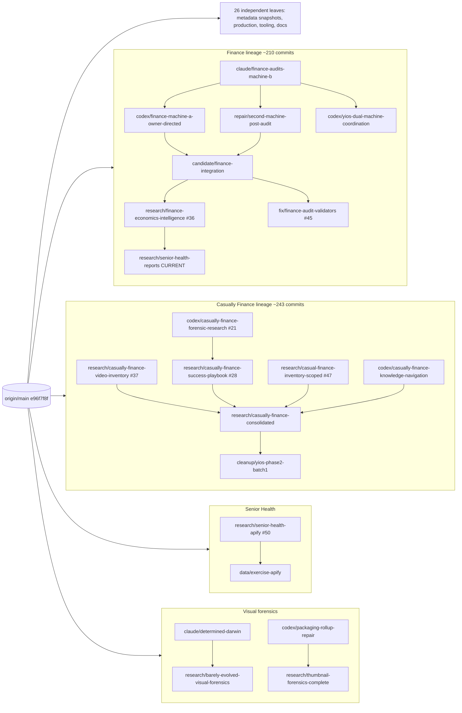

# Branch Comparison

Baseline `origin/main` @ `e96f7f8f` (2026-11-17). Method: containment (`merge-base --is-ancestor` across all 55 unmerged tips), nearest-parent detection (smallest ancestor distance), merge-base file diffs, PR base refs. It builds on, and cross-checks, today's earlier read-only audit `docs/audit/BRANCH-MERGE-AUDIT-2026-11-17.md`. That audit ran a cumulative `merge-tree` simulation, which this audit did not repeat.

## 1. The landscape in one picture

## 2. Structural findings

| Finding | Evidence | Consequence |
|---|---|---|
| Two long stacked lineages hold most of the unmerged work | Finance: 7 branches, leaves `fix/finance-audit-validators` (+215) and `research/senior-health-reports` (+216). CF: 7 branches, leaf `cleanup/yios-phase2-batch1` (+243). | Merging a leaf brings in all its ancestors; PRs #21/#28/#37/#47 and #36 become redundant once their leaf lands. |
| Unrelated work is stacked on the Finance lineage | `research/senior-health-reports` (Senior Health reports), `research/casually-finance-video-inventory` (832 finance files) and `research/what-if-brain-preservation-batch1` (1,066 finance files) carry finance commits they do not need | Topic separation (AGENTS.md rule 16) is lost at branch level; reviewing a Senior Health PR means reviewing 200+ finance commits |
| Branch-only databases diverge from main's data model | `finance_economics_complete.db` (3,634 videos), `senior_health_core.db` (5,802 videos) + 3 transcript shards, `senior_health_apify.db` (501) exist only on branches | CI rule "Reject unapproved databases" fails #36 and #50. A UI cannot depend on them until a DB policy exists |
| Three branches are superseded by main | `ui/v1`, `backup/decode-15cbe9f-original`, `fix/repository-health-remediation-2026-09-21` | Archive, do not merge (supersession inferred from history; line diff not done) |
| 3 orphan refs | `yios-test/34df…/*`: no merge-base with main (verified) | Produced by the dual-machine claim tests; delete |
| 20 branches fully merged | ahead = 0 | Safe deletion candidates after confirmation |
| 1 local-only data branch with no remote copy | `preservation/stash0-untracked-LOCAL-ONLY-2026-11-11` (~2,267 files, ~843 MB) | Single point of loss |
| Local vs origin drift | local `main` 3 behind; current branch 1 ahead with `90f9cd22` (an older slop-gate version than PR #51) | Do not push `90f9cd22` |

## 3. Shared vs unique functionality (code only)

| Capability | Branches | Unique? | Notes |
|---|---|---|---|
| V1 intelligence layers + orchestrator | main (all branches inherit) | shared | `scripts/report_*`, `run_youtube_intelligence.py` |
| AI-slop gate | main (#51); `feat/slop-gate-alerts` (#52) adds session hook + alerts; current branch has an older copy | #52 adds value | take main + #52, drop `90f9cd22` |
| Finance/reference CI gates | `fix/finance-audit-validators` only | **unique** | `.github/workflows/validate.yml` +12, `tests/test_ci_workflow_gates.py`, `tests/test_frozen_registry_separation.py` |
| Reference knowledge DB + `--framework-plan` | finance lineage (also current branch) | lineage-shared, not in main | migration `011_reference_knowledge.sql` is absent from main (`git diff origin/main -- schemas`) |
| Two-Mac claim/checkpoint CLI | `codex/yios-dual-machine-coordination` | **unique** | `scripts/yios*.py` (1,504 lines) + 518 test lines |
| Local media library / cache | `research/local-channel-media-library` | **unique** | the only media-availability abstraction |
| Reviewed channel workbooks importer | `feat/registry-reviewed-workbooks` | **unique** | records a validator failure in its own trial |
| Finance complete DB builder | `data/finance-economics-complete-2026-11-11` | **unique** | `scripts/build_finance_economics_complete_db.py` |
| Senior Health transcript backfill + core DB | `research/senior-health-apify` / `data/exercise-apify` | **unique** | `scripts/backfill_senior_health_transcripts.py` |
| Production renderers (keyframe, gait rigs) | 5 production branches | unique per production | asset-specific; not shared libraries |
| HTML/Remotion demos | CF success playbook, finance-short-01, dr-rehan-test-videos | unique | the only frontend-like code anywhere; demos, not an app |
| Owner-facing HTML/PDF reports | finance-complete (PDF 16-21), senior-health blueprint v1/v2 | unique | evidence of how the owner actually consumes results |

**No branch contains a UI application, API server or front-end framework.** Grep across all 68 origin refs for `.tsx/.jsx/.vue/.svelte` found none. HTML files are generated reports, demo compositions and saved primary sources.

## 4. Conflicts (from the 2026-11-17 cumulative simulation)

- Hot files: `AGENTS.md` (4 branches), `README.md`, `.gitignore`, `docs/START_HERE.md`, `docs/AI_SESSION_CONTEXT.md`, `docs/YIOS_MASTER_PLAN.md` (#44 vs what-if-brain-preservation), `completion-ledger.csv` (thumbnail-forensics vs stash0 delta).
- Duplicate implementations: two versions of the slop gate (main vs current branch), and two YIOS master plans (#44 and what-if-brain-preservation).

## 5. Baseline classification

| State | What |
|---|---|
| **Existing in production** | Nothing is deployed. "Production" means the owner's local Mac running CLI scripts on `main`. |
| **Existing in development (main)** | V1 intelligence, registry, inventory catalog, first-party ingestion (no real data), slop gate, What If integration |
| **Unmerged, valuable** | Finance CI gates (#45), reference KB, media library (#41), reviewed workbooks (#46), slop alerts (#52), finance + senior-health DBs, dual-machine CLI |
| **Incomplete** | Finance audit 558/1,612 accepted; reanalysis 26/558 pending semantic review; CF 19/20 closed; xkcd 29/91 closed; first-party analytics has no real data |
| **Deprecated** | `ui/v1`, `backup/decode…`, `fix/repository-health…`, `yios-test/*` |
| **Proposed (this audit)** | Read-only Explorer web app (see 06/07) |

## 6. Worktrees

| Path | Branch | Note |
|---|---|---|
| repo root | research/senior-health-reports-2026-11-11 | current; untracked `docs/audit/`, `research/what-if-scripts/` |
| ~/.codex/worktrees/yios-dual-machine/… | codex/yios-dual-machine-coordination | |
| ~/Documents/yios-senior-health | research/senior-health-metadata | untracked work (35 files, 10 MB per the 2026-11-17 audit) |
| ~/Documents/yios-wt-consolidation | consolidation/selected-folders-2026-11-11 | |
| ~/Documents/yios-wt-ds11-supplement | data/ds-000011-supplement-2026-11-11 | |
| .claude/worktrees/ai-slop-gate | feat/slop-gate-alerts | |
| .claude/worktrees/dr-rehan-seniors-health-data-5db7ab | claude/dr-rehan-seniors-health-data-5db7ab | |
| .claude/worktrees/finance-audits-machine-b-0044ae | claude/finance-audits-machine-b-0044ae | |
| .claude/worktrees/second-machine-audit-repair-ef17c5 | candidate/finance-integration-2026-11-02 | |
| .claude/worktrees/statins-senior-health-db38aa | claude/statins-senior-health-db38aa | |

Worktree contents other than the two noted were not inspected for uncommitted changes.
