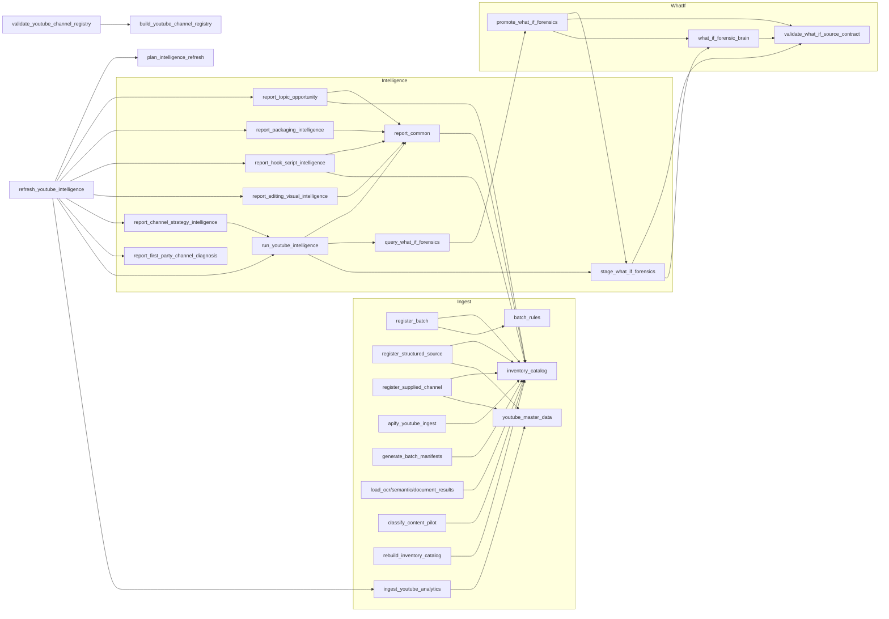

# Module Dependency Map

Measured with an AST import scan of `scripts/**/*.py` on `origin/main` (66 modules). External imports are stdlib plus `openpyxl`, `PIL` and `docx`. `docx` (python-docx) is **undeclared** in `pyproject.toml` (debt D2, still open). Declared runtime deps: `openpyxl`, `Pillow`. Dev: `pytest`, `pytest-cov`, `ruff`.

## Hubs

| Module | Imported by | Role |
|---|---:|---|
| `inventory_catalog` | 14 | DB connection, schema, hashing, IDs: the core library |
| `report_common` | 10 | read-only connect + shared report helpers |
| `stage_what_if_forensics` / `validate_what_if_source_contract` | 3 / 3 | What If evidence chain |
| `source_adapters/youtube_master_data` | 3 | workbook parsing |

## Graph

## Standalone modules (no internal imports)

Registry builder (`build_youtube_channel_registry`, 1,230 lines), validators (`validate_dataset_ledgers`, `validate_legacy_dataset_manifests`, `validate_supplied_channel_packages`, `validate_packaging_research`), `check_slop_risk`, `scan_tracked_secrets`, channel-specific builders (`build_dr_rehan_package`, `build_doctor_thomas_package`, `build_better_health_while_aging_package`, `build_bhwa_deep_investigations`, Decode Your Heart scripts), Node packagers (`package_*_dataset.mjs`, `build_youtube_channel_master_tracker.mjs`) and the macOS OCR helper (`image_text_recognition.swift`).

## Observations

1. **Clean core.** One library hub (`inventory_catalog`) and one read helper (`report_common`). That gives a thin read API a natural place to start.
2. **Inversion:** `report_channel_strategy_intelligence → run_youtube_intelligence`. A future service layer should move the shared functions into `report_common` (or a new `yios_read` module) to break it.
3. **Channel-specific scripts** (Dr Rehan, Doctor Thomas, BHWA, Decode) are one-off builders. Keep them out of any service API.
4. **Branch-only modules** that a UI would call if merged: `scripts/yios*.py` (coordination), `scripts/media_cache.py` + `build_local_media_library.py`, `scripts/build_reviewed_channel_workbooks.py`, `scripts/build_finance_economics_complete_db.py`, `scripts/backfill_senior_health_transcripts.py`, and the finance-lineage `research/finance-economics-intelligence/*.py` validators plus `reference-framework/build_reference_kb.py`.
