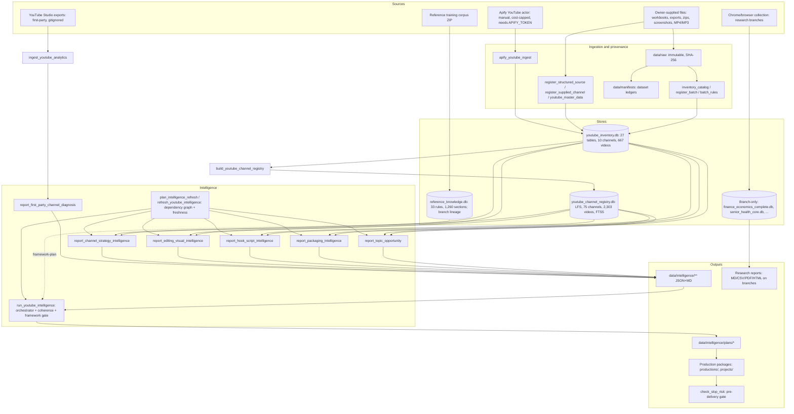

# System Architecture (as built)

Baseline `origin/main` @ `e96f7f8f`. YIOS is a **local, file- and SQLite-based evidence pipeline driven by Python CLI scripts**, operated by one owner across two Macs with AI coding agents. There is **no server, API, UI, queue, scheduler, auth or deployment target**. The "frontend" today is Markdown/JSON in the repo plus PDF/HTML reports generated on research branches.

## 1. End-to-end flow

## 2. Layers

| Layer | Technology | Where | Contract |
|---|---|---|---|
| Evidence storage | files + Git LFS | `data/raw`, `data/extracted`, `research/**`, `~/YIOS-local-audits` (~15 GB local only) | immutable; SHA-256 in ledgers |
| Provenance | CSV/JSON ledgers | `data/manifests/` (107 files) | `validate_dataset_ledgers` |
| Catalog | SQLite (stdlib `sqlite3`) | `data/catalog/youtube_inventory.db` | migrations `schemas/inventory/001-010` (011 only on finance lineage) |
| Registry | SQLite + FTS5 (LFS) | `data/catalog/youtube_channel_registry.db` | rebuilt by `build_youtube_channel_registry`; validated by `validate_youtube_channel_registry` |
| Intelligence | Python, deterministic rules/statistics | `scripts/report_*.py` | JSON envelopes with `evidence_state`, `confidence`, `counter_evidence`, `falsification_condition`, `NOT_AVAILABLE` |
| Orchestration | Python | `scripts/run_youtube_intelligence.py` | `coherence` (11 dimensions), `linkage`, `unavailable_metrics` |
| Freshness | JSON registry + planner | `data/intelligence/system/intelligence-freshness-registry.json`, `plan_intelligence_refresh.py` | `dependency_graph`, `status_taxonomy`, `invalidation_basis` |
| Quality gates | pytest (50 test files), ruff, secret scan, slop gate | `tests/`, `.github/workflows/validate.yml` | CI on PR + push to main |
| Owner delivery | Markdown, CSV, Word/Excel, PDF, HTML | `docs/`, `research/*/06_PDF_REPORTS`, blueprints | ad hoc per workstream |

## 3. Cross-cutting concerns

| Concern | Today | Evidence |
|---|---|---|
| Auth/authz | none (single-user local) | no auth code |
| Search | FTS5 on transcripts (registry, 2,291 rows) and on reference sections (1,260) | `transcript_fts`, `ref_section_fts` |
| Caching | freshness registry and versioned artifacts; media cache on branch #41 | `intelligence-freshness-registry.json` |
| Background jobs | none; refresh is manual CLI | `refresh_youtube_intelligence.py` |
| External integrations | Apify (HTTP, cost cap, no retry: debt D5), Whisper/ffprobe (production), macOS Vision OCR (`image_text_recognition.swift`) | scripts |
| Error handling | typed exceptions (`EvidenceConflict`, `SecurityViolation`, `OrchestrationError`, `ToolFailure`) | scripts |
| Logging | `logs/` folder + `ingestion_runs`/`ingestion_errors` tables | DB |
| Deployment | none; two Macs sync through GitHub | `docs/TWO_MAC_WORKFLOW.md` (branch) |
| Privacy | first-party analytics gitignored; private audio/frames tracked in history (owner decision pending) | prior audit SECURITY_AND_PERFORMANCE.md |

## 4. Architectural strengths to preserve in any UI

1. **Evidence layers are first-class data** (`EXTRACTED_FACT`, `MEASURED_FACT`, `OBSERVATION`, `AI_INTERPRETATION`, `PROPOSED`, `VERIFIED`, `SOURCE_METADATA`). A UI must render them differently.
2. **Honest absence**: `NOT_AVAILABLE` with a `limitation_reason` (registry: 335 of 600 coverage cells; `availability_gaps` 216 rows). Empty states are data, not errors.
3. **Read-only access pattern** already exists: `report_common.connect()` opens SQLite with `mode=ro`.
4. **Deterministic, hash-pinned outputs**, so a UI read model can be rebuilt and verified.

## 5. Architectural weaknesses relevant to a UI

1. **Fragmented video model.** 5 databases hold overlapping video tables (10,553 unique IDs; see 03-data-architecture). There is no single "video" or "channel" read model.
2. **No service boundary.** Scripts are the only interface; `scripts/` is not an installable package (`[tool.setuptools] packages = []`), and modules import each other via `sys.path` manipulation.
3. **Inverted dependency.** `report_channel_strategy_intelligence` imports `run_youtube_intelligence` (a layer depends on its orchestrator).
4. **Value normalization gaps.** `videos.video_type` in the registry has 5 spellings (`video`, `regular video`, `shorts`, `Short`, NULL); senior_health_core adds `videos` and `streams`.
5. **Two ID systems.** Inventory uses `CH-0000NN`; registry uses `canonical_channel_id`; branch DBs use YouTube `UC…` IDs. The join key is the YouTube channel/video ID.
6. **Most evidence volume lives off main** (branch-pinned or local-only), so a UI on `main` alone would see a fraction of the corpus.
