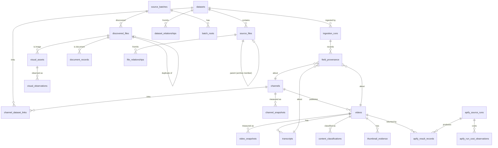
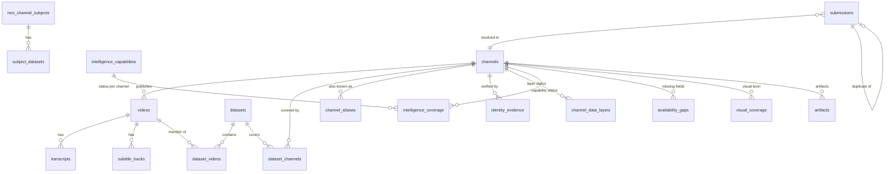
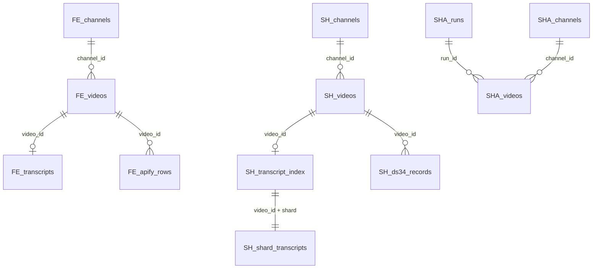

# Database Relationships

FKs are from `PRAGMA foreign_key_list` (read-only). The branch DBs declare **no** FKs. Their joins are implicit on `video_id` / `channel_id` (YouTube IDs).

## 1. Inventory catalog (provenance spine)

`field_provenance` is the key table for a UI: every displayed value can link to its source file, run, extraction method and evidence layer.

## 2. Channel registry (coverage spine)

## 3. Reference knowledge

`ref_source_member` → `ref_section` (FTS) → `ref_rule` (33, with rule class) ↔ `ref_rule_conflict` (3); `ref_constituent_video` (63) and `ref_video_assessment` (722) link rules to audited videos; `ref_platform_verification` (9) records platform-claim checks; `ref_analysis_run` gives provenance.

## 4. Branch DBs (implicit joins)

## 5. Hidden relationships worth surfacing

| Relationship | How to compute | User value |
|---|---|---|
| Same video across stores | join on YouTube video ID | "Where do we know about this video from?" panel; dedup |
| Channel ↔ niche ↔ workstream | registry `target_group` + FE `niche` + SH `category`/`tier` | niche-level browsing |
| Video ↔ finance audit ↔ reference rules | NICK audit IDs → `ref_video_assessment` | "which rules does this video support/contradict" |
| Video ↔ visual forensic ledger ↔ seal | evidence map CSV (`VISUAL_EVIDENCE_MAP.csv`) keyed by video ID + SHA-256 | forensic depth badge per video |
| Channel ↔ template network (Senior Health Report 2: 12-channel network) | report tables | "independent evidence" count, not raw channel count |
| Plan ↔ evidence | plan JSON `internal_evidence`, `linkage`, `counter_evidence` | click-through from a recommendation to its proof |

## 6. Normalization needs

1. **Canonical identity tables**: `entity_channel(youtube_channel_id PK, …)`, `entity_video(youtube_video_id PK, youtube_channel_id, …)`, plus crosswalks to `CH-0000NN` and registry IDs.
2. **Per-field source precedence** (e.g. registry > inventory > FE > SH for titles; latest `observed_at` for metrics), stored, not hard-coded in the UI.
3. **Snapshot table** for metrics with `observed_at` and `store`, so view counts from different scrape dates are never silently mixed.
4. Normalized `video_type` plus the raw value.

## 7. Schema migration risks between branches

- Migration `011_reference_knowledge.sql` is absent on main. Merging the finance lineage adds it.
- `codex/register-verified-transcript-pending-what-if` edits the committed catalog DBs directly. Re-apply it by script, never by a binary merge.
- Branch DBs have no `schema_meta`/migration history (FE has a `meta` table with `built_from_registry_sha256`). Their schemas are defined only by their builder scripts.
