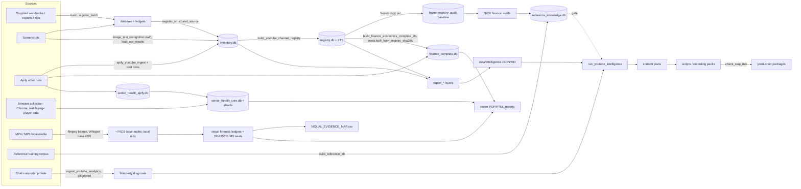

# Data Lineage

## Lineage guarantees today

| Guarantee | Mechanism | Gap |
|---|---|---|
| Raw immutability | ledger SHA-256 + `validate_dataset_ledgers` in CI | local-only media has no remote check |
| Field-level provenance | `field_provenance` (inventory only) | registry and branch DBs keep provenance in `raw_json`/`evidence_locator`/`sources` columns, not per field |
| Derived-artifact freshness | freshness registry `dependency_graph`, `invalidation_basis` | covers `data/intelligence` only, not branch reports or branch DBs |
| Builder reproducibility | FE `meta.built_from_registry_sha256` | SH DBs have no build hash recorded in-DB |
| AI vs fact separation | evidence layers; slop gate for scripts | semantic review is human-only and backlogged (26/558 pending) |

## Update frequency (observed)

| Data | Cadence |
|---|---|
| Competitor metadata | ad hoc batches (registry generated 2026-09-28; SH Chrome refresh 2026-11-11; exercise Apify 2026-11-14) |
| Finance audits | continuous agent sessions (NICK_xxx commits, ~2 per commit) |
| Intelligence artifacts | on refresh (latest V1 set 2026-09-09 to 09-11) |
| Reference KB | rebuilt on corpus change (2026-11-02) |

**UI implication:** every screen needs an "as of" date and a source-store badge, because the stores were captured at different times.
