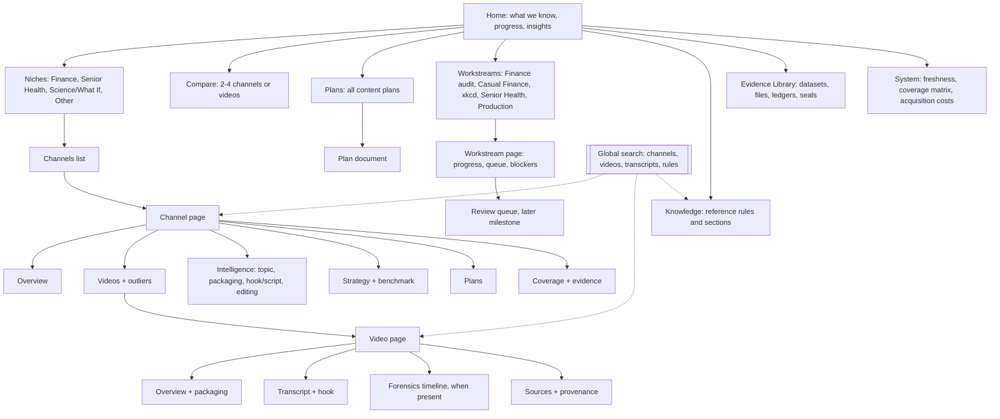
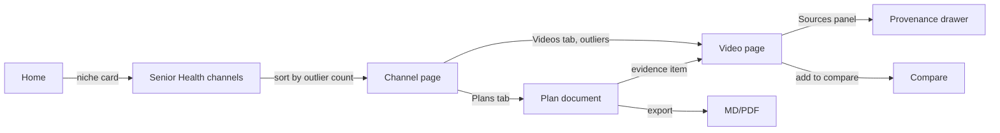
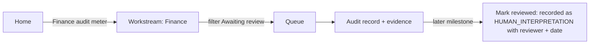

# Information Architecture

Organizing idea: **Discover → Understand → Explore → Compare → Inspect → Act**, mapped to five top-level areas plus global search. Niches and workstreams are the doors; channels and videos are the rooms; evidence is the foundation every value links down to.

## 1. Sitemap

## 2. Primary navigation

| Area | Purpose (stage) | Contains |
|---|---|---|
| **Home** | Discover | KPI row, workstream meter list, latest insights, stale-data warnings |
| **Explore** (Niches → Channels → Videos) | Understand, Explore | the entity hierarchy |
| **Compare** | Compare | side-by-side channels/videos, benchmarks |
| **Plans** | Act | content plans, production readiness (slop gate) |
| **Workstreams** | Understand, Act | research progress, queues, blockers |
| Secondary: **Knowledge**, **Evidence**, **System** | Inspect | playbook, provenance, health |

## 3. Hierarchy and parent-child relationships

`Niche ⊃ Channel ⊃ Video ⊃ {Transcript, Thumbnail, Forensic ledger, Snapshot}`. Cross-links: `Video ↔ Finance audit ↔ Reference rule`, `Plan → evidence (videos, rules)`, `Any value → Provenance record → Dataset → File`.

## 4. Navigation mechanics

| Mechanism | Rule |
|---|---|
| Breadcrumbs | on every entity page: Home / Senior Health / Dr. Okoro / Video title |
| Global search | one box, grouped results (Channels, Videos, Transcript matches, Rules); `/` shortcut |
| Filters | one row above content; chips; state in URL (shareable, back-button safe) |
| Context links | "Seen in 3 sources", "Used in plan CH-000005-CAND-001", "Supports rule R-12" |
| Quick actions | Compare (add to tray), Copy link, Export (MD/CSV/PDF), "Ask agent about this" (later; copies a prompt with IDs) |
| Deep links | every screen state is a URL: needed because the owner shares links with agents |

## 5. Naming (information scent)

Use plain labels; show internal IDs only in a secondary line or the provenance drawer.

| Internal | UI label |
|---|---|
| `NOT_AVAILABLE` | "Not available: <reason>" |
| `SEMANTIC_REVIEW_PENDING` | "Awaiting human review" |
| `ASR_UNCERTIFIED` | "Machine transcript (unverified)" |
| `AI_INTERPRETATION` | "AI reading" |
| `EXTRACTED_FACT` / `MEASURED_FACT` | "From source" / "Measured" |
| `HYPOTHESIS` | "Idea to test" |
| DS-000032 | "Decode Your Heart acquisition (DS-000032)" |

## 6. User flows

Every dataset in DATA_TO_UI_MAPPING.md has a home in this sitemap. Branch/repo maintenance is deliberately **not** in the Explorer (GitHub and git already serve it).
