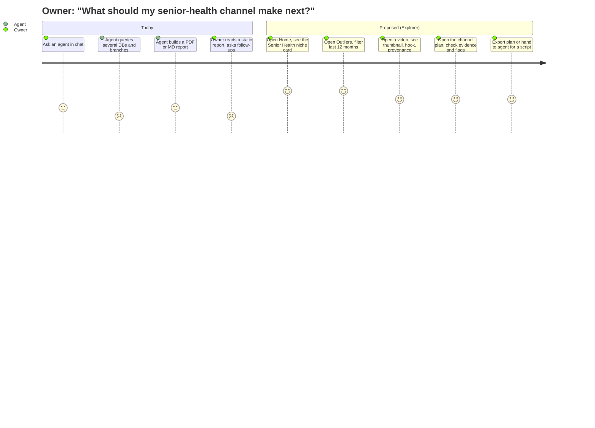

# Product Understanding and User Research

Method: evidence comes from repository artifacts (AGENTS.md, START_HERE, owner-facing PDFs/guides on branches, PR titles, commit cadence, memory notes about working rules), not from interviews. **No user interview was conducted.** Personas are therefore *evidence-based hypotheses* and should be validated with the owner (roadmap stage 3).

## 1. The problem

The owner runs or plans several YouTube channels (finance, senior health, What If-style science) and wants decisions (what to make, how to package it, how to edit it) grounded in competitor evidence rather than guesswork or AI memory. The repository solves *evidence and analysis*. It does **not** solve *access*: the knowledge is spread across 75 branches, 7 databases, ~3,300 files on main, thousands more on branches, and local-only media. Today the owner reaches it by asking an AI agent or by reading generated PDFs.

## 2. Users

| Persona | Evidence | Goals | Frequent tasks | Pain today |
|---|---|---|---|---|
| **P1 Owner / creator-operator** (primary) | PDF "owner simple guide", launch manuals, recording packs, Urdu/English chat requests ("jetna data nekal liya hai sab push kardo"), terse-output working rules | decide what to make next per channel; trust the reasoning; ship videos | check progress; pick a topic; read a plan; review a script; see competitor outliers | needs an agent to answer simple questions; reports are static and scattered; cannot browse evidence alone |
| **P2 Reviewer** (owner in review mode, or a hired human) | `SEMANTIC_REVIEW_PENDING` backlog (26/558), "only a reviewer's reading can set a record to semantically reviewed" | clear the review queue accurately | read an audit + its evidence, mark reviewed, flag issues | no queue UI; review state lives in files |
| **P3 AI agent** (Claude/Codex on two Macs) | AGENTS.md, claims/checkpoints CLI, dual-machine coordination | retrieve evidence correctly; avoid duplicate work | query DBs, run validators, checkpoint | ad-hoc SQL against 7 stores; no single read API |

P3 is served by the **read API**, not the UI. Designing the API once serves both.

## 3. Key decisions the owner makes (jobs to be done)

1. *Which niche/channel deserves my next video?* → coverage, benchmarks, workstream state
2. *Which topic and angle?* → topic opportunities, outliers, transcript search
3. *How to package it?* → title/thumbnail patterns from outliers, with evidence layer
4. *How to open and structure the script?* → hook/script archetypes, reference rules
5. *How to edit it?* → forensic timelines (where available)
6. *Is it ready to ship?* → slop gate verdict, medical validation flag
7. *How far along is each research project, and what is blocked?* → progress meters, blockers

## 4. Journey (today vs proposed)

## 5. Workflow friction observed

| Friction | Evidence | Fix in design |
|---|---|---|
| Too many places to look | 75 branches, START_HERE needs pinned-SHA links | one Explorer index, workstreams as first-class objects |
| Same video counted many times | 10,553 unique vs 12,907 rows | deduped entity pages with a "sources" panel |
| Status words easy to mix | START_HERE "do not mix them" table | a fixed status-chip vocabulary with definitions on hover |
| Absence looks like failure | 56% coverage cells NOT_AVAILABLE | designed empty states with reasons |
| Reports are static | PDF 16-21, blueprint HTML | live, linkable screens; export kept as a secondary action |

## 6. Pattern research (applied, not copied)

| Source | Pattern | Why it fits here |
|---|---|---|
| Nielsen Norman Group: progressive disclosure, recognition over recall, visibility of system status | overview → category → detail → record; status chips; "as of" dates | the corpus is large and the owner is non-technical |
| NN/g: information scent | descriptive labels ("Outliers", "What we know") rather than internal names (DS-000032, NICK_281) | internal IDs mean nothing to P1 |
| Material Design 3: navigation rail (desktop) / bottom bar (mobile), cards, data tables, chips | layout skeleton and filter chips | well-tested responsive navigation |
| Apple HIG: clarity, deference, sidebar + detail split view | split view on desktop/iPad | dense detail beside a list |
| WCAG 2.2 AA: contrast 4.5:1, non-color cues (1.4.1), focus visible (2.4.7), target size (2.5.8), accessible authentication (3.3.8) | status = icon + label; table alternative per chart; 24 px targets | mandated; also helps CVD and print |
| Analytics products with provenance (e.g. data catalogs, research tools such as Observable/Datasette-style explorers) | "row → source" drill, faceted search | YIOS's core value is provenance |

**Core principle:** a new user should understand what YIOS knows, how sure it is, and where it came from, without knowing SQL, git or internal IDs.
