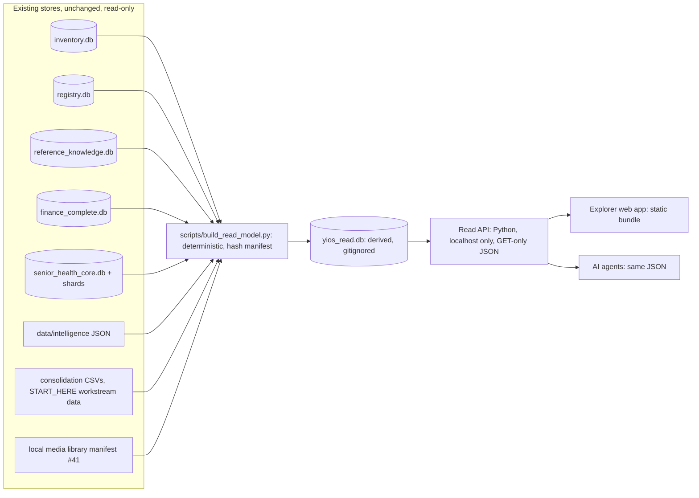

# Proposed Technical Architecture

**Status: proposal only.** AGENTS.md rule 12 says no V2 work (UI, API, …) begins automatically. Implementing this needs the owner's explicit authorization and an AGENTS.md update that scopes it.

Guiding rule: **additive, read-only, and boring.** Wrap what exists. Never modify raw evidence or the existing stores.

## 1. Shape

## 2. Components

| Layer | Choice | Why | Alternatives rejected |
|---|---|---|---|
| **Read model** | one new SQLite file `yios_read.db`, built by `scripts/build_read_model.py` from all stores; recorded source hashes; gitignored, rebuildable | fixes A1/A3/A4 (dedupe, normalized `video_type`, ID crosswalk) without touching sources; SQLite + FTS5 already in use | merging stores in place (violates immutability); Postgres (infrastructure the project does not need, rule 10) |
| Read-model tables | `entity_channel`, `entity_video`, `video_metric_snapshot(store, observed_at)`, `entity_source` (crosswalk + per-field origin), `transcript` (+FTS), `insight` (flattened artifact cards with evidence_layer), `plan`, `coverage_cell`, `workstream`, `rule`, `evidence_file`, `build_meta` | maps 1:1 to the screens | — |
| **Interim explorer (M0 spike)** | Datasette over `yios_read.db`, read-only, localhost | facets, FTS, JSON API and CSV export with zero UI code; validates the read model in about a day | — |
| **Read API** | small Python HTTP service (FastAPI, or stdlib `http.server` if endpoints stay few), GET-only, bound to 127.0.0.1, opens SQLite `mode=ro` (reuses the `report_common.connect()` pattern) | typed contracts for the UI and agents | exposing raw DB files to the client (forbidden by the 2026-09-11 handoff) |
| API contract | `/channels`, `/channels/{id}`, `/channels/{id}/videos`, `/videos/{id}`, `/search?q=`, `/plans`, `/plans/{id}`, `/coverage`, `/workstreams`, `/rules`, `/evidence/datasets`, `/provenance/{entity}/{id}/{field}`, `/system/build`; every response carries `as_of`, `sources[]`, `evidence_layer` | evidence travels with data | GraphQL (unneeded flexibility) |
| **Frontend** | Vite + TypeScript + React, TanStack Table (tables), Observable Plot (charts), URL-state routing; static build served by the API | widely known by agents; Plot covers strip, heatmap, small multiples and timelines with little code | heavy BI tools (break the evidence-layer UX); a chart lib per chart type |
| Styling | CSS custom properties (tokens) + CSS modules; no UI kit in M1 | small surface | — |
| Search | FTS5 in the read model (transcripts, titles, rules, sections) | already proven in registry and KB | vector/RAG (V2, not authorized) |
| Caching | none beyond SQLite page cache; the read model *is* the cache; ETag = build hash | simplest correct option | Redis |
| Auth | none; localhost bind only. Any remote access requires an auth decision first | single user, private data | — |
| Mutations (M3 only) | separate POST endpoints, one per action, explicit confirm, writes append-only records (e.g. review decisions as HUMAN_INTERPRETATION) into a **new** review store, never into evidence | keeps evidence immutable | generic "run script" endpoint |
| Media | resolve via local media library manifest (#41); serve files by hash from allowed roots only | heavy media stays local | copying media into the app |
| Testing | pytest: read-model invariants (union = 10,553 deduped IDs at current data; every row has a source; no `video_type` outside the enum); API contract tests; Playwright smoke + axe-core | ties to existing CI | — |
| Monitoring | `/system/build` + a stale-build banner when source hashes change | local app | — |
| Deployment | `uv run python -m scripts.build_read_model && uv run python -m yios_explorer` on each Mac; CI builds the read model from main's stores and runs the tests | no server to run | cloud hosting (privacy) |

## 3. Reuse from branches

| Reuse | Source branch | Required change | Risk | Migration | Regression |
|---|---|---|---|---|---|
| Reference KB + migration 011 | finance lineage | land via #36/#45 | AGENTS.md conflict | additive migration | finance gates + pytest |
| Finance complete DB builder | `data/finance-economics-complete-2026-11-11` | commit builder + manifest; DB not tracked (policy b) | `.gitignore` conflict | none (separate file) | builder hash reproduces `meta.built_from_registry_sha256` |
| Senior Health core DB + backfill | #50 / exercise branch | same policy | CI DB allowlist | none | rebuild + row counts |
| Local media library | #41 | merge | low | none | its smoke test |
| Workstream data | `docs/START_HERE.md`, `research/consolidation/*.csv` | parse CSVs into `workstream` table | CSV paths point at branches | none | snapshot test |
| Slop gate verdicts | main + #52 | read `*.slop-risk.json` | none | none | — |
| Coordination CLI | dual-machine branch | none for the UI (agents only) | — | — | — |

## 4. Fixes to make in existing code first (small)

1. Move the shared functions used by `report_channel_strategy_intelligence` out of `run_youtube_intelligence` (inverted dependency, A5).
2. Declare `python-docx` as an optional extra (D2).
3. Make `scripts/` importable as a package (avoid `sys.path` inserts) so the read API can import `report_common`.

## 5. Security and privacy

Localhost bind; GET-only in M1/M2; first-party analytics excluded from the read model unless a local flag is set, and never included in exports; no secrets in the read model; path allow-list for media; the secret scanner extended to the new code.
