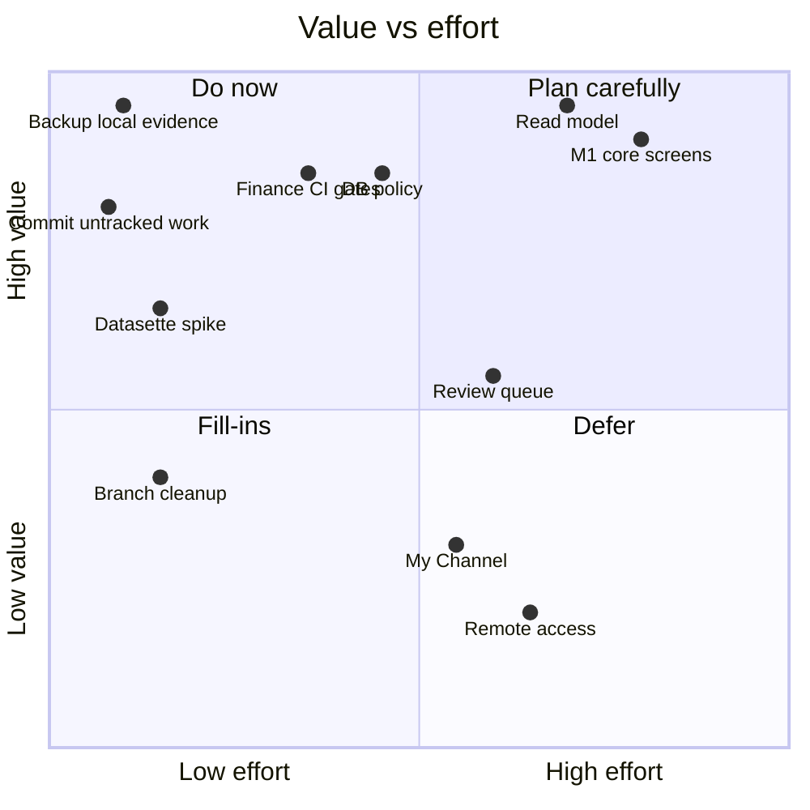

# Priority Matrix

| Priority | Quick (≤ 1 day) | Large (> 1 day) |
|---|---|---|
| **Critical** | 1.1 off-device backup of local-only evidence · 1.2 commit untracked work | 1.5 finance CI gates (#45) · 1.6 DB policy · 2.1-2.2 read model · 4.1-4.5 M1 core screens |
| **High** | 1.3 drop duplicate gate commit · 1.4 merge green/doc PRs · 3.1 persona check · 3.2 palette | 1.7 unstack Senior Health · 2.3-2.5 insights/plans/workstreams + API contract · 3.3 prototype · 4.6 plans · 5.1-5.3 charts |
| **Medium** | 1.8 branch cleanup · 1.9 A5/D2/package fixes · 2.6 Datasette spike | 3.4 kitchen sink · 5.4 secondary screens · 5.5 forensics timeline · 6.1 review queue |
| **Optional** | 6.2 dry-run refresh · 6.3 agent prompt copy | 6.4 My Channel · 6.5 remote access |

