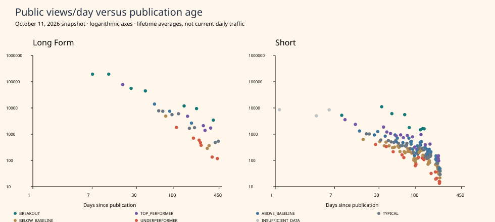

# Executive findings

**Build around a concrete financial anomaly, one understandable mechanism and a truthful payoff.** Public reach is strongly uneven; no view-only model can prove which packaging or motion caused it. Our analysis covers all 206 publicly listed identities in the saved October 11, 2026 catalog. It reuses 16 available forensic videos and does not certify the competitor's whole corpus.

## Five observable ingredients, with causal boundaries

1. **Familiar stakes plus a resolvable contradiction.** Housing opens with seller surplus versus price resilience (Uumnx2Fo6cE B001–B002, 0–34.52s); SpaceX introduces scale then “who buys?” (-X6YzlY_8tM B001–B002, 0–42.78s). Both are relative BREAKOUTs, but recent age-peer baselines are unstable. Audience curiosity is a hypothesis.
2. **Institutional mechanisms become visual actors.** Bonds/payments become characters/props, business units labeled cartons, eligibility a height marker. Source-backed SpaceX 65–80s and 618–636s show explanatory mapping; clarity may aid understanding, but no retention effect is measured.
3. **A recognizable economical visual grammar.** Black contours, peach faces, repeated host/map/money motifs, short headline and one chart contrast recur. Mobile samples preserve large forms while fine labels disappear. White backgrounds are common, not universal. Original asset-file reuse and exact tools are unknown.
4. **Information unfolds progressively.** Reviewed sequences separate cut, entrance, reveal and enlargement. Long-form has 33.458 stable states/min; Shorts 49.205 in selected evidence, although Shorts have fewer reviewed shots/min. Caption changes can create rhythm inside a held scene. These are descriptive counts, not production quotas or retention drivers.
5. **Topic reach includes current mechanisms and historical explanation.** Housing's dated source predates upload; 1973 crash is a strong older outlier. Warning words, hidden mechanisms and readable metaphors also occur in weak videos. Opportunity lies in evidence plus a distinctive answer, not an automatic doom/news formula.

Evidence locators and counterexamples: title/thumbnail, topic, script and visual reports; exact public metrics/peer IDs in VIDEO_PERFORMANCE.csv. External event dates are documented in NEWS_SOURCE_CHECKS.json. No CTR, retention, impressions or traffic-source data exists.

## Representative public performance

These are analyst-defined snapshot tiers after age/format comparison. Ratio is lifetime views/day relative to median selected same-format age peers; sensitive labels are explicitly marked. A BREAKOUT is not a guarantee of quality, causation or future performance.

| Video | Saved title | Saved views | Age days | Tier / ratio | Confidence |
|---|---|---:|---:|---|---|
| [DKyJABtbF2o](https://www.youtube.com/watch?v=DKyJABtbF2o) | The 1973 Stock Market Crash that Nobody Remembers | 1,281,284 | 373.1 | BREAKOUT / 7.1555× | MODERATE_DESCRIPTIVE |
| [Uumnx2Fo6cE](https://www.youtube.com/watch?v=Uumnx2Fo6cE) | The New American Housing Crisis Has Landed | 2,352,982 | 12.1 | BREAKOUT / 6.648× | LOW_BASELINE_SENSITIVE |
| [roe3SgezmmU](https://www.youtube.com/watch?v=roe3SgezmmU) | The Stock Market Is Being Used as a Dumping Ground | 1,377,351 | 7.1 | BREAKOUT / 6.6273× | LOW_BASELINE_SENSITIVE |
| [5umJ63d3rzQ](https://www.youtube.com/watch?v=5umJ63d3rzQ) | Brace For Impact. | 2,038,798 | 215.1 | BREAKOUT / 6.1765× | MODERATE_DESCRIPTIVE |
| [-X6YzlY_8tM](https://www.youtube.com/watch?v=-X6YzlY_8tM) | The SpaceX IPO... It's Worse Than You Think | 1,710,013 | 143.1 | BREAKOUT / 5.3499× | LOW_BASELINE_SENSITIVE |
| [Qof71Ef-3EU](https://www.youtube.com/shorts/Qof71Ef-3EU) | The Cheap Money Era Is Coming to an End | 366,349 | 32.9 | BREAKOUT / 19.0376× | MODERATE_DESCRIPTIVE |
| [turJ6VMfUjI](https://www.youtube.com/shorts/turJ6VMfUjI) | Why You (Mathematically) Need Inflation | 389,111 | 69.9 | BREAKOUT / 14.9867× | MODERATE_DESCRIPTIVE |
| [rSa2aziEsAI](https://www.youtube.com/shorts/rSa2aziEsAI) | Why Japan's Economy Is Awful | 279,072 | 45.9 | BREAKOUT / 11.8508× | MODERATE_DESCRIPTIVE |
| [kwMHrTFCWUE](https://www.youtube.com/watch?v=kwMHrTFCWUE) | Every Type of Investor Explained in 6 Minutes | 191,741 | 397.9 | TYPICAL / 0.9507× | LOW_BASELINE_SENSITIVE |
| [o3FQcd91MIs](https://www.youtube.com/watch?v=o3FQcd91MIs) | Why The Dumbest Investors Win (it's not why you think) | 236,601 | 440.1 | TYPICAL / 1.1222× | LOW_BASELINE_SENSITIVE |
| [dlBhLhn8lL0](https://www.youtube.com/watch?v=dlBhLhn8lL0) | MicroStrategy: The Crypto Scam Hiding in Plain Sight | 50,259 | 426.1 | UNDERPERFORMER / 0.2329× | MODERATE_DESCRIPTIVE |
| [7uu6qaCGZsY](https://www.youtube.com/watch?v=7uu6qaCGZsY) | Private Credit: The Secret Industry Taking Over Wall Street | 48,404 | 359.1 | UNDERPERFORMER / 0.2658× | MODERATE_DESCRIPTIVE |

Qof71Ef-3EU and turJ6VMfUjI are the strongest Short ratios but have missing original media. Their animation/hook causes cannot be inferred. Three source-backed recent Shorts are too young (<7 days) and remain INSUFFICIENT_DATA. Investor-types is TYPICAL within its older age peers even though older pooled-channel analysis called it below baseline; both describe different reference groups. MicroStrategy remains weak despite a readable Trojan-horse metaphor. Strong historical crash source media/thumbnail is unavailable here.

The chart separates formats, uses logarithmic axes and colors by relative tier. It exposes recency/velocity confounding rather than proving a growth trajectory. Exact numeric records are in the CSV; hovering or color alone is not needed to read tiers.

## Packaging decisions

Use a complementary title and cover: title names a mechanism/puzzle; image presents one observable relationship. Compare actual strong/typical/weak examples before adopting a formula. Warning, curiosity and specificity feature medians do not yield a reliable causal ranking. Prefer one dominant object, readable words and honest implied stakes; test 320px and 160px plus actual Short crop. Eighteen local thumbnail images are available, 188 catalog visuals unavailable.

## Story and production decisions

Write one bounded question, prerequisite definitions, progressive mechanism, sourced evidence, counterargument, conditional consequence and answer. Six selected Shorts offer immediate narration and compact reveals; SpaceX's successful Short is a teaser, showing complete payoff is not a universal performance signature. Our original channel should choose completeness deliberately. Long-form may use chapter/reset structure; sponsor placement and delayed answers need real retention tests.

Build original SVG rigs/props, parent-child transforms, masks, truthful charts and one deterministic frame timeline. Preserve original silhouette/face anchors; change local pose/expression rather than generating a new unrelated character every shot. Maintain a source/date/unit component. Do not copy competitor artwork or infer After Effects/Remotion/AI usage from pixels. Read-only Dr Rehan technical reference supports pose records and frame interpolation; no medical assets/code are reused.

## Codex feasibility and next production

A coherent 55–85-component visual kit, one host rig and three environments can generate many exports and distinct compositions. Icons/charts/labels/props/keyframes are straightforward; consistent characters need a bible and reviewed pose matrix; sophisticated anatomy/acting/unique scenes need manual art direction. Hundreds of exports are not hundreds of unique illustrations. Initial 6–8m system/episode planning estimate 47–116 person-hours; established-kit episode 27–68 under explicit assumptions, not a measured guarantee.

Start with one original 5–8m mechanism explainer plus a self-contained Short from the same verified research. Use production gates in ORIGINAL_CHANNEL_PRODUCTION_SOP.md. Measure actual Studio impressions/CTR, first30s retention, source mix and format-specific outcomes before promoting audience hypotheses into rules.

## Research completion boundary

This playbook can be complete while inherited whole-corpus audiovisual/financial verification remains partial. Existing register: 287 groups, 33 verified/76 partial/136 unverified/38 not testable/four contradicted at the frozen base. Scope/date/denominator corrections are central original-channel improvements, not a new competitor audit. Continuous playback/listening, exact easing, actual authoring workflow, rights, trend search evidence and causal success remain unknown. See EVIDENCE_AND_LIMITATIONS.md for precise boundaries and verification artifacts.

## Demonstration result

[Original editable demo](DEMO/README.md): one original rig, nine pose/expression exports, one environment and progressive schematic diagram. Rendered 8s, 240 frames, 1920×1080 at30fps, no audio. Five proof frames inspected; repeated5.9s image identical after backward seek. It proves deterministic composition/reuse, not sophisticated acting or hundreds-of-illustrations throughput.
